- [机器学习基本概念](#机器学习基本概念)
    - [机器学习的不同类型](#机器学习的不同类型)
    - [预测频道流量](#预测频道流量)
        - [训练三步骤](#训练三步骤)
            - [Function with Unknown Parameters](#function-with-unknown-parameters)
            - [Define Loss from Training Data](#define-loss-from-training-data)
            - [Optimization](#optimization)
        - [Linear Model](#linear-model)
            - [Model Bias](#model-bias)
        - [Piecewise Linear Curves（Sigmoid）](#piecewise-linear-curvessigmoid)
        - [Loss函数](#loss函数)
        - [优化的过程](#优化的过程)
        - [Batch training](#batch-training)
        - [ReLU (Rectified Linear Unit)](#relu-rectified-linear-unit)
        - [模型变形](#模型变形)
        - [引入 Deep Learning](#引入-deep-learning)
        - [更深的网络不一定更好要看它在新数据上的表现](#更深的网络不一定更好要看它在新数据上的表现)
- [DeepLearning-General Guidance](#deeplearning-general-guidance)
    - [Framework of ML](#framework-of-ml)
        - [训练资料与测试资料](#训练资料与测试资料)
        - [训练过程](#训练过程)
    - [General Guide](#general-guide)
        - [Loss on training data](#loss-on-training-data)
            - [Model Bias](#model-bias)
            - [Optimization](#optimization)
            - [如何区分Model Bias和Optimization问题](#如何区分model-bias和optimization问题)
        - [测试资料上的Loss](#测试资料上的loss)
            - [Overfitting](#overfitting)
            - [如何解决Overfitting](#如何解决overfitting)
            - [给模型太大限制导致Model Bias](#给模型太大限制导致model-bias)
        - [偏差与复杂度的权衡](#偏差与复杂度的权衡)
        - [Cross Validation](#cross-validation)
        - [N-fold Cross Validation](#n-fold-cross-validation)
        - [Mismatch](#mismatch)
- [DeepLearning-Loss of Classification](#deeplearning-loss-of-classification)
    - [Classification as Regression](#classification-as-regression)
    - [Class as one-hot vector](#class-as-one-hot-vector)
        - [Classification with softmax](#classification-with-softmax)
    - [Loss of Classification](#loss-of-classification)
- [CNN](#cnn)
    - [Image Classification](#image-classification)
        - [基本步骤](#基本步骤)
        - [将图片输入到模型中](#将图片输入到模型中)
    - [神经元角度介绍 CNN](#神经元角度介绍-cnn)
        - [观察一](#观察一)
        - [简化一](#简化一)
        - [感受野的典型设置](#感受野的典型设置)
        - [观察二](#观察二)
        - [简化二：Parameter Sharing](#简化二parameter-sharing)
        - [Convolutional Layer](#convolutional-layer)
    - [滤波器角度介绍 CNN](#滤波器角度介绍cnn)
        - [卷积层基本定义](#卷积层基本定义)
        - [多层卷积](#多层卷积)
            - [让小卷积核看到大 pattern](#让小卷积核看到大-pattern)
    - [神经元角度VS滤波器角度](#神经元角度vs滤波器角度)
    - [Subsampling](#subsampling)
        - [不同Pooling方法](#不同pooling方法)
    - [The whole CNN](#the-whole-cnn)
    - [CNN应用](#cnn应用)
        - [Alpha Go](#alpha-go)
        - [语音和NLP](#语音和nlp)
    - [CNN的缺陷](#cnn的缺陷)
- [Self-attention](#self-attention)
    - [声音信号处理](#声音信号处理)
    - [图像信号处理](#图像信号处理)
- [输出的三种可能性](#输出的三种可能性)
    - [每一个向量都有一个对应的的标签](#每一个向量都有一个对应的的标签)
    - [一组向量序列输出一个标签](#一组向量序列输出一个标签)
    - [模型自行決定输出多少个标签](#模型自行決定输出多少个标签)
- [Self-attention运作原理](#self-attention运作原理)
    - [以 Sequence Labeling 为例](#以-sequence-labeling-为例)
    - [Self-attention model](#self-attention-model)
        - [Self-attention内部架构](#self-attention内部架构)
        - [Self-attention具体步骤](#self-attention具体步骤)
        - [Self-attention矩阵的角度](#self-attention矩阵的角度)
    - [Multi-head Self-attention](#multi-head-self-attention)
    - [Positional Encoding](#positional-encoding)
    - [Self-attention应用](#self-attention应用)
        - [自认语言处理](#自认语言处理)
        - [语音识别](#语音识别)
        - [图像识别](#图像识别)
            - [Self-attention vs CNN](#self-attention-vs-cnn)
            - [Self-attention vs RNN](#self-attention-vs-rnn)
        - [图结构数据](#图结构数据)
- [Transformer](#transformer)
    - [seq2seq](#seq2seq)
    - [Transformer架构](#transformer架构)
        - [TransformerEncoder](#transformerencoder)
            - [TransformerEncoder內部剖析](#transformerencoder內部剖析)
            - [residual connection和 layer normalization](#residual-connection和-layer-normalization)
        - [TransformerDecoder](#transformerdecoder)
            - [Transformer的Decoder](#transformer的decoder)
            - [non-autoregressive](#non-autoregressive)
        - [Encoder-Decoder的CrossAttention](#encoder-decoder的crossattention)
    - [Transformer应用](#transformer应用)


# 机器学习基本概念

## 机器学习的不同类型

机器学习就是让机器具备“找一个函数”的能力。

机器学习最基础的三个分类

1. 回归 (Regression)
    - 核心逻辑：函数的输出是一个具体的连续数值 (Scalar)。
    - 例子：预测明天的 PM2.5 数值。
        - 输入：今天的 PM2.5、温度、臭氧浓度等数据。
        - 输出：一个具体的数字（比如 35.5）。
        
2. 分类 (Classification)
    - 核心逻辑：函数的输出是从预先设定的有限选项（类别）中选出一个。
    - 例子：邮件过滤（垃圾邮件识别）。
        - 输入：一封邮件的内容。
        - 输出：只有两个选项（是垃圾邮件 / 不是垃圾邮件）。

3. 结构化学习 (Structured Learning)
    - 核心逻辑：这比前两者更复杂，机器不只是输出一个数字或选一个类别，而是要创造出一个具有复杂结构的对象。
    - 例子：让机器写一首诗、生成一张逼真的人脸图片、或翻译一段话。
        - 生成式任务：比如机器根据描述写一段话、画一幅图（这些结果都有严谨的内部结构）。
        - 翻译：将一种语言的句子结构转换成另一种语言的句子结构。

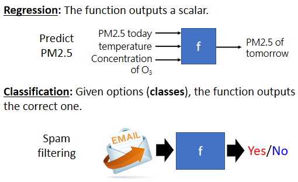

## 预测频道流量

### 训练三步骤

#### Function with Unknown Parameters

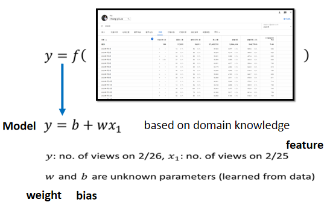

核心公式：$y = b + w \cdot x_1$

这是最简单的线性模型。你可以把它想象成一条直线方程（类似 $y = mx + c$）：

1. $y$ (预测目标)：你想要预测明天的流量（比如 2 月 26 日的观看人数）。
2. $x_1$ (Feature，特征)：这是你已经知道的、用来做预测的依据。图中选取了“前一天（2 月 25 日）的流量”。
3. $w$ (Weight，权重)：它代表 $x_1$ 对 $y$ 有多大的影响。比如，如果 $w=1.1$，意味着你假设明天的流量大约是今天的 1.1 倍。
4. $b$ (Bias，偏差)：它是一个基础数值，用来微调结果。就算 $x_1$ 为 0，最终结果也可能因为 $b$ 而不是 0。

名词解释

1. Feature (特征)：就是模型使用的输入信息，比如“昨天的浏览量”、“发布时间”、“视频标签”等。
2. Weight (权重)：代表这个特征的“话语权”有多重。
3. Bias (偏差)：代表一种基础的倾向性

虽然我们写出了公式 $y = b + w \cdot x_1$，但我们不知道 $w$ 和 $b$ 到底是多少。

#### Define Loss from Training Data

Loss 也是一个函数，它的输入是 model 中的参数 (w, b)

- 它的输入：你当前模型使用的参数 $w$ 和 $b$。
- 它的输出：一个数值 $L$。这个数值告诉你这套参数到底“有多烂”。
- 核心逻辑：
    - $L$ 越大 $\rightarrow$ 模型预测得越离谱（参数设置不好）
    - $L$ 越小 $\rightarrow$ 模型预测得越准（参数设置得很好）。

计算误差的方法

1. MAE (Mean Absolute Error, 平均绝对误差)：
    - 公式：$e = |y - \hat{y}|$
    - 含义：直接计算“预测值”和“真实值”的绝对距离。比如你猜 4.8k，实际 4.9k，误差就是 0.1k。
2. MSE (Mean Square Error, 均方误差)：
    - 公式：$e = (y - \hat{y})^2$
    - 含义：对误差进行平方。这会放大“大错误”的影响。比如误差是 2 的话，MSE 会变成 4；如果误差是 0.1，MSE 就只有 0.01。这会让模型对较大的错误更加敏感，训练时会更努力避免犯大错。
3. Cross-entropy (交叉熵)：
    - 当你的任务不是预测数值（回归），而是做分类时（比如判断是不是垃圾邮件），就不能用上面的减法了，得用“交叉熵”来衡量两个概率分布之间的差距。

Error Surface：

试不同的参数，然后计算 loss 所绘制的等高线图

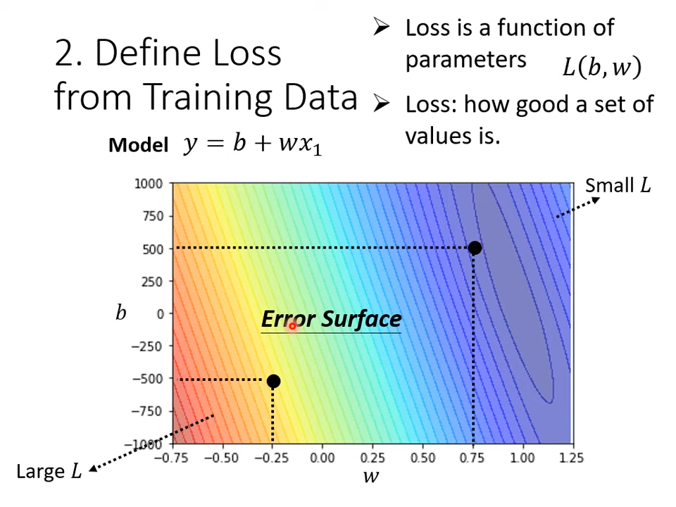

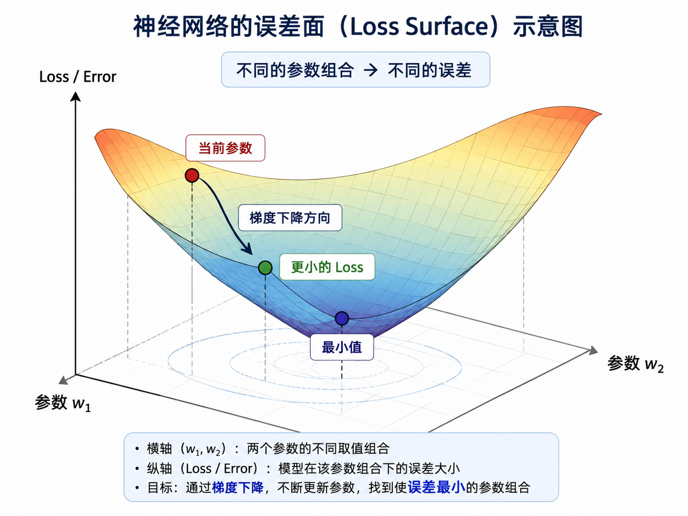

#### Optimization

找到可以让损失函数值最小的参数

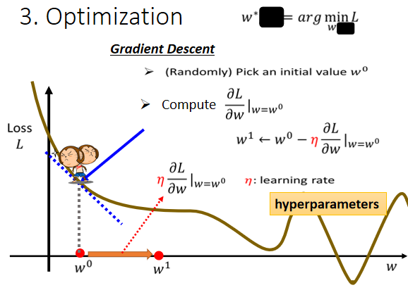

方法：

Gradient Descent(梯度下降)

步骤：

1. 随机选取初始值 $w^0$。

2. 计算在 $w = w^0$ 时，损失函数 $L$ 对 $w$ 的偏导数（即梯度）：
$$
\frac{\partial L}{\partial w} \bigg|_{w = w^0}
$$

3. 沿着梯度下降的反方向（即负梯度方向）更新参数：
$$
w^1 \leftarrow w^0 - \eta \frac{\partial L}{\partial w} \bigg|_{w = w^0}
$$

4. 其中 $\eta$ 是学习率，控制每一步的步长。

5. 什么时候停下来？
    - 自己设置上限（超参数），这是最简单粗暴的方法。人为设定一个“训练轮数（Epochs）”或者“迭代次数”。
        - 例子：设定迭代 1000 次，无论损失是否降低，到了 1000 次就强行停止。
        - 缺点：这是一个“超参数”，如果设置得太小，模型还没收敛；设置太大，则浪费算力。
    - 理想情况：微分值为 0（极小值点），从数学角度看，当损失函数的导数（梯度）为 0 时，说明到达了函数的波谷（极小值点）。此时参数不再更新，算法自然停止。
    - 在高维的复杂神经网络中，相比于局部最小值（Local Minima），鞍点（Saddle Points）和平坦区域（Plateaus，梯度极其微小，参数几乎不再发生改变，看起来就像训练“停滞”了一样）确实是更常见且更棘手的阻碍。

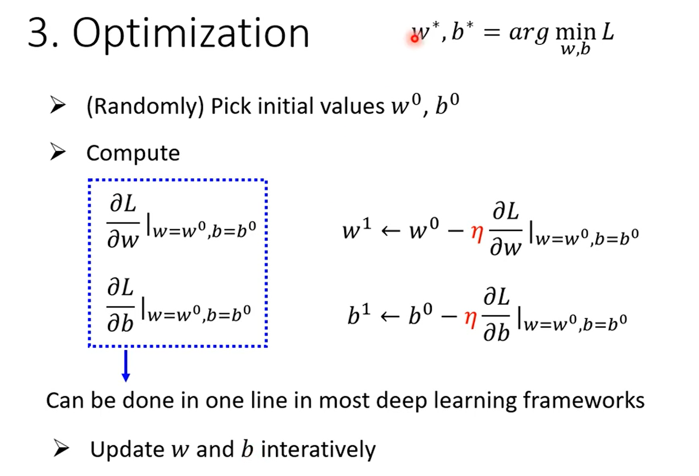

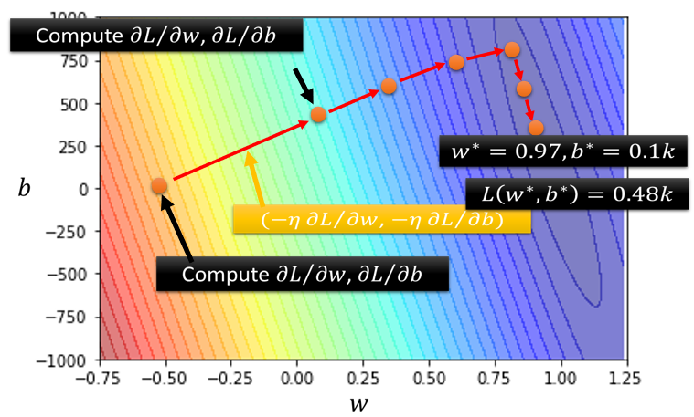

问：为什么模型优化路径没有走到图像的最右上角（最蓝的区域）就停下了？

答： 因为那里已经不是“下坡”路了；模型已经抵达了损失函数的谷底（极小值点），此时梯度几乎为零，算法判定任务完成，继续往前走反而会变成“上坡”（损失增大），因此停止更新。

### Linear Model

"Linear Model" 这个标题在图中想表达的核心含义是：正在用一种“线性假设”来解释和预测复杂的世界。

1. 它是一种“简单的假设”在线性模型中，我们假设：**未来的结果（$y$）等于过去所有影响因素（$x_j$）的“简单加权之和”**。这个标题是在告诉你：在这个特定的模型里，我们不搞复杂的逻辑，不搞弯曲的曲线，我们只看“线性关系”。

2. 它是一个“不断优化”的框架标题下面跟着 $y = b + \sum w_j x_j$，它想说明的是：**线性模型是一个具有“可扩展性”的框架**。
    - 当模型表现不好（误差 $L$ 大）时，我们不需要推翻整个模型，只需要在这个“线性框架”下：
        - 增加变量：从看 1 天数据变成看 56 天数据（增加 $x_j$）。
        - 调整权重：通过训练改变 $w_j$，让模型更精准地找到规律。

3. 它是在为“复杂模型”铺路
在机器学习课程中，讲“Linear Model”通常是为了对比。
    - 线性模型（Linear Model）：像是用直线去切分数据。
    - 非线性模型（Neural Network/Deep Learning）：像是用极其复杂的折线或曲线去拟合数据。

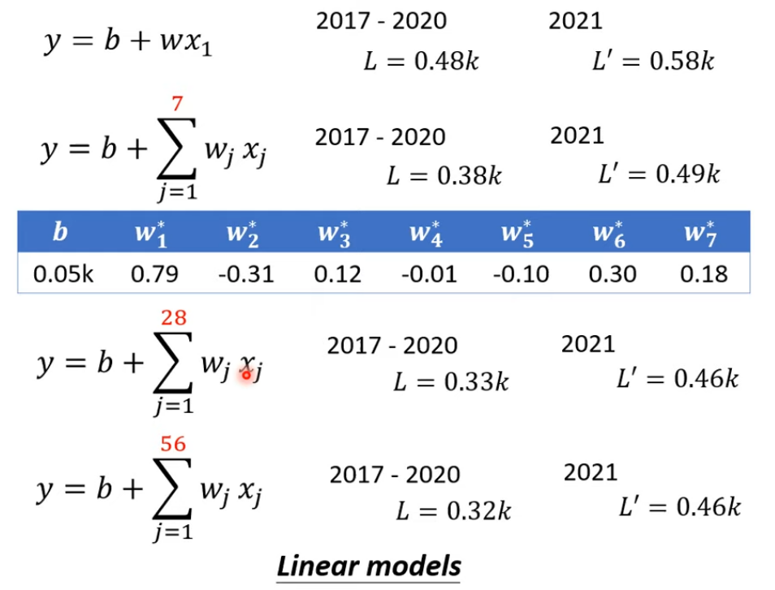

#### Model Bias

“Model Bias”这个词里的“Bias”，和公式 $y = wx + b$ 里的“偏置参数 $b$”，是两个完全不同的概念。前者叫“bias parameter”。

Model Bias 不是某个参数，而是：

**模型整体的表达能力不足，导致它天然拟合不好真实规律**。

比如真实规律是弯的：

$$y=x^2$$

但你用线性模型：

$$y = wx + b$$

不管怎么调 w 和 b，它都只能画直线，没法完美拟合抛物线。

这个问题叫：

Model Bias 高

也叫：

欠拟合 underfitting

如何解决呢？

需要一个更复杂的、更有弹性的、有未知参数的 function

### Piecewise Linear Curves（Sigmoid）

#### 模型定义

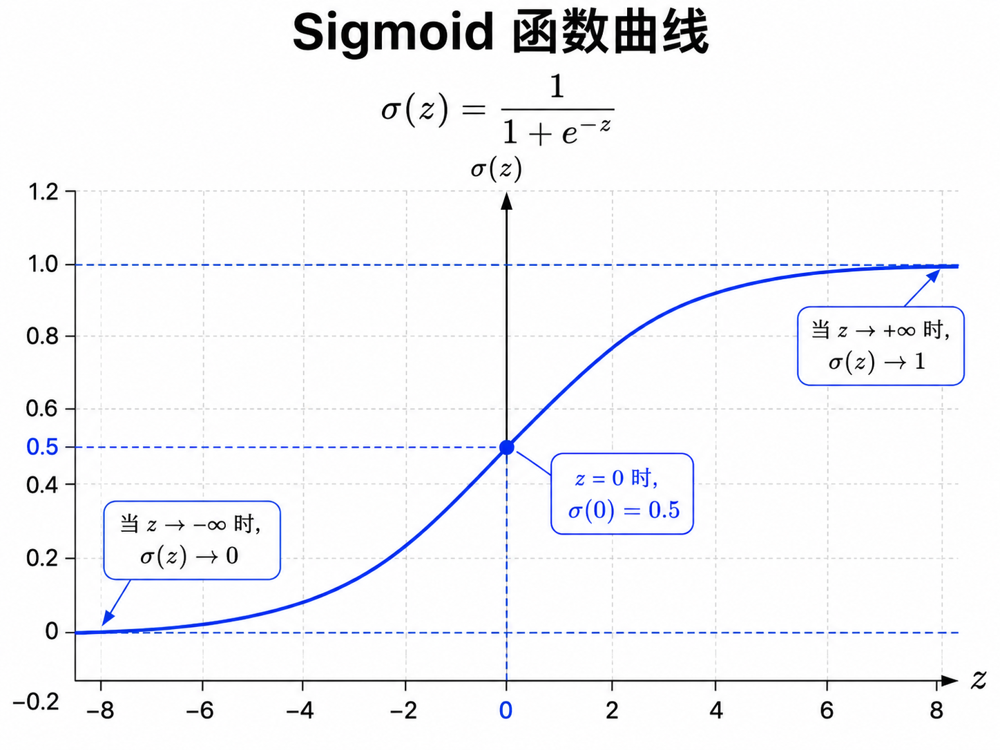

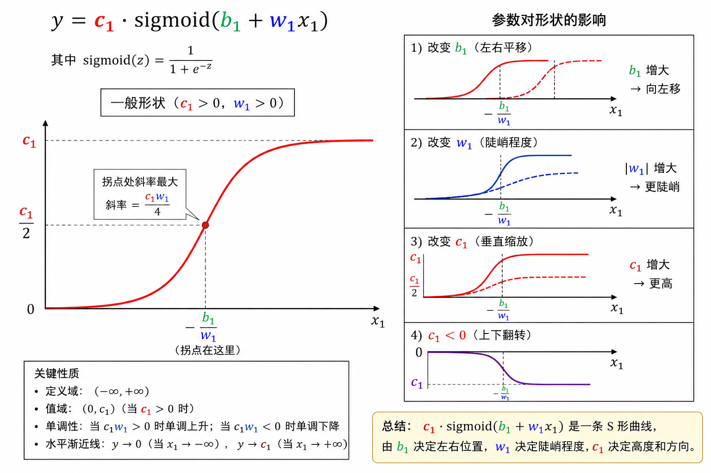

计算 $y$ 对 $x_1$ 的导数（链式法则）令 $z = b_1 + w_1 x_1$，则 $y = c_1 \cdot \sigma(z)$。使用链式法则：
 
$$\frac{dy}{dx_1} = \frac{dy}{dz} \cdot \frac{dz}{dx_1}$$
 
1. $\frac{dy}{dz} = c_1 \cdot \sigma'(z) = c_1 \cdot \sigma(z)(1 - \sigma(z))$
2. $\frac{dz}{dx_1} = w_1$

因此，斜率公式为：

$$\frac{dy}{dx_1} = c_1 \cdot w_1 \cdot \sigma(z)(1 - \sigma(z))$$

在拐点处计算斜率拐点对应 $z = 0$（即 $b_1 + w_1 x_1 = 0 \Rightarrow x_1 = -b_1/w_1$）。当 $z = 0$ 时：

1. $\sigma(0) = \frac{1}{1+e^0} = \frac{1}{1+1} = \frac{1}{2}$
2. 代入导数公式：

$$\text{斜率} = c_1 \cdot w_1 \cdot \sigma(0) \cdot (1 - \sigma(0))$$

$$\text{斜率} = c_1 \cdot w_1 \cdot \frac{1}{2} \cdot (1 - \frac{1}{2})$$

$$\text{斜率} = c_1 \cdot w_1 \cdot \frac{1}{2} \cdot \frac{1}{2} = \frac{c_1 w_1}{4}$$

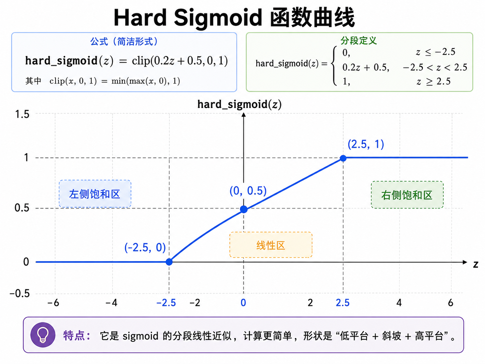

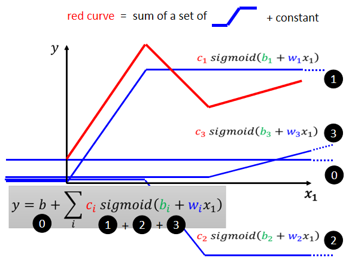

定义：由多段锯齿状的线段所组成的线，可以看作是一个常数，再加上若干个蓝色的函数（Hard Sigmoid）组合而成。公式如下：

$$y = b + \sum_{i} c_i \cdot \text{sigmoid}(b_i + w_i x_1)$$

图解说明：

1. 红线 (red curve)：最终叠加后的结果，即“一组 Sigmoid 函数之和 + 常数”。

2. 蓝线 (1, 2, 3)：每个 $c_i \cdot \text{sigmoid}(b_i + w_i x_1)$ 代表一个独立的蓝色函数组件。

3. 常数 (0)：代表基础偏移量 $b$。

核心概念：

1. 用来近似描述这些蓝色曲线的函数，被称为 Sigmoid 函数（S 型函数）。

2. 事实上，Sigmoid 函数的个数就代表了神经网络中一层神经元的节点数（使用多少个 Sigmoid 是超参数）。

3. 在深度学习中，“超参数（Hyperparameters）”指的是在训练开始前，由人为设定好的参数，而不是模型自己“学”出来的。
    - 你的选择：你需要自己在写代码时决定：“我要用 5 个神经元？还是 100 个？”
    - 不同的结果：
        - 如果你设置的 $i$ 太小（比如只有 2 个），你的模型就像一个“画质很差的笔”，画不出复杂的曲线，拟合能力弱。
        - 如果你设置的 $i$ 很大（比如 512 个），你的模型就有 512 块“积木”可以拼接，能画出极其复杂的形状，但同时也更容易导致“过拟合”

结论：

1. 可以用 分段线性曲线 (Piecewise Linear Curves) 去逼近任何连续的曲线。

2. 每一个分段线性曲线，都可以通过叠加一堆蓝色的函数并加上一个常数来得到。

3. 只要有足够的蓝色函数进行累加，就可以组合成任何连续的曲线。

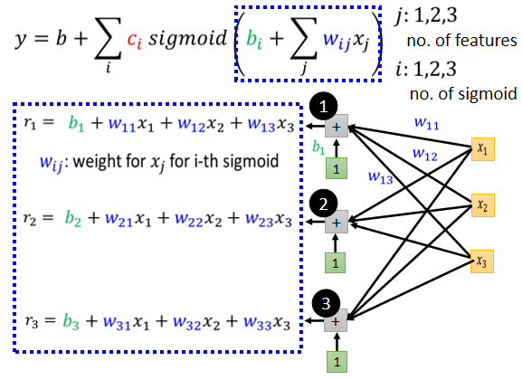

第一部分：单变量进化 (前两行)

$$y = b + wx_1 \longrightarrow y = b + \sum_{i} c_i \cdot \text{sigmoid}(b_i + w_i x_1)$$

1. 第一行 (线性模型)：这是最原始的模型，只能画出一条直线。$b+wx_1$ 决定了这条线的位置和斜率。

2. 第二行 (非线性模型)：引入了 Sigmoid 和求和符号，也就是我们之前讨论的，通过叠加多个“S型积木”，模型现在可以拟合曲线了（但仍然只处理一个特征 $x_1$）。

第二部分：多变量进化 (后两行)这是图中真正想让你看懂的“进化”，也就是处理多个特征的能力：

$$y = b + \sum_{j} w_j x_j \longrightarrow y = b + \sum_{i} c_i \cdot \text{sigmoid}\left(b_i + \sum_{j} w_{ij} x_j\right)$$

1. 第三行 (多元线性回归)：现在的输入不再只有一个 $x_1$，而是多个变量 $x_j$（比如 $x_1=$房间面积, $x_2=$房龄, $x_3=$楼层）。这里的 $\sum_{j} w_j x_j$ 是在对所有特征进行加权求和。

2. 第四行 (全连接神经元结构)：这是神经网络的核心公式！它的逻辑是：
    - 内部 $\sum_{j} w_{ij} x_j$：先将所有输入的特征（$x_j$）加权汇总，每个特征都有一个对应的权重 $w_{ij}$。
    - 加入 $b_i$：加上偏置项，调整这个神经元的“触发门槛”。
    - 放入 $\text{sigmoid}(\dots)$：将汇总后的结果通过非线性激活函数，让它具备处理弯曲数据的能力。
    - 外部 $\sum_{i} c_i \dots$：最后，把多个这样处理好的神经元（$i$）的结果再次加权求和，输出最终预测值 $y$。

**从简单的线性叠加变成了“加权汇总 $\rightarrow$ 非线性激活 $\rightarrow$ 再叠加”的多层处理逻辑。**

转化为矩阵计算+激活函数形式：

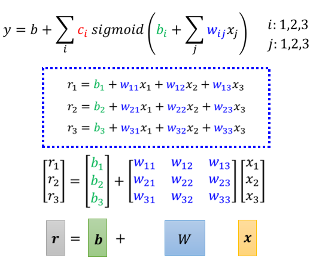

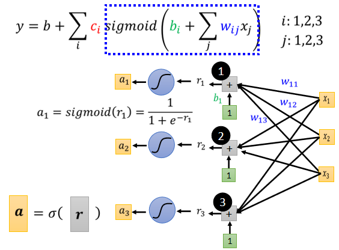

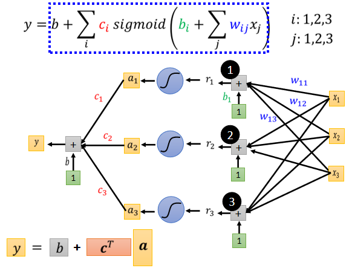

为什么一定要用 $c^T \cdot a$？

在矩阵乘法规则里，如果你想把两个向量对应元素相乘再求和（即 $c_1a_1 + c_2a_2 + c_3a_3$），你需要用一个行向量去点乘一个列向量：

$$c^T \cdot a = \begin{bmatrix} c_1 & c_2 & c_3 \end{bmatrix} \times \begin{bmatrix} a_1 \\ a_2 \\ a_3 \end{bmatrix} = (c_1 \times a_1) + (c_2 \times a_2) + (c_3 \times a_3)$$

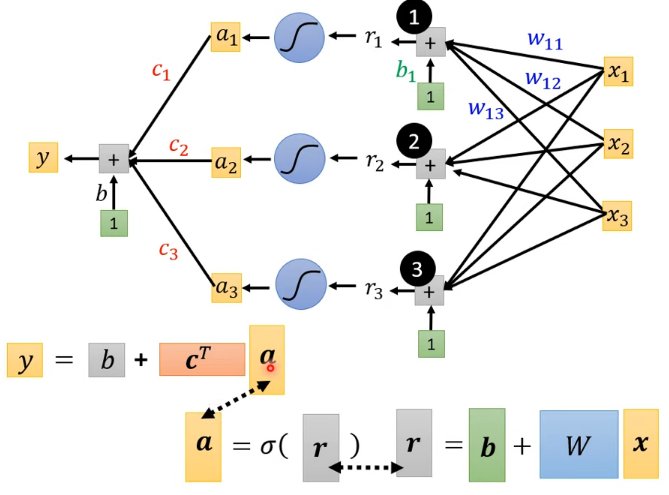

总之：

什么是 $\theta$ (Theta)？

$\theta$ 就是一个“收纳袋”。它代表了模型中所有需要被训练的参数的总和。

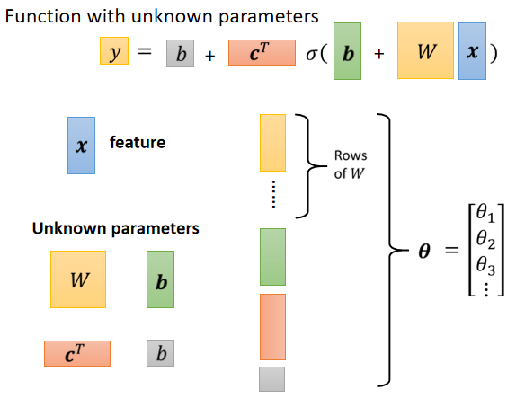

### Loss函数

因为所有参数统称为 $\theta$，loss 表示为 $L(\theta)$。

### 优化的过程

仍是梯度下降

1. 选定初始参数值（向量）$\theta_0$
2. 对每个参数求偏导数
3. 更新参数，直至设定的次数

​
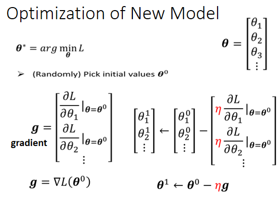

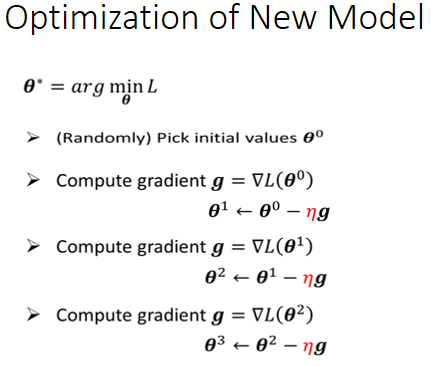

核心公式拆解

$$\theta^* = \arg \min_{\theta} L$$

1. $\theta$ (Theta)：代表模型中所有需要学习的参数（例如所有神经元之间的权重 $W$ 和偏置 $b$）。
2. $L$ (Loss)：代表损失函数。它用来衡量模型“猜得有多准”。$L$ 的值越小，代表模型表现越好（猜得越准）。
3. $\min_{\theta} L$：这部分的意思是“寻找一个 $\theta$，使得 $L$ 的值最小”。
4. $\arg \min_{\theta} L$：这代表“使得 $L$ 取得最小值的那个 $\theta$ 的值”。
    - min 的结果是一个数值（最小的误差值）；
    - arg min 的结果是参数本身（让误差最小的那组旋钮配置）。
5. $\theta^*$：就是我们最终梦寐以求的“最优参数”。

### Batch training

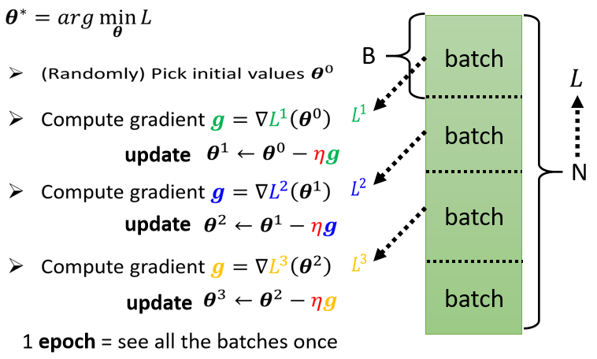

简单来说，如果你的样本数据（$N$）非常多，直接把所有数据一次性丢给模型训练是非常慢且占内存的。所以，我们把数据切分成很多小块，一块一块地喂给模型。

1. 以下是核心概念的拆解：
    - 什么是 Batch (批次)？Batch：就是把庞大的训练数据集 $N$ 分成一个个小份，每一份叫一个 Batch，大小为 $B$。
    - 为什么需要 Batch？
        - 内存限制：如果一次性把 100 万条数据全部读进内存，显卡（GPU）可能会直接崩溃。
        - 训练速度：分批次训练可以让模型在还没看完所有数据时，就已经开始通过梯度下降更新参数了，这样学习效率更高。

2. 训练流程：Update 与 Epoch
    - Update (参数更新)：
        - 每次模型读取一个 Batch 的数据。
        - 计算这一个 Batch 的损失 $L^i$。
        - 计算梯度 $g$。
        - 更新参数 $\theta$。
        - 重点：只要算完一个 Batch 并更新一次参数，就叫一次 Update。如果一个 Epoch 里有 100 个 Batch，那么一次 Epoch 就对应 100 次 Update。
    - Epoch：
        - 指的是“把所有的数据（即 $N$ 个数据）完整地看了一遍”。
        - 如果你的数据集被分成了 4 个 Batch，那么当你把这 4 个 Batch 全部训练过一次之后，就完成了 1 个 Epoch。

3. 为什么 Batch 大小也是“超参数(人为设置)”？
    1. Batch 太小：参数更新太频繁，虽然学得快，但受单个噪声数据影响大，训练不稳定。
    2. Batch 太大：更新次数少，利用不到大数据量带来的高效计算优势，且可能卡在局部最优解。
    3. 找平衡：我们需要人为去设置一个合适的 Batch 大小（比如 32, 64, 128），这就是所谓的“超参数”。

### ReLU (Rectified Linear Unit)

$$y = b + \sum_{i} \max(0, b_i + w_ix_i)$$

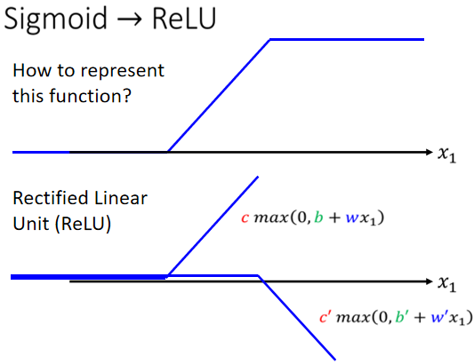

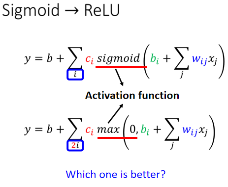

Sigmoid 和 ReLU 都属于激活函数（Activation Function）

为什么叫 "Hard Sigmoid"？

- 传统的 Sigmoid 函数：图像像是一个平滑的“S”形曲线，涉及指数运算（$e^z$），计算量较大。

- Hard Sigmoid：使用分段线性函数（如 ReLU）来模拟这种“S”形。它通过“平直的线”而不是“平滑的曲线”来逼近，计算非常快。在现代神经网络中，为了提升效率，经常会用这种“Hard”版本替代原始的 Sigmoid。

如何通过定位“拐点”来控制函数形状

我们将 $f(x) = c \max(0, b + wx) + c' \max(0, b' + w'x)$ 视为两个“零件”的组合，通过控制它们的“开启点”（拐点）和“贡献权重”（系数 $c, c'$）来塑造形状。

拐点的定义与介入

ReLU 函数 $\max(0, b+wx)$ 的拐点出现在 $b+wx=0$ 时，即 $x = -b/w$。这是函数从“零”变为“线性”的转折点。

1. 第一个拐点 $x_1 = -b/w$：此处第一个单元开始介入。

2. 第二个拐点 $x_2 = -b'/w'$：此处第二个单元开始介入。

假设 $x_1 < x_2$，分段推导为了清晰起见，假设 $w, w' > 0$（即线性项随 $x$ 增大而增大）：

1. 区间 I ($x < x_1$)：完全沉睡，两个项的输入均为负，输出皆为 0，结果为 $f(x) = 0$。这是一条水平线。

2. 区间 II ($x_1 \le x < x_2$)：部分激活第一个项被激活（且 $c$ 必须为正才能产生向上趋势），输出 $c(b+wx)$。此时函数斜率为 $cw$，呈现斜向上增长。

3. 区间 III ($x \ge x_2$)：全部激活两个项都被激活，函数变为 $f(x) = c(b+wx) + c'(b'+w'x)$。总斜率为 $cw + c'w'$。为了实现“上升后回到水平”，我们必须设置 $c'$ 为负数，使得 $c' = -c \cdot (w/w')$。此时总斜率抵消为 0，函数回归为水平线。

### 模型变形

模型变形 ⇒ 多加几层

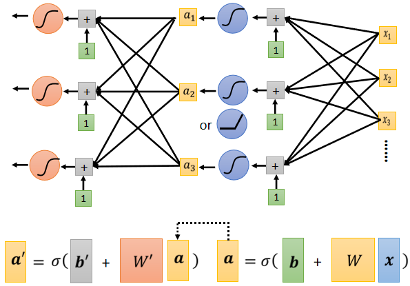

### 引入 Deep Learning

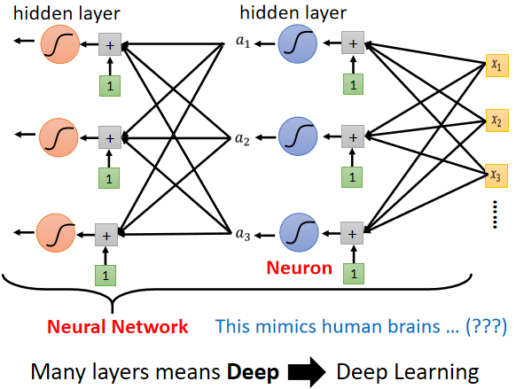

### 更深的网络不一定更好要看它在新数据上的表现

层数加深会降低训练误差，但如果模型太复杂，就可能过拟合：训练数据表现很好，新数据表现反而变差。

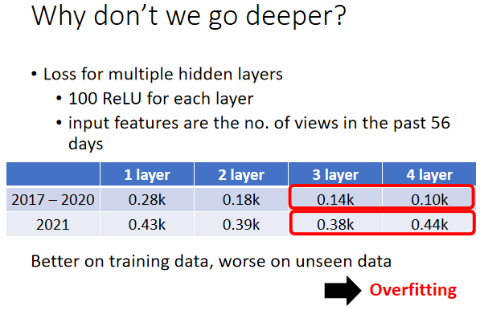

# DeepLearning-General Guidance

## Framework of ML

### 训练资料与测试资料

1. 训练资料 (Training data)：定义为 $\{(x^1, \hat{y}^1), (x^2, \hat{y}^2), ..., (x^N, \hat{y}^N)\}$。
    - 这里每一对 $(x, \hat{y})$ 代表一个样本，其中 $x$ 是输入特征，$\hat{y}$ 是对应的标准答案（标签）。
    - 模型通过这 $N$ 个已知答案的样本来学习规律，从而调整自身的参数。
    
2. 测试资料 (Testing data)：定义为 $\{x^{N+1}, x^{N+2}, ..., x^{N+M}\}$。
    - 这是模型在训练完成后，用于评估模型性能的数据。
    - 注意这里的 $x$ 没有对应的 $\hat{y}$，这意味着模型需要根据之前学到的规律，独立推断出这些测试数据的结果。

### 训练过程

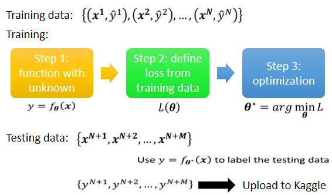

1. 设定模型结构 (Function with unknown parameters)
    - 含义：这是定义“模型”的过程。你先写出一个数学函数 $y = f_{\theta}(x)$，其中 $\theta$ 是还没确定的参数（权重）。
    - 比喻：就像制造一台机器，现在的机器还没调试好，参数 $\theta$ 就是机器内部的旋钮，还不知道转到哪个角度输出结果才最准确。

2. 定义损失函数 (Define loss from training data)
    - 含义：你需要一个标准来判断“现在的 $\theta$ 到底好不好”。$L(\theta)$（损失函数）用来衡量模型预测值与真实答案（$\hat{y}$）之间的差距。
    - 比喻：给机器打分。如果机器预测结果和正确答案差得远，Loss 就大（分数低）；如果差得近，Loss 就小（分数高）。

3. 优化 (Optimization)
    - 含义：目标是找到一组最佳参数 $\theta^*$，使得损失函数 $L$ 最小化。公式 $\theta^* = \text{arg min}_{\theta} L$ 的意思就是“找到那个能让损失值最小的 $\theta$”。
    - 比喻：不断转动机器上的旋钮，直到得分最高（损失最小）。
    
总结整个流程：

有了这三个步骤，你就可以拿新的测试资料 $x^{N+1}, ..., x^{N+M}$ 去跑已经训练好的 $f_{\theta^*}(x)$，得到预测结果 $y^{N+1}, ..., y^{N+M}$。图中的“Upload to Kaggle”是指把你的预测结果提交到数据科学竞赛平台，去看看模型在真实环境下的准确率如何。

## General Guide

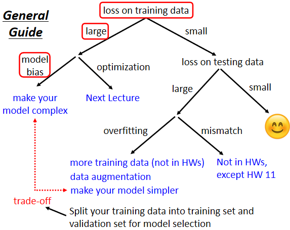

1. 起点：看训练集上的 Loss
    - 如果 Loss 很大：说明模型存在 model bias（模型偏差），即模型本身太简单，无法拟合训练数据。解决方案是：make your model complex（增加模型复杂度）。
    - 如果 Loss 很大，训练失败并不总是因为模型架构太简单（Model Bias），有时是因为“优化”没做好。
    - 如果 Loss 很小：说明模型在训练数据上表现良好，接着需要看在测试集上的表现。

2. 第二步：看测试集上的 Loss
    - 如果 Loss 很小：恭喜你，模型表现理想。
    - 如果 Loss 很大：说明模型在未见过的测试数据上表现不好，此时分为两种情况：
        - Overfitting (过拟合)：模型在训练集上太“死记硬背”了。解决方案包括：增加训练数据（not in HWs）、使用数据增强（data augmentation）或 make your model simpler（简化模型）。
        - Mismatch (不匹配)：训练数据和测试数据的分布不一致。

3. 核心权衡 (Trade-off)：
    - 图中通过红色的虚线强调了 trade-off（权衡），即在“增加复杂度”和“简化模型”之间存在平衡。
    - 为了更好地进行模型选择，建议将训练数据划分为训练集和验证集（validation set）。

### Loss on training data

#### Model Bias

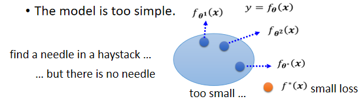

以下是核心逻辑解析：

1. 蓝色椭圆区域：代表你当前所设计的模型架构（Function Set）所能覆盖的所有函数空间。
2. 橙色点 ($f^*(x)$)：代表能真正解决你当前问题、实现“最小损失”（small loss）的理想函数。
3. 模型太简单 (The model is too simple)：因为你的模型架构太简单，导致这块蓝色的“函数空间”太小，根本没有覆盖到那个理想的橙色点 $f^*(x)$。你在蓝色区域里找来找去（找到 $f_{\theta^1}, f_{\theta^2}, f_{\theta^*}$ 等），就像在草堆里找针（find a needle in a haystack），但实际上草堆里根本就没有那根针（but there is no needle）。

重新设计模型的核心方向

1. 增加层数（Deep）：通过堆叠更多的隐藏层，模型能够逐层抽象特征，由简入繁地处理输入数据。
2. 增加宽度（Wide）：在每一层增加更多的神经元，可以提升模型对特征的记忆容量和单层处理能力。
3. 引入更多特征（Features）：除了原本的特征外，可以引入更多相关的输入维度，丰富模型接收到的信息。

#### Optimization

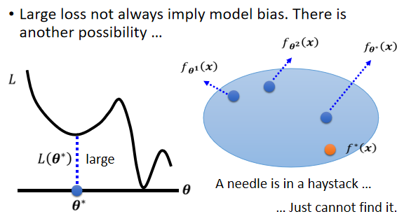

训练失败并不总是因为模型架构太简单（Model Bias），有时是因为“优化”没做好。

1. 局部极小值 (Local Minima)
    - 这是最直观的解释：损失函数 $L(\theta)$ 的地形非常崎岖，充满了像碗一样的“坑”。
        - 现象：当参数 $\theta$ 走到某个碗底时，周围的 Loss 都比它高。根据梯度下降的原理，算法会认为“我到了最低点”，于是停止更新。但实际上，这个碗底只是局部最低点，真正的“全局最低点”（那个能让 Loss 极小的点）可能在隔壁更深的地方。
 
2. 鞍点 (Saddle Points) —— 真正的幕后黑手
    - 在现代神经网络中，研究人员发现鞍点比局部极小值要常见得多。
        - 什么是鞍点：就像是一个马鞍的中心，向一个方向看它是最低点，但向另一个方向看它是最高点。
        - 困境：在鞍点附近，函数的梯度（导数）几乎为零。梯度下降算法依赖梯度来指引方向，当梯度消失时，算法会“卡住”走不动，即使它离真正的低 Loss 区域只有一步之遥。

3. 平原区域 (Plateaus)
    - 有时损失函数表面会非常平坦，形成一个长长的“高原”。
        - 现象：在高原上，梯度非常微小，参数更新极其缓慢。模型看起来还在进步，但进步速度慢到几乎停滞，导致训练迟迟无法达到理想效果。

#### 如何区分Model Bias和Optimization问题

1. Start from shallower networks (or other models), which are easier to train.
    - 浅模型（Simple Model）：比如线性回归、决策树、或者是只有 1-2 层的神经网络。这些模型的参数少、函数空间简单，优化起来非常容易
2. If deeper networks do not obtain smaller loss on training data, then there is optimization issue.
    - 理论上：深模型（Deep Network）比浅模型拥有更大的“函数空间”，也就是更强的弹性。理论上，深模型应该能覆盖更多的可能性，从而找到更低的点（更小的 Loss）。
    - 现实中：如果你把模型加深了，按理说性能应该变好（Loss 变小）。但如果发现：深模型的 Loss 反而比浅模型还要高，或者压根没降低。
    - 结论：这说明你的“深模型”并没有发挥出它应有的威力。为什么？因为它被“优化（Optimization）”拖了后腿。
    
| 情况 | 诊断结果 | 对应处理方法 |
| :--- | :--- | :--- |
| **浅模型训练失败** | 数据有问题 或 流程错误 | 检查数据清洗、输入特征、代码 Bug |
| **浅模型成功，深模型更成功** | 模型架构合理 | 恭喜，正常训练 |
| **浅模型成功，深模型失败 (Loss 变高)** | **优化问题 (Optimization Issue)** | 更换优化器 (如 Adam)、调整学习率、检查初始化 |

### 测试资料上的loss

#### Overfitting

**模型不是越复杂越好，而是越“贴合规律”越好**。

training 的 loss 小，testing 的 loss大，有可能是 overfitting。如果你的 model 它的自由度很大的话，它产生生非常奇怪的曲线，导致训练集上的結果好，但是测试集上的 loss 很大。

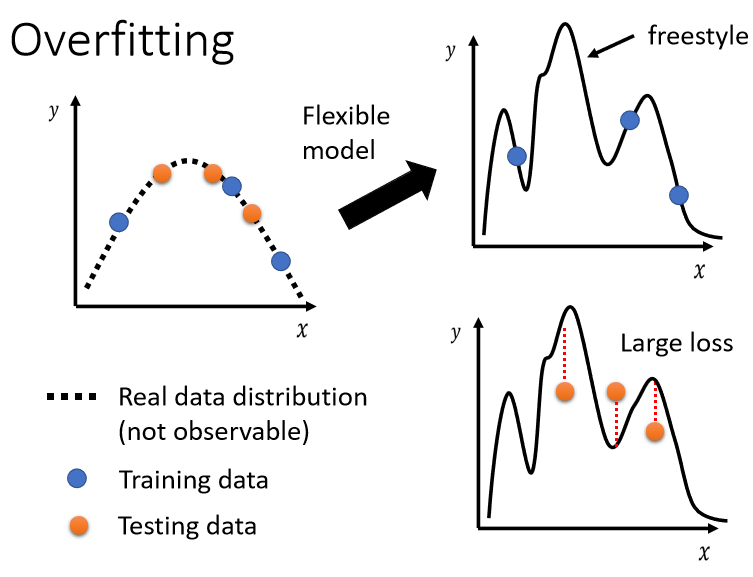

1. 左图（真实分布）：虚线表示数据的潜在规律（平滑的抛物线），蓝色是训练点，橙色是测试点。它们都大致分布在虚线上。

2. 右上图（灵活的模型/Overfitting）：模型太“自由”了（Flexible model），它不再试图去拟合那条平滑的虚线，而是为了“经过每一个蓝色训练点”，强行弯曲自己，画出了一条大起大落的“狂野曲线”（freestyle）。

3. 右下图（悲剧的结果）：当测试数据（橙色点）出现时，因为模型之前的曲线已经扭曲得不成人形，这些橙色点完全落在了曲线之外。于是，模型预测值与真实值之间产生了巨大的距离，这就是图中显示的 Large loss。

#### 如何解决Overfitting

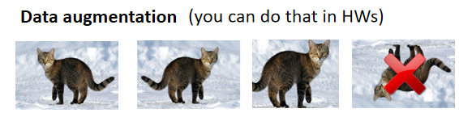

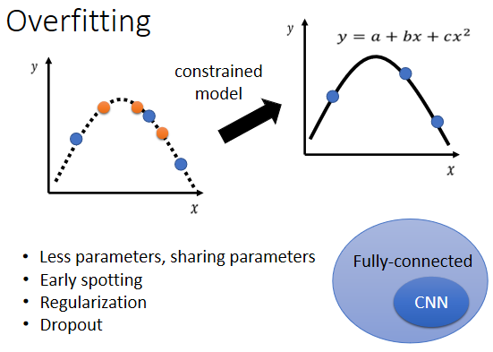

1. 增加数据 (Data Augmentation)：利用数据增强，让模型在更多样化的数据中学习真实的规律，而不是死背原始数据。
    - 在数据有限的情况下，通过人为加工，‘创造’出更多训练样本，从而让模型变得更聪明、更强壮。但是需要注意合理性。
2. 约束模型弹性 (Constrained model)：
    - 减少参数：减少神经元数目、使用参数共享（如 CNN 中的卷积核）。
    - 正则化手段：使用 Early Stopping（及时停止训练）、Regularization（惩罚项）、Dropout（随机丢弃部分神经元）。

为什么会有“灵活性”的博弈？

图中提到 "freestyle"（狂野曲线）与 "constrained model"（约束模型）的对比：

1. 灵活模型（太自由）：模型为了经过所有训练点，画出了扭曲的曲线，导致对未知数据预测失效（Large Loss）。

2. 约束模型：通过人为干预，让模型保持平滑（如抛物线形状），这样它不仅能拟合训练点，对未来的预测也更加准确。

#### 给模型太大限制导致Model Bias

模型太灵活会过拟合；但如果限制得太狠，又会回到 model bias，也就是欠拟合。

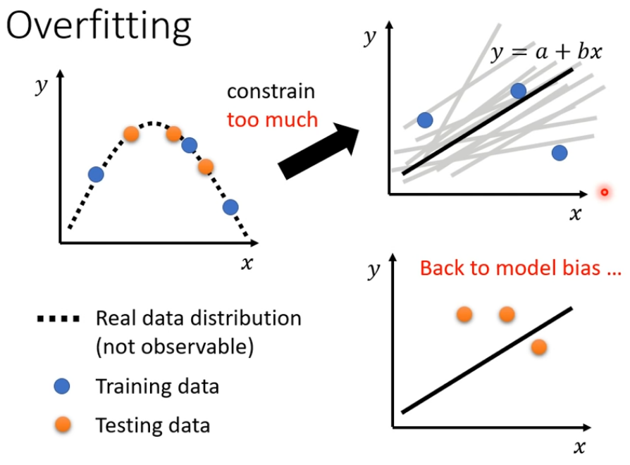

### 偏差与复杂度的权衡

模型并非越复杂越好，权衡偏差与复杂度。

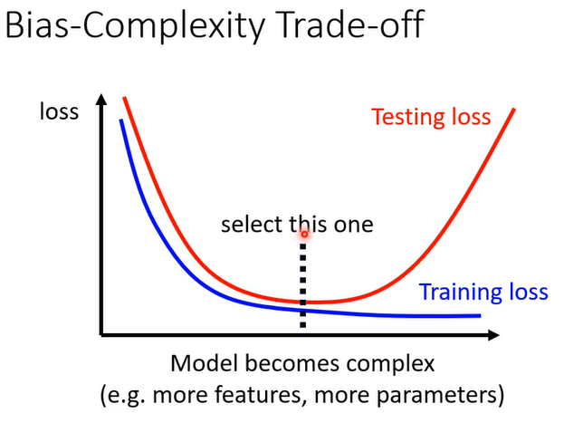

### Cross Validation

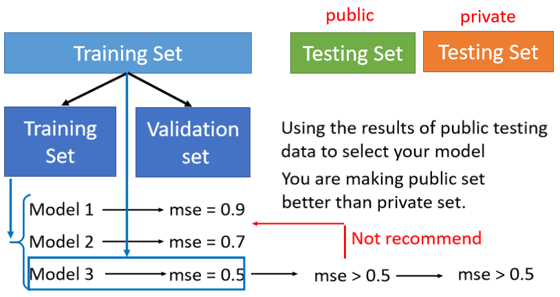

1. 把 training 的资料分成两部分，一部分叫作 training set，一部分是 validation set

2. 在 validation set 上面去衡量他们的分数，根据 validation set 上面的分数去挑选结果，不要管在 public testing set 上的结果以避免 overfitting

3. 不推荐用 public testing set 的结果来挑模型。因为你这样会把模型调得越来越适合 public testing set，但最终在 private testing set 上不一定表现好。

### N-fold Cross Validation

N-fold Cross Validation 就是先把训练集切成 N 等份，切完以后拿其中一份当作 Validation Set，另外 N-1 份当作 training set，重复 N 次。

把多个模型在这三个 setting 下通通跑过一次，把 N 中状况的结果都平均起來，看看谁的结果最好；最后再把最终选择的 model（这里是 Model 1），再拿全部的 training set（public）训练 Model 1，训练完后，再用在 testing set 上面

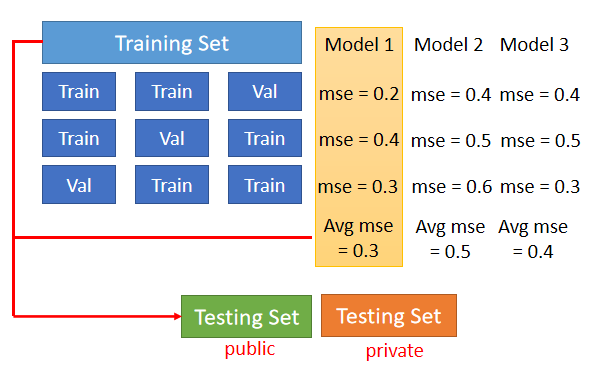

**训练集里面切出 validation set，用它来比较和选择模型；真正的 testing set 只在最后评估一次，不要拿 testing set 来挑模型**。

不要用真正的 Testing Set 来挑模型；要用 Training Set 切出来的 Validation Set 来挑。

核心意思分三层：

1. Training Set 被分成 Train / Val

左边蓝色大框叫 Training Set，但它里面又被切成几份：

一部分拿来真正训练模型：Train

一部分暂时不训练，只拿来评估模型：Val

2. 右边是在比较三个模型

我有多个候选模型，我要决定最终用哪一个。

3. 真正的 Testing Set 只能最后用一次

public test set：你提交模型后，平台给你一个公开分数。

private test set：最终排名/最终成绩用的真正测试集，你看不到。

public testing set 也不能频繁拿来挑模型，否则你其实是在“偷看考试答案”。

### Mismatch

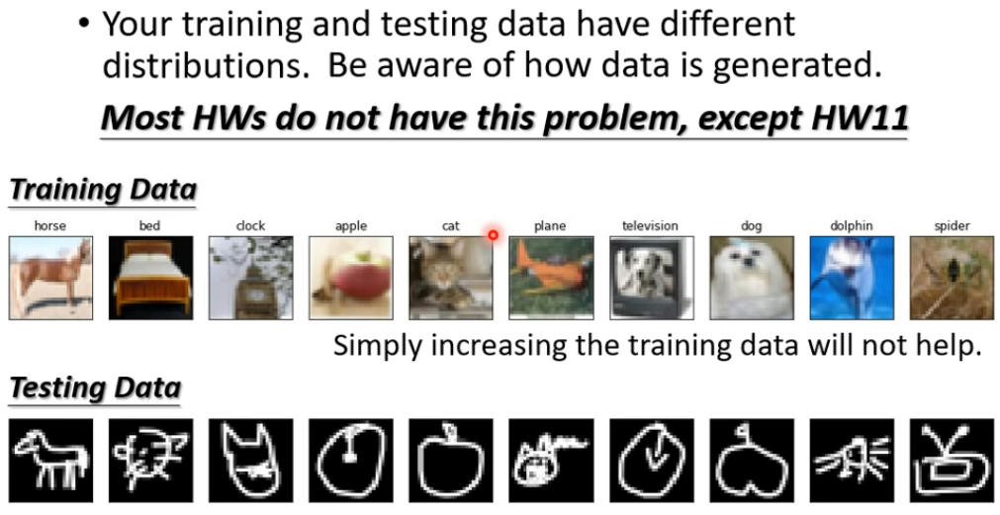

1. 问题定义：当训练集（Training Data）和测试集（Testing Data）的数据分布不一致时，就会出现 Mismatch 问题。

2. 直观示例：训练集包含的是高质量、写实的物体照片（如真实的马、床、猫等），而测试集却由简笔画（Doodles）组成。尽管它们代表的类别相同，但数据本身的外观形态（分布）完全不同。

3. 错误应对：面对这种数据分布差异，单纯增加训练数据的规模（Simply increasing the training data）是无法解决问题的。

4. 建议： 遇到这种情况时，需要特别关注数据是如何生成的（Be aware of how data is generated），并依照对数据本身的理解来做出判断与调整。

# DeepLearning-Loss of Classification

## Classification as Regression


回归和分类问题的核心区别

1. 回归 (Regression)：
    - 核心逻辑：拟合 (Fitting)。模型试图找到一条曲线或曲面，让预测值尽量靠近真实的数值。
    - 输出特点：输出的是一个具体的、可以无限细分的“数值”（例如：25.6度，100.5元）。
    - 适用场景：当你关心的是“量”的大小或变化趋势时。
2. 分类 (Classification)：
    - 核心逻辑：划分 (Decision Boundaries)。模型试图找到一条或多条“边界”，把不同性质的数据分在不同的区域里。
    - 输出特点：输出的是一个预定义的“类别名称”或“标签”（例如：猫/狗，0/1）。 
    - 适用场景：当你关心的是“是什么”或“属于哪一类”时。

在机器学习中，回归问题通常使用均方误差（MSE）来衡量好坏，而分类问题则通常使用交叉熵（Cross-Entropy）来度量预测概率分布与真实类别之间的差异。


如果把“分类问题”简单地强行当作“回归问题”来处理，会遇到什么陷阱。

简单来说，它的核心矛盾在于：“你给类别编的号，模型会当成数字的大小来处理。”

我们有时希望模型输出一个数值，比如 1.1，然后我们可以将其四舍五入变成 1（代表 class 1）。如果模型输出 1.9，我们将其变成 2（代表 class 2）。这样看起来用处理“回归”的方法（输出一个连续数值）来解决“分类”问题好像很顺手。

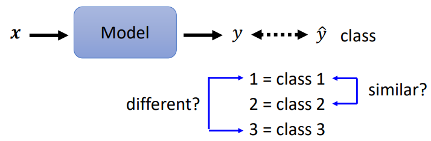

当你把类别标记为 $1, 2, 3$ 时，在数学上，$1$ 和 $2$ 的距离是 $1$，$1$ 和 $3$ 的距离是 $2$。模型会自动认为：类别 1 和类别 2 的“差异”比类别 1 和类别 3 的“差异”要小。

这就导致了两种完全不同的结果：

1. 情况 A：真的有顺序（成功）比如：
    - 预测小学生年级（一年级、二年级、三年级）。
    - 一年级确实和二年级在身高、体重特征上更接近。此时，让模型预测数值 $1, 2, 3$ 是合理的，因为数值的大小刚好符合分类的逻辑（一年级 < 二年级 < 三年级）。
2. 情况 B：类别间没有逻辑顺序（失准）比如：
    - 预测猫、狗、鸟。
    - 如果你把猫编为 $1$，狗为 $2$，鸟为 $3$。
    - 难道“猫”和“狗”的距离就比“猫”和“鸟”的距离近吗？完全没有依据！
    - 模型会强行学到一个错误的假设：认为“狗”位于“猫”和“鸟”之间。如果模型预测出来的是 $1.5$，那代表什么？它既不是猫也不是狗，这种数值上的平均在分类中是没有意义的。

## Class as one-hot vector

既然类别之间没有自然的“大小”和“距离”关系，那我们就不要强行用数字 $1, 2, 3$ 来表示，而是用一种全新的结构——“独热编码 (One-Hot Vector)”来表示。

任意两个类别距离一样

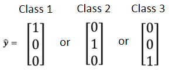

```
输入

x1 x2 x3
    │
    ▼
第一层全连接
    │
    ▼
a1 a2 a3
    │
Activation
    │
    ▼
r1 r2 r3
    │
第二层全连接
    │
    ▼
y1 y2 y3
```

例如图片属于 Class2，

真实标签就是

[0 1 0]

神经网络输出

[0.1 0.8 0.1]

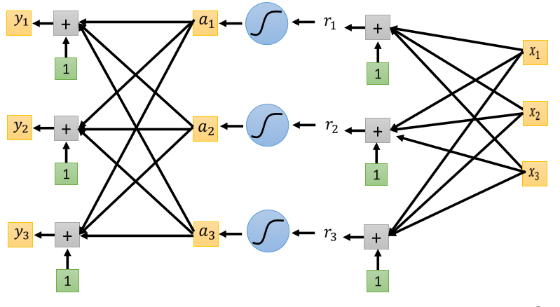

### Classification with softmax

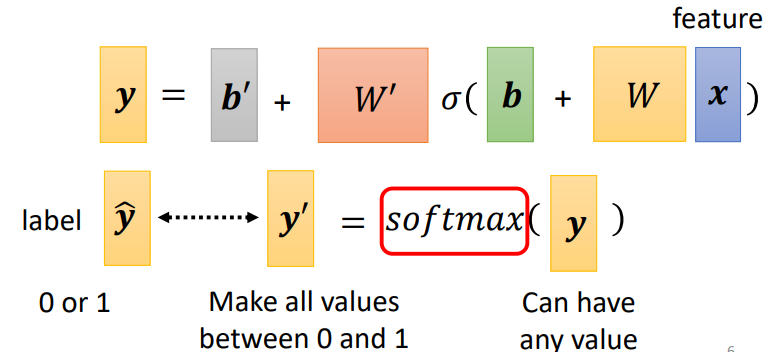

当你对向量应用激活函数（如 Sigmoid 或 ReLU）时，它会“逐元素”应用，结果依然是一个向量，而不是一个标量。

在神经网络中，无论是 Sigmoid 还是 ReLU，它们在处理向量时，本质上都是执行 Element-wise Operation（逐元素运算）。

假设你的隐藏层有 3 个神经元，经过 b + Wx 计算后，你得到一个向量 $v = [v_1, v_2, v_3]$。

当你对这个向量使用 ReLU 时，计算过程是这样的：

$$\text{ReLU}(v) = [\text{ReLU}(v_1), \text{ReLU}(v_2), \text{ReLU}(v_3)]$$

如果你输入的是一个 3 维向量，你得到的依然是一个 3 维向量。每一个分量都被激活函数独立处理了。

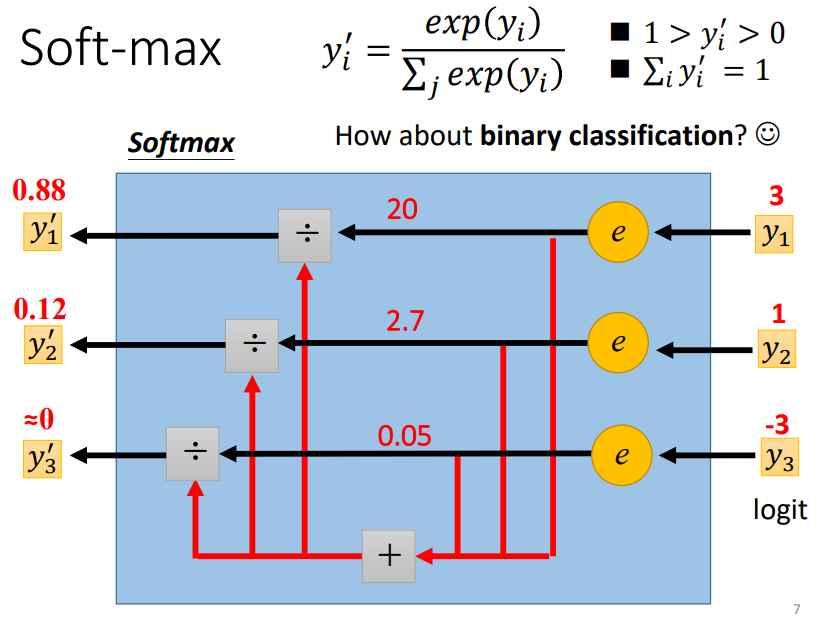

Softmax 是干嘛的？

Softmax = 把任意实数向量 → 转换成概率分布（加起来=1，每个值在0~1之间）

公式：

$$y'_i = \frac{\exp(y_i)}{\sum_j \exp(y_j)}$$

- $y_i$：模型原始输出（logit），比如 3, 1, -3
- $y'_i$：经过 softmax 后的“概率”，比如 0.88, 0.12, 0 $\approx 0$
- 分母是所有 exp 的和 → 保证总和为 1

在处理只有两个类别（二分类）的问题时，Sigmoid和Softmax虽然数学形式不同，但它们在逻辑和输出概率上达到了完全相同的效果。

| 特性 | Sigmoid (只算“一个筐”) | Softmax (算“两个筐”) |
| :--- | :--- | :--- |
| **输出结果** | 1 个数 ($P_1$) | 2 个数 ($P_1, P_2$) |
| **概率保证** | 必须由人手动定义 $P_2 = 1 - P_1$ | 自动保证 $P_1 + P_2 = 1$ |
| **输入矩阵** | $1 \times 2$ 的权重向量 | $2 \times 2$ 的权重矩阵 |

## Loss of Classification

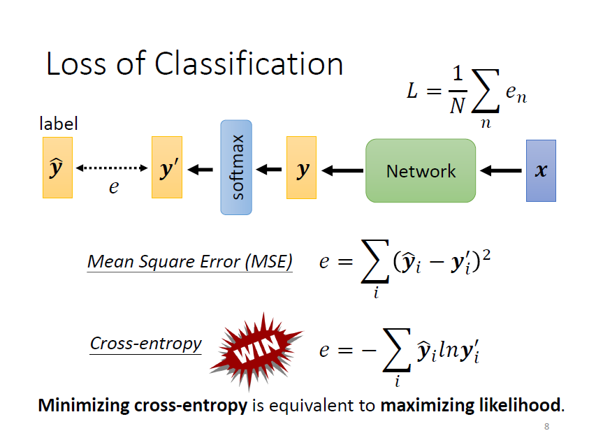

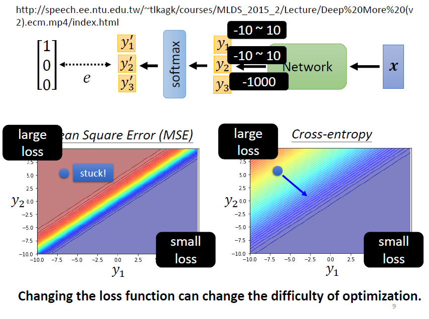

$$L = \frac{1}{N} \sum e_n$$

**需要理清 Batch、Iteration 和 Epoch 这三个层级**

1. Batch (批次)：数据集有 1000 个样本，设置 batch_size = 100。
2. Iteration (迭代)：每处理完这 100 个样本（算出一个 $L$ 并进行一次参数更新），就叫 1 次 Iteration。在上述例子中，跑完这 1000 个样本需要 10 次 Iteration。
    - 这个公式其实就是在每一次 Iteration 内部执行的逻辑。
        - 第一步：网络对 $N$ 个样本分别计算出各自的 $e_1, e_2, \dots, e_n$。
        - 第二步（应用公式）：程序执行 loss = sum(errors) / N。这就是你图里的那个公式 $L$！它把 $N$ 个散乱的误差压缩成了一个标量。
        - 第三步：执行 loss.backward()（反向传播）。计算梯度时，正是对这个平均值 $L$ 求导。
3. Epoch (轮次)：当这 1000 个样本全部参与过一次训练（也就是跑完 10 次 Iteration），这叫 1 个 Epoch。


**整体流程图解析图中从左到右：**
 
1. 输入 x → 经过 Network（神经网络） → 输出 y（logits，未归一化的分数）
2. y → 经过 softmax → 得到 y'（概率分布，即预测的概率）
3. y' 与 label（真实标签 $\hat{y}$） 比较 → 计算误差 e
4. 最终损失 L = (1/N) Σₙ eₙ（平均每个样本的误差）

✅ 注意： 这里的 $\hat{y}$ 是 one-hot 编码的真实标签，比如类别 3 在 5 类中就是[0, 0, 0, 1, 0]，y' 是 softmax 输出的概率向量，比如 [0.1, 0.2, 0.05, 0.6, 0.05]

**两种计算误差 $e$ 的数学方法，并明确指出 Cross-entropy（交叉熵）是赢家（WIN）**

1. MSE (均方误差)：$e = \sum_{i} (\hat{y}_i - y'_i)^2$
    - 本质上是衡量预测向量与真实向量之间的“距离”。
    - 在分类任务中，由于 Softmax 的性质，使用 MSE 会导致训练时出现梯度消失，模型学得极慢。

1. Cross-entropy (交叉熵)：$e = -\sum_{i} \hat{y}_i \ln y'_i$
    - 直接衡量的是“预测概率”与“真实概率”之间的相似度。
    - 在反向传播时，它的梯度计算非常简洁（直接等于预测值与真实值的差），能有效避免梯度消失，使模型训练又快又稳。

**推到**

数学模型设定

1. $i$：代表的是你正在关注的那个输出节点（即第 $i$ 个类别的概率）。$k$：代表的是求和时的索引（遍历所有的类别，从 1 到 $K$）。
2. 线性输出：$z_i = \sum w_{ij} x_j + b_i$
3. Softmax 输出：$y'_i = \frac{e^{z_i}}{\sum_k e^{z_k}}$
4. MSE 损失：$e = \sum_{k} (\hat{y}_k - y'_k)^2$

我们要计算 Loss 对线性层输入 $z_i$ 的导数：$\frac{\partial e}{\partial z_i}$。

我们定义 MSE 损失函数为：

$$e = \sum_{k=1}^K (\hat{y}_k - y'_k)^2$$

如果我们要算 $\frac{\partial e}{\partial z_i}$，我们看看 $z_i$ 出现在哪里：
1. $z_i$ 在 $y'_i$ 的公式里（它是分子）。
2. 同时，$z_i$ 也出现在每一个 $y'_k$ 的公式里（因为它是分母 $\sum_{j=1}^K e^{z_j}$ 的一部分）。

所以，$z_i$ 的变动会同时扰动 $y'_1, y'_2, \dots, y'_K$。根据多元函数的链式法则，我们不能只看某一项，必须计算总影响：

$$\frac{\partial e}{\partial z_i} = \frac{\partial e}{\partial y'_1} \frac{\partial y'_1}{\partial z_i} + \frac{\partial e}{\partial y'_2} \frac{\partial y'_2}{\partial z_i} + \dots + \frac{\partial e}{\partial y'_K} \frac{\partial y'_K}{\partial z_i}$$

$$\frac{\partial e}{\partial z_i} = \sum_{k=1}^K (\frac{\partial e}{\partial y'_k} \cdot \frac{\partial y'_k}{\partial z_i})$$

$\frac{\partial e}{\partial y'_k} $ 求导：

$$\frac{\partial e}{\partial y'_k} = 2(y'_k - \hat{y}_k)$$

$\frac{\partial y'_k}{\partial z_i}$ 求导的两种情况：

Softmax 的输出结果是一组概率，它们必须满足：

$$\sum_{k=1}^K y'_k = 1$$

当你调整输入 $z_i$ 时，总概率“蛋糕”的大小是固定的（必须是 1）。你增加 $z_i$ 导致 $y'_i$ 变大，必然会挤压其他 $y'_k$ 的份额。

在计算导数 $\frac{\partial y'_k}{\partial z_i}$ 时，我们用一个数学技巧叫 Kronecker delta ($\delta_{ki}$)，它的定义是：

1. 如果 $k = i$，$\delta_{ki} = 1$
2. 如果 $k \neq i$，$\delta_{ki} = 0$

你可以把 Softmax 的导数统一写成一个漂亮的公式：

$$\frac{\partial y'_k}{\partial z_i} = y'_k (\delta_{ki} - y'_i)$$

这个公式完美涵盖了两种情况：

1. 当 $k=i$ 时：$\delta_{ki}=1$，公式变为 $y'_k(1 - y'_i)$，即 $y'_i(1 - y'_i)$。
    - $z_i$ 增大，自身的概率增加，但受到分母增大的牵制。
2. 当 $k \neq i$ 时：$\delta_{ki}=0$，公式变为 $y'_k(0 - y'_i)$，即 $-y'_k y'_i$。
    - $z_i$ 增大，分母增大，导致其他类别的概率被“挤压”。

合并导数，将上面两部分代入求和公式：

$$\frac{\partial e}{\partial z_i} = \sum_{k} (y'_k - \hat{y}_k) \cdot \frac{\partial y'_k}{\partial z_i}$$

代入具体的 Softmax 导数：

$$\frac{\partial e}{\partial z_i} = 2(y'_i - \hat{y}_i) \cdot y'_i(1 - y'_i) + 2\sum_{k \neq i} (y'_k - \hat{y}_k) \cdot (-y'_k y'_i)$$

通过整理（省略部分代数简化过程），最终得到：

$$\frac{\partial e}{\partial z_k} = 2y'_k(y'_k - \hat{y}_k)$$

什么是模型的“自信” (Confidence)？

在 Softmax 输出层，我们得到的是一组概率 $y'_1, y'_2, \dots, y'_K$。
- “自信”：意味着其中某一个类别的概率非常大（趋近于 1），而其他类别的概率非常小（趋近于 0）。这种分布叫作“峰值分布”。
- “不自信”：意味着所有的类别概率都差不多（比如 3 分类，每个都是 0.33 左右）。这种分布叫作“平坦分布”。

“自信且错误”致命的梯度消失

1. 假设真实标签 $\hat{y}_k = 1$，但模型给出的概率 $y'_k = 0.01$。

2. 此时误差 $(y'_k - \hat{y}_k) = 0.01 - 1 = -0.99$。理论上你应该给予极大的修正力度（即负梯度要足够大）。

3. 但是，梯度公式里乘了一个 $y'_k$：

$$\text{梯度} = 2 \cdot (0.01) \cdot (-0.99) \approx -0.02$$

4. 结果：因为模型表现出“我不相信它是猫（自信）”，它产生的梯度信号被这个“自信度”系数 $y'_k$ 压制到了几乎为零。模型越是笃定地猜错，梯度越是小，导致模型学不动。

再看看交叉熵：

$$L = - \sum_{k} \hat{y}_k \ln(y'_k)$$

$$\frac{\partial L}{\partial z_i} = -(\hat{y}_i - y'_i) = y'_i - \hat{y}_i$$

1. 观察差别：交叉熵的梯度公式里没有任何系数乘子！
2. 在上述“自信且错误”的场景下（$y'_k = 0.01, \hat{y}_k = 1$）：

$$\text{梯度} = 0.01 - 1 = -0.99$$

3. 对比：MSE 的梯度只有 -0.02，而交叉熵的梯度是 -0.99。

总结：两者的博弈

| 模型状态 | MSE 的表现 (梯度) | 交叉熵的表现 (梯度) |
| :--- | :--- | :--- |
| **错得很离谱（盲目自信）** | **极小** (被 $y'_k$ 压死，学不动) | **极大** (强力修正，效果好) |
| **快学对了（正常学习）** | 中等 | 中等 |
| **完全学对了（饱和）** | 极小 | 极小 |

**“Minimizing cross-entropy is equivalent to maximizing likelihood.**

“最小化交叉熵” 只是我们训练时的具体手段，它的本质目的就是 “让模型认为真实标签出现的概率达到最高”。

什么是“似然（Likelihood）”？

“似然”可以理解为：在当前的权重参数下，模型预测出的结果，有多大可能性正好就是我们手中的真实标签。

1. 如果模型预测：“这张图是猫的概率是 99%”，而真实标签确实是“猫”，那么这个预测的“似然值”就很高。

2. 如果模型预测：“这张图是猫的概率是 1%”，而真实标签是“猫”，那这个预测的“似然值”就极低。

我们训练模型的目标，就是找到一套最好的权重参数，使得模型在所有训练数据上的“似然值”达到最大。这叫极大似然估计（Maximum Likelihood Estimation, MLE）。

# CNN

卷积神经网络(CNN) 是一种专门用于分析视觉数据的人工神经网络。 

## Image Classification

### 基本步骤

1. 把所有图片都先 rescale 成大小一样
2. 把每一个类别表示成一个个 one-hot vector（dimension 的长度決定模型可以辨别出多少不同类别的东西）
3. 将图片输入到模型中

### 将图片输入到模型中

为什么深度学习在处理影像任务时，不能单纯依靠“全连接层”（Fully Connected Network, FCN）？

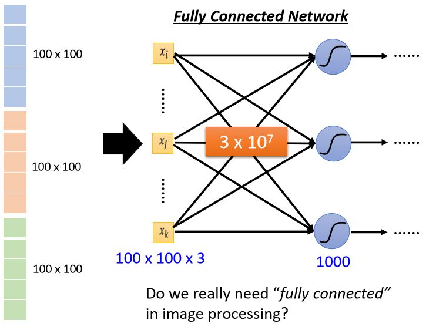

图中通过一个数学计算展示了“全连接”架构的低效：

1. 输入端：假设输入一张 $100 \times 100$ 的彩色图片（RGB 三个通道），像素点总量为 $100 \times 100 \times 3 = 30,000$。
2. 网络连接：如果第一层就有 1,000 个神经元（neuron），且每个神经元都与每一个输入像素连接。
3. 计算结果：需要的权重（weight）数量就是 $30,000 \times 1,000 = 3 \times 10^7$（即 3,000 万个参数）。

带来的负面影响：

1. 计算资源浪费：仅仅第一层就需要处理 3,000 万个参数，这在工程上是非常巨大的负担。
2. 过拟合 (Overfitting) 风险：参数数量过多会显著增加模型的复杂度，虽然这理论上能增加模型的“能力”，但也让模型极易在训练数据上产生过拟合，导致无法处理未见过的图片。

## 神经元角度介绍 CNN

### 观察一

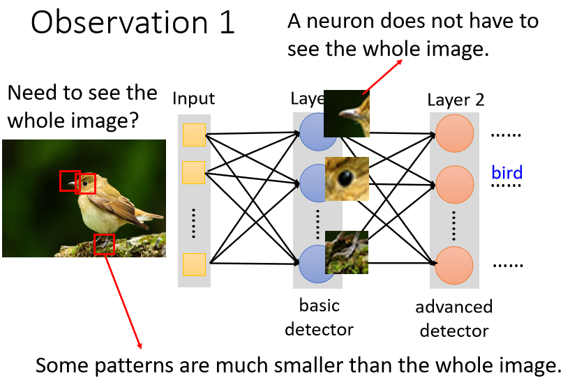

模型通过识别一些特定 patterns 來识别物体，而非整张图片。

neuron 也许根本不需要把整张图片当作输入，只需把图片的一小部分当作输入，就足以判断某些特別关键的 pattern 有沒有出现。

### 简化一

在卷积神经网络（CNN）中，感受野（Receptive Field） 指的是：输出端的一个神经元，能够“看到”原始输入图片上的区域大小。

1. 如果一个神经元只能感知原图 $3 \times 3$ 的像素区域，那么这个神经元的感受野就是 $3 \times 3$。
2. 如果通过层层叠加，它能感知到原图 $100 \times 100$ 的区域，那它的感受野就是 $100 \times 100$。

为什么它很重要？

1. 视野太小：神经元只能看到图像的局部细节（比如点、线），无法理解物体的整体结构（比如认不出这是一整只鸟）。

2. 视野太大：计算量会急剧增加（正如第一张图所示，会导致参数爆炸），且容易忽略掉那些小的、关键的细节（比如鸟喙）。

深度学习设计的艺术，就是通过堆叠不同的卷积层，让感受野从“小”慢慢变“大”，从而实现从“看局部”到“看全局”的进化。

每个神经元只需要考察自己特定范围内的图像信息，我们不是把整张 $100 \times 100$ 的大图展平，而是通过一个“滑动窗口”（也就是卷积核/Filter），每次只截取图像的一小块（例如 $3 \times 3$ 或 $5 \times 5$ 的小方块）。我们将这一小块的局部数据进行数学处理（比如加权求和），然后再输入给神经元。

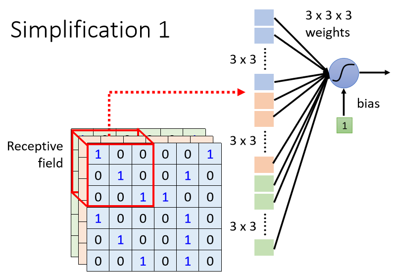

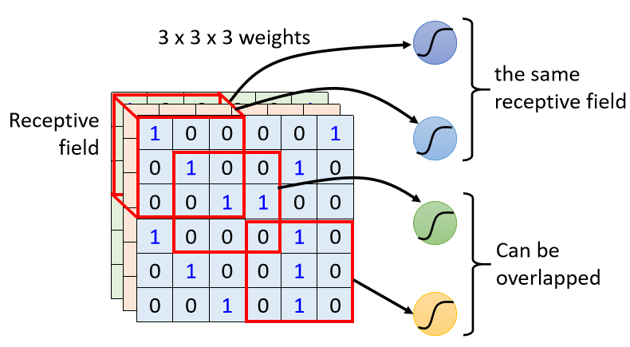

逐步拆解图示：

1. 左侧的立方体（输入数据）：
    - 这是一张彩色图片，有 3 个颜色通道（RGB）。
    - 你可以把它想象成一个长、宽都是 3，高是 3 的数据块。
2. 红色的方框（感受野/Receptive Field）：
    - 这是这个神经元（右侧蓝圈）的“视野窗口”。
    - 它的大小是 $3 \times 3$，因为图片有 3 层，所以它的厚度也是 3。
    - 关键点： 这个神经元只看红框里的这 $3 \times 3 \times 3 = 27$ 个像素点的数据，完全忽略红框外面的其他像素。
3. 中间的连线（局部连接）：
    - 图中的红色虚线箭头，表示把红框里的 27 个像素数值“提取”出来，一一对应地连接到右侧的神经元。
    - 右侧的圆圈（神经元的工作）：
        - 这个蓝圈就是这一个神经元。
        - 它接收了左边传来的 27 个像素值。
        - 它对这 27 个输入值，分别乘以 27 个权重（weights，图中标注为 $3 \times 3 \times 3$ weights），然后求和。
        - 再加上一个偏置（bias，图中标注为 1）。
        - 最后通过一个激活函数（那个波浪线符号），输出一个数值。

卷积到底是个啥：

所谓的“一层卷积”，其实就是无数个像这样的小神经元排成一排（或者摞在一起）

1. 每个神经元都有自己独立的 $3 \times 3 \times 3$ 的权重集（脑子里的知识）。
2. 它们并没有连在一起，而是像盖章一样，在输入图片上从左到右、从上到下滑动（这叫 Stride）。
3. 每滑动到一个位置，那个神经元就看一眼盖住的局部区域，计算出一个数值，作为输出图像的一个像素点。

注意：

1. receptive field 之间可以重叠
2. 一个 receptive field，我们可以安排“多个不同职责”的神经元进行并行处理
3. receptive field 可以有大有小
4. receptive field 可以只考虑某一些 channel
5. receptive field 可以是长方形
6. receptive field 不一定要相连

### 感受野的典型设置

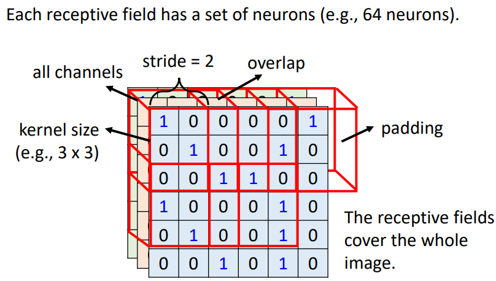

概念：

1. 什么是“守备”？在卷积神经网络中，“守备” (Coverage) 指的是一个或一组神经元对特定空间位置（感受野）的特征提取责任。
    - 当一个 $3 \times 3$ 的感受野在图片上滑动时，在这个固定的 $3 \times 3$ 空间坐标内，网络需要提取出多种不同维度的特征（比如有的神经元专门找边缘，有的找颜色，有的找纹理）。
    - 我们将这一组负责处理该空间区域的神经元集合，形象地称为“守备”该区域。

我们可以把它看作是 CNN 架构设计的“配置清单”，以下是详细解读：

1. Each receptive field has a set of neurons (e.g., 64 neurons)：
    - 这意味着对于每一个感受野（红框覆盖的区域），我们不是只用一个神经元去“看”，而是安排了一组神经元（比如 64 个）同时工作。每个神经元都有自己独特的权重，负责提取该区域内的一种特定特征（如边缘、颜色或纹理），这直接决定了输出特征图的深度。
2. all channels：
    - 卷积运算会同时考量输入数据的所有通道（例如彩色图像的 R、G、B 三个通道）。感受野在计算时，其深度必须与输入数据的通道数保持一致，从而获取该局部区域完整的颜色和深度信息。
3. kernel size (e.g., 3 x 3)：
    - 定义了感受野在空间上的长与宽。它是卷积核的大小，决定了神经元一次能“看”到的图片范围。在影像辨识中，通常不设置过大的 kernel size，最常见的是 $3 \times 3$，以平衡特征提取能力与参数量。
4. stride = 2：
    - 这是“步长”，即感受野在图片上滑动的位移距离。图中显示每次向右滑动 2 个像素格。它直接影响输出图像的尺寸，步长越大，输出图像越小。
        - 如果步长 Stride = 1：你移动得很细致，每走 1 个像素就切一下。你会切下很多张照片（输出尺寸大）。
        - 如果步长 Stride = 2：你每走 2 个像素才切一下。因为你“跳着走”，所以你完成扫描所需的总步数变少了，最后生成的“裁剪图”数量自然就变少了（输出尺寸小）。
5. overlap：
    - 指的是相邻感受野之间的重叠部分。设置重叠是为了避免在窗口滑动的过程中，恰好位于边界处的关键图案（pattern）被遗漏，确保特征提取的连续性。
    - 想象你有一个巨大的图案（比如一个字母 "A"），如果你的感受野（红框）滑动时完全不重叠，就像跳棋一样走：
        - 如果不重叠：假设第一个框（感受野）正好切到了字母 "A" 的左半部分，而第二个框接着往右跳，正好切到了 "A" 的右半部分。如果中间没有任何交集，这两个神经元可能都只看到了 "A" 的“碎片”，而无法完整地感受到这个形状。
        - 如果有重叠：感受野之间有交叉区域，这意味着第二个框也观察到了第一个框观察过的一部分边缘信息。这种交叉让神经元能够“衔接”起图案的轮廓，确保关键图案不会因为刚好落在窗口边界上而被“咔嚓”掉。
6. padding：
    - 这是“填充”技术，用于处理当感受野移动到图片边缘时，超出范围的情况。通过在原图周围填充额外的像素（如补 0），可以确保图像边缘的信息也能被感受野捕捉到，防止特征丢失。
7. The receptive fields cover the whole image：
    - 这是卷积神经网络的目标，通过滑动窗口机制，确保感受野的移动能够覆盖原始图片的每一个角落，从而完整地提取整张图的特征。

### 观察二


权重共享（Weight Sharing/Parameter Sharing），如果没有“权重共享”，逻辑会变成这样：

1. 如果我们要识别“鸟嘴”，图片左上角有一个神经元专门识别左上角的鸟嘴，右上角有一个神经元识别右上角的鸟嘴。

2. 结果：你需要为图片的每一个位置都训练一套完整的、独立的“鸟嘴识别”参数。这会导致参数量极其庞大，且完全无法泛化（如果你训练的是识别“左上角的鸟嘴”，那右下角出现一个鸟嘴时，网络就认不出来了）。

侦测同样 pattern 的神经元做的工作是一样的，尽管守备的 receptive field 不一样，但参数会是一样的。

1. 逻辑转换：不论鸟嘴出现在图片的蓝色框位置，还是红色框位置，其实质都是一个“鸟嘴”图案。

2. 核心机制：既然 pattern 是一样的，我们就只训练一组“鸟嘴探测器”的权重参数（例如那 $3 \times 3$ 的权重矩阵）。

3. 滑动扫描：让这组共享的权重在全图范围内滑动扫描，只要某处出现了符合该权重的特征，神经元就会触发，告诉系统“我检测到了鸟嘴”。

### 简化二Parameter Sharing


在实际设计中，我们在同一个感受野区域内，会并行放置一组（Set）神经元，比如 64 个。

1. 多重探测器：这 64 个神经元就像是 64 个不同的“专家”，它们同时盯着同一个感受野区域。

2. 分工不同：

    - 神经元 1 可能专门负责探测“垂直边缘”。

    - 神经元 2 可能专门负责探测“圆圈”。

    - 神经元 3 可能专门负责探测“某种特定颜色”。

3. 并行输出：因为有 64 个神经元在同一个感受野工作，所以这一个感受野位置最终会输出 64 个不同的特征值，这就构成了输出特征图（Feature Map）的 64 个“深度”（通道）。

CNN 中的准确描述是：

1. 总共的专家组数：在这一层中，共有 1000 个不同的空间位置（感受野）需要被处理。

2. 每个位置的配置：在每一个空间位置上，都有 64 个不同的专家（Filter）在协同工作。

3. 参数共享的约束：

    - 这 1000 个空间位置中的第 1 号专家（Filter 1），它们共享同一组权重参数。

    - 这 1000 个空间位置中的第 2 号专家（Filter 2），它们共享另一组权重参数。

    - 以此类推，这 64 个不同的专家组，各自拥有自己的一套权重参数，并在 1000 个位置上重复使用。

4. “64 个专家神经元”：这对应的是输出通道数 (Output Channels)。

    - 在卷积神经网络中，每一个感受野位置确实都由一组神经元（专家）守备。

    - 如果这组神经元有 64 个，就意味着这一层卷积层有 64 个 Filter（卷积核），它们会并行对每一个感受野区域提取 64 种不同的特征。

### Convolutional Layer


这张图用“包含关系”直观地展示了为什么卷积层（Convolutional Layer）实际上是“受限版”的全连接层（Fully Connected Layer），并解释了这种“限制”带来的巨大好处。

以下是核心逻辑解读：

1. 为什么说卷积层是“受限”的全连接层？
    - 全连接层（FC）非常“自由”，它允许每个神经元连接输入端的任何像素，并且每个连接都有自己独立的权重。卷积层则通过引入两项“限制”给自己套上了枷锁：
        - 感受野（Receptive Field）限制：卷积层强迫神经元只能关注局部区域，而不能像全连接那样一次性“纵览全局”。
        - 权重共享（Parameter Sharing）限制：卷积层强迫不同位置的神经元必须共用同一套权重参数（Filter），而不能像全连接那样为每个位置的神经元单独学习参数。

2. 为什么要“自找麻烦”施加这些限制？（分析部分）
    - 你可能会问，既然全连接层更自由，为什么还要限制它？答案就在于“模型偏差（Model Bias）”与“过拟合（Overfitting）”之间的博弈：
        - 全连接层：Jack of all trades, master of none。
            - 它是一个非常灵活的模型，几乎可以学习任何东西。但也正因为这种“漫无目的”的自由，当面对图像数据时，它太容易过拟合（Overfitting）了——它尝试记住每一个像素的细微差别，而不是提取本质特征。
    - 卷积层：Larger model bias (for image)。
        - 卷积层通过引入这些“限制”，实际上是向模型中注入了对图像数据的先验知识（Prior Knowledge）：
            - 图像的特征通常是局部的（由感受野实现）。
            - 同样的特征（比如鸟嘴）会在图像的不同位置反复出现（由权重共享实现）。
        - 这种“偏见（Bias）”反而让模型在处理影像任务时更专注、更高效，从而在特定任务上做得更好。

总结

1. 这张图的核心思想是：“限制”即“专业化”。

2. 通过丢弃全连接层的通用性（Flexibility），卷积层利用了影像数据的空间特性，大大减少了参数量，不仅防止了过拟合，还通过“权重共享”让模型学到的特征更具有普适性（平移不变性），从而在图像识别领域远胜于原始的全连接层。

## 滤波器角度介绍CNN

### 卷积层基本定义


这张图展示的是 CNN 中单个卷积核（Filter）如何通过滑动计算生成特征图（Feature Map）的过程，正好对应我们刚才聊的“每一个 Filter 负责抓取一种 Pattern”。

具体拆解如下：

1. 输入图像 (6 x 6 image)

左下角是一个 $6 \times 6$ 的单通道图像矩阵。单通道意味着每个像素点只需要一个数值就能表示。最典型的就是灰度图（Grayscale Image）。蓝色方框代表卷积核当前的感受野（Receptive Field），大小是 $3 \times 3$，每次移动的步长（stride）是 $1$。

2. 卷积核 (Filter 2)

上方展示的是当前使用的卷积核 Filter 2，矩阵内容为：

$$\begin{bmatrix} -1 & 1 & -1 \\ -1 & 1 & -1 \\ -1 & 1 & -1 \end{bmatrix}$$

- 权重参数（Weights）： 矩阵里的这些数字（$-1, 1, -1 \dots$）就是神经元中的权值。
- 它在抓取什么 Pattern？ 注意看 Filter 中间一列是 $1$，左右两列是 $-1$。这种结构的 Filter 对中间高、两边低/高的垂直线条非常敏感（用来检测垂直纹理）。

3. 滑动与点积运算 (Do the same process for every filter)

Filter 在 $6 \times 6$ 的图像上从左到右、从上到下按步长为 1 进行滑动：

- 每到一个位置，将 Filter 中的数字与图像对应位置的像素值逐元素相乘再相加（即“内积/点积”）。
- 算出来的结果填入右边的阵列中，最终形成一个 $4 \times 4$ 的特征图（Feature Map）。

底部文字解释

“卷积层中有若干个 filters，每个 filter 可以“抓取”图片中的某一种 pattern... filter 的参数就是神经元中的“权值（weight）”

这就是我们刚才说的  Channel 逻辑：

1. 如果只有 Filter 1，可能只能提取“横线”特征；
2. 加上图中的 Filter 2，就能提取“竖线”特征；
3. 如果一个卷积层有 64 个 Filter，就会输出 64 个 Feature Map（即 64 个 Channel），分别记录图片在 64 种不同特征下的响应强度。

### 多层卷积


假设我们要处理一张猫的图片：

1. 多层（Multiple Layers）：信息的“加工流水线” 
    - 含义：代表先后顺序的深度。
    - 比喻：工厂的工序。
        - 第一层：负责提取简单的基础特征（比如线条、边缘、斑点）。
        - 第二层：把第一层出来的特征组合起来，提取局部部位（比如猫耳朵、猫眼睛、猫须）。
        - 第三层：把局部组合成完整概念（比如猫脸、全身）。
    - 对应图中：从上往下的箭头（Convolution -> Convolution -> ...）就是多层。
 
2. 通道数（Channels）：同一工序里的“专家团队种类”
    - 含义：代表同一时间并行提取的不同特征种类。
    - 比喻：第一道工序（第一层）里有 64 个不同的专家在同时看图：
        - 专家 1 专门找“垂直边缘”；
        - 专家 2 专门找“水平纹理”；
        - ...
        - 专家 64 专门找“黄色斑点”。
    - 对应图中：64 channels 和堆叠起来的 64 层圆圈。每一层圆圈（通道）就是某一个专家提取出来的特征全貌。

3. 神经元（Neuron）：输出矩阵里的“每一个独立数值”
    - 含义：神经网络最基本的计算单元（输入数据 $\rightarrow$ 乘以权重加偏置 $\rightarrow$ 激活函数 $\rightarrow$ 输出一个数）。
    - 判定方法：在特征数据张量（Tensor）中，每一个单元格/像素点，就是一个神经元！
    - 对应图中：
        - 输出特征图大小为：高 $4 \times$ 宽 $4 \times$ 深度（通道）$64$。
        - 神经元总数 $= 4 \times 4 \times 64 = 1024$ 个。
        - 意思是：这一层有 1024 个计算节点在输出结果。

4. 滤波器/卷积核（Filter / Kernel）：提取特征的“专家工具箱”
    - 含义：带有权重参数的小矩阵（扫描仪），是负责在特征图上滑动并进行乘加运算的计算单元。
    - 比喻：工序里每个专家手里拿的专属检测仪。比如专门用来找垂直边缘的 $3 \times 3$ 矩阵模板。
    - 核心联动关系：
        - 决定通道数：当前层用了多少个不同的 Filter，就会输出多少个通道（Channel）的 Feature Map。
        - 匹配上一层：如果上一层有 $C$ 个 Channel，那么当前层的每一个 Filter 的深度就必须是 $C$（即尺寸为 $3 \times 3 \times C$）。
    - 对应图中：
        - 左侧标注的 64 filters（代表当前层派出了 64 个不同的 Filter 并行工作）。
        - 下方标注的 Filter: 3 x 3 x 64（代表第二层的每一个卷积核，其空间大小是 $3 \times 3$，深度必须匹配上一层输出的 64 个 Channel）。

多层卷积（Multiple Convolutional Layers）的数据流动规则：

1. 上一层用 $N$ 个 Filter $\rightarrow$ 输出 $N$ 个通道的 Feature Map $\rightarrow$ 下一层的每一个 Filter 的深度就必须是 $N$。

#### 让小卷积核看到大 pattern


**随着卷积层越来越深，即使只是 $3 \times 3$ 的 filter，看到的范围实际上会越来越大。**

## 神经元角度VS滤波器角度


卷积神经网络（CNN）中“神经元（Neuron）”与“滤波器（Filter/Kernel）”这两种视角在数学和逻辑上的等价性（They are the same story）。

简单来说，它们是从两个不同角度描述了同一个计算过程：

1. 两个视角分别是怎么看待卷积的？
    - 神经元视角（Neuron Version Story）
        - 局部感受野（Receptive Field）：传统的全连接网络中，一个神经元会连接输入图像的所有像素。但在 CNN 中，每个神经元只看一小块区域（比如 $3\times3$ 的像素块）。
        - 参数共享（Weight Sharing）：滑到图像不同位置的许多神经元，它们的连接权重（即 $3\times3$ 个权重值）是完全一样的。图中红、黄、绿色的连接线，就对应右侧 Filter 矩阵里的红、黄、绿圈出的权重数字。
    - 滤波器视角（Filter Version Story）
        - 模式检测器（Pattern Detector）：我们有一组固定大小的滤波器（比如 $3\times3\times \text{channel}$ 的张量），用来识别特定的图像特征（比如垂直边缘、角落或颜色组合）。
        - 卷积滑动（Convolution）：同一个 Filter 在整张输入图像上滑动做内积（Convolve），提取出整张图的特征图（Feature Map）。
        
2. 它们为什么是“同一个故事”？这张图画得非常直观：
    - 右边的 Filter：本质上就是一个包含了 $3\times3 = 9$ 个权重参数（Weights）的张量。
    - 左边的 Neuron：这个神经元接收来自 Receptive Field（$3\times3$ 区域）的 9 个输入值，乘以这 9 个权重，加和后通过激活函数 $\sigma$ 输出。
    - 当这个神经元滑动到图像的下一个 $3\times3$ 区域时，在神经元视角下，这是“另一个神经元，但共享了上一组参数”；而在滤波器视角下，这是“同一个 Filter 滑到了下一个位置”。

## Subsampling


卷积神经网络（CNN）中的 下采样 / 池化操作（Subsampling / Pooling） 的核心思想和性质。

核心思想：下采样（Subsampling）

“Subsampling the pixels will not change the object”（对像素下采样不会改变图中的物体）

直观理解：如 PPT 中的鸟类图片所示，如果你把一张高分辨率图片的偶数行、奇数列像素直接删掉（即图像缩小一半），人眼依然能一眼看出来这是一只“鸟（bird）”，并不会因为分辨率变低了就把它认成“狗”。
1. 目的：减少运算量
2. 在神经网络中，把特征图（Feature Map）缩小（比如从 $100\times100$ 降到 $50\times50$），数据量直接缩减为原来的 $\frac{1}{4}$，可以大幅降低后续卷积层的计算量，同时还能提高对微小变形/位移的平移不变性（Invariance）。

核心思想：池化（Pooling）

Pooling（池化）是卷积神经网络（CNN）中用来降低特征图（Feature Map）尺寸、减少数据运算量的一种下采样（Subsampling）操作。

简单来说，它的本质就是：“降采样/删减像素，保留最核心的特征信息”。

Pooling 并不是一个包含了需要学习的权重的“实体网络层”，而是一个像 ReLU 一样无参数的“数学操作函数（算子）”。它根据输入数据的具体内容，动态地挑选或计算出最关键的特征进行下采样。

### 不同Pooling方法

| 图片1 | 图片2 |
| ----- | ----- |
|  |  |

Max Pooling（最大池化）的具体计算过程，它用左右两组矩阵对比，直观展示了数据是如何被“筛选”并缩小的。

1. 图中的核心元素说明
    - Filter 1 & Filter 2：这是上一步卷积层用到的两个不同的滤波器（卷积核）。
    - 左边的矩阵（红色 & 蓝色）：这是卷积计算后输出的 Feature Maps（特征图）。
        - 红色部分：经过 Filter 1 卷积后得到的特征图（包含 4 个 $2\times2$ 的小区域）。
        - 蓝色部分：经过 Filter 2 卷积后得到的特征图（同样划分成 4 个 $2\times2$ 的区域）。
    - 右边的矩阵：这是经过 Max Pooling（最大池化）后输出的结果。

2. Max Pooling 是怎么算出来的？看图中的对应关系就一目了然了：它的规则就是在每个 $2\times2$ 的小方框里，只挑出数值最大的那一个数。
    - 以红色（Filter 1）的 4 个区域为例：
        - 左上角区域 $\{3, -1, -3, 1\} \xrightarrow{\text{取最大值}} \mathbf{3}$
        - 右上角区域 $\{-3, -1, 0, -3\} \xrightarrow{\text{取最大值}} \mathbf{0}$
        - 左下角区域 $\{-3, -3, 3, -2\} \xrightarrow{\text{取最大值}} \mathbf{3}$
        - 右下角区域 $\{0, 1, -2, -1\} \xrightarrow{\text{取最大值}} \mathbf{1}$
    - 再看蓝色（Filter 2）的左上角区域：
        - $\{-1, -1, -1, -1\} \xrightarrow{\text{取最大值}} \mathbf{-1}$（注意负数里 $-1$ 比其他负数大）
        - 右图就只保留了这些选出来的“代表数字”，其余位置全部舍弃。

3. 这张图想表达什么本质？
    - 通道独立性（Channel-wise）：
        - Filter 1 和 Filter 2 生成的特征图是各自独立做 Pooling 的，互不干扰，通道数（Channel）保持不变。
        - 尺寸减半（Downsampling）：原本每个特征图是 $4\times4$ 像素（由 4 个 $2\times2$ 区域组成），经过池化后变成了 $2\times2$ 的矩阵，长宽各缩减了一半，数据量直接减少了 75%。
        - 保留强响应特征：无论区域里其他像素表现如何，只要有一个位置响应极强（数值高），这个信号就会被无损地传导给下一层。

## The whole CNN

| 图片1 | 图片2 |
| ----- | ----- |
|  |  |


经典的 CNN 分类网络架构

| 网络阶段 | 空间尺寸（高 $H \times$ 宽 $W$） | 通道数（通道 $C$） | 数据的整体形状 | 阶段主要职责 / 作用 |
| :--- | :--- | :--- | :--- | :--- |
| **原始输入** | $224 \times 224$ (原始分辨率) | **3** (RGB 颜色通道) | $224 \times 224 \times 3$ | 原始图像数据输入 |
| **浅层 Block 1** | $112 \times 112$ (降采样 $1/2$) | **64** (聘请 64 个专家) | $112 \times 112 \times 64$ | 提取基础特征（边缘、颜色、角落） |
| **中层 Block 2** | $56 \times 56$ (降采样 $1/4$) | **128** (专家翻倍) | $56 \times 56 \times 128$ | 组合基础特征（纹理、简单图案） |
| **深层 Block 3** | $28 \times 28$ (降采样 $1/8$) | **256** (专家再翻倍) | $28 \times 28 \times 256$ | 提取局部结构（器官、部件、轮廓） |
| **末端 Block 4** | $7 \times 7$ (极其微小) | **512 / 2048** (专家极大化) | $7 \times 7 \times 512$ | 提取高级语义（完整物体、抽象概念） |
| **Flatten（展平层）** | **无空间结构** | **无通道概念** | **$25,088$** ($7 \times 7 \times 512$) | **格式转换**：将 3D 特征块拉平为 1D 特征向量 |
| **Fully Connected（全连接层）** | - | - | **$1,024 \rightarrow 512$** | **综合推理**：对展平后的所有特征打分加权 |
| **Softmax（分类输出层）** | - | - | **$N$**（如 1000 分类） | **结果输出**：计算概率（如猫 $85\%$、狗 $10\%$） |

## CNN应用

Alpha Go，语音和NLP

## CNN的缺陷

1. 为什么 CNN 搞不定“平移之外”的变换？
    - CNN 最骄傲的特性是平移不变性（Translation Invariance）——主要依靠卷积核滑动（参数共享）和 Pooling 操作。无论猫在左上角还是右下角，CNN 都能认出来。
    - 但是，CNN 对尺度变化（Scale）和旋转变化（Rotation）天生是无能为力的：
        - 关于缩放（Scale）：
            - 卷积核的感受野（Receptive Field）是固定的（比如 $3\times3$）。
            - 一张小猫脸可能恰好占满了 $3\times3$ 的区域，网络识别出了“猫耳”特征；但如果把这张图片放大 5 倍，猫耳变得巨大，原先的 $3\times3$ 卷积核只能看到猫耳边缘的一小块皮肤纹理，根本识别不出这是耳朵了。
        - 关于旋转（Rotation）：
            - 卷积核的权重矩阵（例如横向边缘检测器 $\begin{bmatrix} -1 & 0 & 1 \end{bmatrix}$）是有固定方向性的。
            - 如果图片顺时针旋转了 90°，原本的横向边缘变成了纵向边缘，原来的卷积核激活响应就会剧烈下降，甚至完全失效。

2. 数据增强（Data Augmentation）在干什么？既然神经网络自身没有这种“旋转/缩放平移不变性”，最直接、最工程化的解决办法就是：在训练时，强制让网络见多识广。
    - 在训练每个 Epoch 时，对输入图片施加随机变换：
        - 随机裁剪与缩放（Random Crop & Scale）：让网络学会识别不同尺寸下的同一物体。
        - 随机旋转与翻转（Random Rotation & Flip）：让网络学习到“倒着的猫”或“侧着 45° 的猫”依然是猫。
        - 其他扰动：加上平移、色彩抖动（Color Jitter）、高斯噪声等。

# Self-attention

## 输入是向量序列

| 图片1 | 图片2 |
| ----- | ----- |
|  |  |


如何把“人类语言的文字”转换成“计算机能看得懂的数学向量（Vector）”。

图中对比了两种不同时代的技术思想：One-hot Encoding（独热编码） vs Word Embedding（词嵌入）。

1. 左边：One-hot Encoding（传统/死板的方法）
    - 做法，建一个极其庞大的字典（比如包含全网 10 万个词）。每个词对应向量里的一个位置，只有自己那个位置写 1，其他所有地方都写 0。
        - apple    = [1, 0, 0, 0, 0 ...]
        - bag      = [0, 1, 0, 0, 0 ...]
        - cat      = [0, 0, 1, 0, 0 ...]
    - 核心缺陷：
        - 维度灾难（维度过高/过于稀疏）：字典有 10 万个词，向量长度就是 10 万，极度浪费内存。
        - 完全没有语义联系（无法表达词与词的关系）：
            - 在几何上，任意两个 One-hot 向量（如 cat 和 dog）做点积（Dot Product）结果都是 0（正交）。
            - 计算机无法知道“猫”和“狗”都是动物，反而觉得“猫”和“苹果”的亲疏关系跟“猫”和“狗”一模一样。

2. 右边：Word Embedding（现代/聪明的嵌入方法）
    - 做法：不再用包含几万个 0 的长向量，而是把每一个词映射到一个低维度的连续实数空间（通常是 128、512 或 768 维）。
    核心优势：包含了“语义信息（Semantic Information）”：
        - 如右侧坐标图所示，通过神经网络学习后，语义相近的词，在空间里的距离会靠得非常近！
        - 动物类（dog、rabbit、cat）：在空间里聚在一起。
        - 动作类（run、jump）：在另一块区域聚在一起。
        - 植物类（tree、flower）：在第三块区域聚在一起。
        - 甚至还能做数学上的向量加减法（语义计算）：

$$\text{Vector}(\text{"King"}) - \text{Vector}(\text{"Man"}) + \text{Vector}(\text{"Woman"}) \approx \text{Vector}(\text{"Queen"})$$


给每一个词汇一个向量，这个向量是包含语义信息的，而一个句子就是一组长度不一的向向量

1. 一个词 $\rightarrow$ 一个 Embedding 向量（比如维度为 $512$）。
2. 一个句子（如包含 10 个词） $\rightarrow$ 一组向量组成的矩阵（尺寸为 $10 \times 512$）。

### 声音信号处理


如何把一连串连续的“声音波形”，切碎并转换成计算机能处理的“向量序列”。

1. 核心概念拆解
    - 波形（Waveform）：图中的蓝色震动线条是连续的声音信号（模拟或采样后的数字音频）。
    - 窗口 (Window)：
        - 因为声音是随时间变化的流数据，模型不可能一次性处理一整段音频。
        - 所以用一个固定时间长度的“小框框”（比如图中标注的 25ms）去截取一小段声音。
    - 帧 (Frame) 与 向量 (Vector)：
        - 这个 25ms 窗口里的音频数据，经过频域变换（如傅里叶变换 FFT、MFCC 或 Log-Mel 声学特征提取）后，会变成一个描述该时间段声音特征的向量。
        - 这个向量，就叫做一帧（Frame）。


### 图像信号处理


图神经网络（Graph Neural Networks, GNN）如何把“图结构数据（Graph）”转换成模型可处理的向量。

1. 例子一：社交网络（Social Networks）
    - 图的构成：
        - 节点（Node/Vertex）：社交网络里的每个人。
        - 边（Edge）：人与人之间的好友/关注关系（图中连接头像的虚线）。
    - 节点变成向量（Node as Vector）：
        - 图中每个人头顶上立着的彩色柱状图（Each profile is a vector），代表这个人的特征向量。
        - 比如：把用户的性别、年龄、职业、兴趣标签等数字化，拼成一个数组（如 $[28, 1, 0, 85, \dots]$）。
    - 核心理解：整个社交网络就变成了一个由一堆节点向量 + 节点之间的连接关系矩阵（邻接矩阵 Adjacency Matrix）共同组成的图数据。
    
2. 例子二：分子结构（Molecular Structures）
    - 图的构成：
        - 节点（Node）：分子结构里的每一个原子（图中不同颜色的球）。
        - 边（Edge）：原子之间的化学键（连接球的杆）。
    - 节点变成向量（Node as Vector）：
        - 图中用 One-hot Vector（独热编码） 来标识原子的种类：
            - 氢原子 $H = [1, 0, 0, 0, 0 \dots]$
            - 碳原子 $C = [0, 1, 0, 0, 0 \dots]$
            - 氧原子 $O = [0, 0, 1, 0, 0 \dots]$
    - 核心理解：一个复杂的化学分子（如药物分子、蛋白质），在计算机眼中就是一个由“原子类型向量”和“化学键拓扑”构成的图。


3. 一句话总结这一系列 PPT 的核心脉络，从文字、语音到这里的图，其实是在传达深度学习万物皆可向量化的统一建模思想：

$$\begin{aligned} \text{图像 (CV)} &\rightarrow \text{规则的 2D 像素矩阵} \\ \text{文本 (NLP)} &\rightarrow \text{一维词向量序列} \\ \text{语音 (Audio)} &\rightarrow \text{一维帧向量序列} \\ \text{图 (Graph)} &\rightarrow \text{不规则节点向量网格 + 拓扑连接关系} \end{aligned}$$

只要你能把现实世界的对象（图片、文字、声音、社交关系、分子）表征成包含特征的向量，深度学习模型（CNN、RNN/Transformer、GNN）就能通过矩阵运算来进行推理和预测

## 输出的三种可能性

### 每一个向量都有一个对应的的标签


核心概念：每一个输入向量，对应一个输出标签

1. 输入：$N$ 个向量（如包含 $N$ 个词的句子、包含 $N$ 帧的音频、包含 $N$ 个节点的社交图）。
2. 输出：$N$ 个标签（如 $N$ 个分类结果）。
3. 特点：输入与输出的长度完全一致（$N \rightarrow N$）。模型不需要自己去预测“输出应该在何时结束”，每个输入位置都绑定一个确定的输出位置。

### 一组向量序列输出一个标签


核心概念：多对一（Many-to-One）
1. 输入：$N$ 个向量组成的序列（如一整句话、一段音频、一个完整分子）。
2. 输出：单个标签或分类数值（分类/回归结果）。
3. 本质：模型需要将整个序列的信息进行聚合（Pooling / Aggregation），提炼出整段数据的全局语义。

### 模型自行決定输出多少个标签


核心概念：模型自行决定输出长度（$N \rightarrow N'$）
1. 输入：$N$ 个向量（如长度为 $N$ 的句子或音频）。
2. 输出：$N'$ 个标签（如长度为 $N'$ 的翻译文本）。
3. 关键机制：
    - 模型会逐字/逐词生成输出。
    - 至于什么时候停止？模型内部学会了一个特殊的结束符号（如 <EOS>，End of Sequence）。当模型预测出这个结束符号时，它就会自己停止输出。

## Self-attention运作原理

### 以 Sequence Labeling 为例


1. 对输入的 $N$ 个向量，各自独立地送入同一个全连接网络（FC）进行分类输出。
    - 图中的句子是："I saw a saw"（我看见了一把锯子）。
    - 每个词向量各自向上穿过 FC 层，直接预测出对应的标签。

2. 这个做法有什么“致命瑕疵”？
    - 它完全忽略了序列上下文（Context）的关系。
    - 经典同词异义例子："saw"
        - 在句子 "I saw a saw" 中，出现了两次 "saw"：
            - 第一个 "saw" 是动词（看见）。
            - 第二个 "saw" 是名词（锯子）。
        - 如果每个词是独立独立独立送进 FC 网络的：
            - 因为输入的是同一个词（同一个 Word Embedding），过的是同一个 FC 网络（权重一模一样）；
            - FC 网络算出来的输出结果必然完全相同！
            - 这就会导致模型把两个 "saw" 预测成一模一样的词性（要么都判定为动词，要么都判定为名词），这显然是错误的。


1. 加一个滑动窗口（Window），既然独立看一个词不够，那就把目标词及其邻居（左中右）拼在一起丢进 FC 网络！
    - 做法：设定一个固定大小的窗口（例如窗口大小 $W=3$）。
    - 过程：
        - 要判断第二个词 saw 的词性时，不只看 saw 自己，而是把 ["I", "saw", "a"] 这 3 个词的向量串联（Concat）起来，一起送入 FC 层。
        - 这样 FC 层就能看到邻居信息（前面是 "I"，后面是 "a"），从而能区分出第一个 saw 是动词、第二个 saw 是名词了。

2. 方法二面临的新瓶颈（局限性），滑动窗口虽然解决了“局部上下文”的问题，但遭遇了更棘手的难题：
    - 窗口开小了：无法捕获长距离依赖（Long-range Dependency）
        - 如果关键信息在 10 个词以外（例如句首的主语决定了句尾动词的形态），小窗口根本盖不到。
    - 窗口开大了：参数暴增与过拟合（Overfitting）
        - 文本序列长度有长有短。要想覆盖整句话，窗口就得开得非常大。
        - 全连接层（FC）的缺点：输入维度翻倍，权重参数量成倍暴增。这会导致计算极其缓慢，且非常容易过拟合。

**$\boldsymbol{\Rightarrow} \text{想要更好地考虑整个输入序列的信息，就要用到} \textbf{自注意力模型（Self-Attention）}$**

### Self-attention model

考虑整个序列的所有向量，综合向量序列整体与单个向量个体，得到对每个向量处理后的向量，将这些向量分别连接一个全连接层（FC），使全连接层专注于处理该位置的向量，得到对应结果。


自注意力模型并非只能使用一次，而是可以堆叠多层，并与全连接层（FC）交替使用。


#### Self-attention内部架构


揭示 Self-Attention（自注意力机制）内部到底是怎么把信息做全局融合的。

1. 符号含义拆解
    - 输入：$\boldsymbol{a}^1, \boldsymbol{a}^2, \boldsymbol{a}^3, \boldsymbol{a}^4$
        - 这是一串输入向量序列（比如包含 4 个词的句子）。
        - 输入来源：它可以是整个网络最顶端的原始输入（如 Word Embedding），也可以是中间某个隐藏层（Hidden Layer）的输出（对应上一页提到的深层 Self-Attention 叠加）。
    - 输出：$\boldsymbol{b}^1, \boldsymbol{b}^2, \boldsymbol{b}^3, \boldsymbol{b}^4$
        - 这是经过 Self-Attention 融合信息后，输出的带有上下文信息的向量序列。

2. 核心细节：看懂图中的虚线箭头，仔细观察图中每个 $\boldsymbol{b}$ 是怎么来的：
    - 以 $\boldsymbol{b}^1$ 为例，除了有一条从正下方的 $\boldsymbol{a}^1$ 连上来的垂直箭头外，还有从 $\boldsymbol{a}^2, \boldsymbol{a}^3, \boldsymbol{a}^4$ 交叉连上来的虚线！
        - “每一个 $\boldsymbol{b}$，都是考虑了所有的 $\boldsymbol{a}$ 以后才生成出来的。
        - ”$\boldsymbol{b}^1$ 不仅包含 $\boldsymbol{a}^1$ 原有的特征，还融入了 $\boldsymbol{a}^2, \boldsymbol{a}^3, \boldsymbol{a}^4$ 的信息。
        - 同理，$\boldsymbol{b}^2$ 也是同时吸收了 $\boldsymbol{a}^1, \boldsymbol{a}^2, \boldsymbol{a}^3, \boldsymbol{a}^4$ 的信息计算出来的。
        - 全局感受野：对于序列中的任意位置 $i$，生成对应的 $\boldsymbol{b}^i$ 时，没有距离限制，一次性把整个序列的所有 $\boldsymbol{a}$ 全都看一遍。

#### Self-attention具体步骤

**step1**


要算出 $\boldsymbol{b}^1$，首先要确定 $\boldsymbol{a}^1$ 和序列里每个元素（$\boldsymbol{a}^1, \boldsymbol{a}^2, \boldsymbol{a}^3, \boldsymbol{a}^4$）关联有多大。

**step2**


两个向量 $q$ 和 $k$，用什么数学手段来评估它们“有多贴合”。图中给出了两种经典解法：Dot-product（点积注意力） 和 Additive（加法注意力）。

1. 左侧：点积注意力 (Dot-product Attention)，这是现代 Transformer（如 BERT, GPT 系列）中最常用的计算方式，特点是计算速度极快。计算步骤：
    - 输入特征与线性变换：最底部的绿色块表示输入向量，分别乘以权重矩阵 $W^q$ 和 $W^k$，生成查询向量（Query, $q$）和键向量（Key, $k$）。
    - 点积运算：将得到的 $q$ 与 $k$ 做向量点积（$\cdot$）。
    - 输出得分：
    $$\alpha = \mathbf{q} \cdot \mathbf{k}$$
    - 点积可以用来直接衡量 $q$ 和 $k$ 的相似度。

2. 右侧：加法注意力 (Additive Attention)，这是早期（如 Bahdanau 等人在 Seq2Seq 模型中）常用的注意力机制，通过一个单隐层的前馈神经网络来计算相关性。计算步骤：
    - 线性变换：与点积注意力相同，输入向量首先通过 $W^q$ 和 $W^k$ 映射出 $q$ 和 $k$。
    - 相加与激活：将 $q$ 和 $k$ 按元素相加（$+$），然后传入非线性激活函数 $\tanh$。
    - 二次线性变换：将 $\tanh$ 的结果乘以另一个可学习的权重参数矩阵/向量 $W$。
    - 输出得分：
    $$\alpha = W \cdot \tanh(\mathbf{q} + \mathbf{k})$$

**step3**


展示了自注意力机制（Self-Attention）中如何计算 $a^1$ 与序列中所有向量的注意力权重（Attention Weights），并将其归一化的过程。

详细步骤拆解

1. 生成 $q$ 和 $k$（Query 与 Key）
    - $a^1$ 作为当前关注的主体，通过线性变换分别生成 查询向量 $q^1$ 和 键向量 $k^1$。
    - 序列中的其他向量（$a^2, a^3, a^4$）也各自通过线性变换生成各自的 键向量（$k^2, k^3, k^4$）。

2. 计算原始相关性得分 $\alpha_{1,i}$，用 $q^1$ 分别与序列中的每一个键向量 $k^i$ 做点积（Dot-product），衡量它们之间的相似度或相关性：
    - $\alpha_{1,1} = q^1 \cdot k^1$ （注意：必须包含它自己）
    - $\alpha_{1,2} = q^1 \cdot k^2$
    - $\alpha_{1,3} = q^1 \cdot k^3$
    - $\alpha_{1,4} = q^1 \cdot k^4$
    - 算出的这组数值 $\alpha_{1,1} \sim \alpha_{1,4}$ 就是未归一化的原始关联得分。

3. 通过 Softmax 归一化为概率分布 $\alpha'$，因为原始得分 $\alpha$ 的范围不固定（可能是负数或很大），为了后续能够进行加权求和，需要将它们映射为加和为 1 的概率分布。图中的 Softmax 公式为：

$$\alpha'_{1,i} = \frac{\exp(\alpha_{1,i})}{\sum_{j} \exp(\alpha_{1,j})}$$

经过 Softmax 之后，得到的 $\alpha'_{1,1}, \alpha'_{1,2}, \alpha'_{1,3}, \alpha'_{1,4}$ 均大于 0 且相加等于 1。

**step4**


基于注意力权重对数值（Value）进行加权求和，生成融合了上下文信息的全新特征向量 $b^1$

详细步骤拆解

1. 生成数值向量 $v$ (Value)
    - 序列中的每个输入向量 $a^1, a^2, a^3, a^4$ 分别乘以同一个可学习的权重矩阵 $W^v$，变换得到各自的 数值向量 $v^1, v^2, v^3, v^4$。
    - 物理意义：$v^i$ 代表该位置向量所包含的实际内容信息。

2. 加权求和 (Weighted Sum)
    - 利用上一步算出的归一化注意力权重 $\alpha'_{1,i}$，去乘对应的 $v^i$。
    - 将这 4 个乘积向量累加，得到位置 1 的最终输出向量 $b^1$：

$$b^1 = \sum_{i} \alpha'_{1,i} v^i = \alpha'_{1,1}v^1 + \alpha'_{1,2}v^2 + \alpha'_{1,3}v^3 + \alpha'_{1,4}v^4$$

#### Self-attention矩阵的角度


核心操作拆解

1. 拼接输入矩阵 $I$ (Input)将序列中的所有输入向量 $a^1, a^2, a^3, a^4$ 按列拼接起来，组成一个输入矩阵 $I$：

$$I = \begin{bmatrix} a^1 & a^2 & a^3 & a^4 \end{bmatrix}$$

2. 一次性并行计算 $Q, K, V$，利用线性代数的矩阵乘法，将权重矩阵与输入矩阵 $I$ 直接相乘：
    - Query 矩阵：
    $$Q = W^q I = \begin{bmatrix} q^1 & q^2 & q^3 & q^4 \end{bmatrix}$$
    - Key 矩阵：
    $$K = W^k I = \begin{bmatrix} k^1 & k^2 & k^3 & k^4 \end{bmatrix}$$
    - Value 矩阵：
    $$V = W^v I = \begin{bmatrix} v^1 & v^2 & v^3 & v^4 \end{bmatrix}$$


核心操作拆解

1. 矩阵乘法：计算原始得分矩阵 $A$，在前一步中，我们将向量拼接成了矩阵：
    - $Q$ 的每一列是一个查询向量 $q^j$
    - $K^T$ 的每一行是一个键向量 $(k^i)^T$
    - 将它们相乘 $K^T Q$：
    $$A = K^T Q$$
    - 矩阵内每个元素：第 $i$ 行与第 $j$ 列相乘，正好得到 $\alpha_{j,i} = k^i \cdot q^j$。
    - 矩阵 $A$ 的第 $j$ 列：代表第 $j$ 个向量的 $q^j$，对序列中所有 $k^1, k^2, k^3, k^4$ 算出的原始相关性得分。

通过这一步，原本需要循环 $N^2$ 次（这里是 $4 \times 4 = 16$ 次）的点积计算，被压进了一次矩阵乘法中。

2. 列向 Softmax：归一化得到注意力矩阵 $A'$，得到原始得分矩阵 $A$ 后，对 矩阵 $A$ 的每一列 分别执行 Softmax 归一化：

$$A' = \text{Softmax}(A)$$

- 归一化后，矩阵 $A'$ 中每一列的所有数值加起来都等于 1。
- 得到的 $A'$ 即为最终的**注意力矩阵（Attention Matrix）**，其中每一个元素 $\alpha'_{j,i}$ 记录了第 $j$ 个词分配给第 $i$ 个词的注意力权重。


核心操作拆解，矩阵乘法：$O = V A'$，我们将前两步算出的矩阵组合起来：
- $V$ 的结构：按列排列的数值向量 $\begin{bmatrix} v^1 & v^2 & v^3 & v^4 \end{bmatrix}$
- $A'$ 的结构：注意力权重矩阵，第 $j$ 列记录了第 $j$ 个向量对全序列的注意力分布
- $O$ 的结构：最终输出矩阵 $\begin{bmatrix} b^1 & b^2 & b^3 & b^4 \end{bmatrix}$

对应单个向量的展开校验，以输出矩阵 $O$ 的第 1 列 $b^1$ 为例：

$$b^1 = V \cdot (\text{矩阵 } A' \text{ 的第 1 列}) = \begin{bmatrix} v^1 & v^2 & v^3 & v^4 \end{bmatrix} \begin{bmatrix} \alpha'_{1,1} \\ \alpha'_{1,2} \\ \alpha'_{1,3} \\ \alpha'_{1,4} \end{bmatrix} = \sum_{i=1}^{4} \alpha'_{1,i} v^i$$

**总结**


大核心步骤拆解

1. 线性变换（Feature Projection）计算：
    - $Q = W^q I, \quad K = W^k I, \quad V = W^v I$
    - 关键点：图中用红框特别强调了 $W^q, W^k, W^v$ 是整个层中唯一需要学习的参数（Parameters to be learned）。
        - 训练（Backpropagation）更新的就是这三个权重矩阵。
        - $Q, K, V$ 只是输入 $I$ 经过权重矩阵映射后产生的中间激活值（Activations）。

2. 计算关联度（Attention Score）计算：
    - $A = K^T Q \xrightarrow{\text{Softmax}} A'$
    - 关键点：$K^T \cdot Q$ 一口气算出了序列中所有向量两两之间的点积相似度，再通过 Softmax 按列归一化，得到概率分布矩阵 $A'$。
    
3. 上下文融合（Context Aggregation）计算：
    - $O = V A'$
    - 关键点：用特征数值矩阵 $V$ 乘上注意力权重矩阵 $A'$，得到最终的输出矩阵 $O$。
    
终极公式与工程直觉整个 Self-Attention 层的计算可以用一行公式总结：

$$O = (W^v I) \cdot \text{Softmax}\left((W^k I)^T (W^q I)\right)$$

Self-Attention 模块能拥有特征学习与抽象能力的核心原因：$W^q, W^k, W^v$ 不是硬编码的常量，而是模型的权重（Weights），会在训练过程中不断优化。

### Multi-head Self-attention


1. 为什么需要“多头”（Multi-head）？在标准的自注意力机制（Self-attention）中，模型用 Query（$q$）去匹配 Key（$k$）来计算两个词/向量之间的“相关性”。但问题是，词与词之间的“相关性”有很多种不同的维度和形式：
    - 可能是语法关系（如：主语和谓语的关系）；
    - 可能是指代关系（如：“它”指代“猫”）；
    - 可能是局部语义（如：相邻词组的搭配）；
    - 可能是上下文距离等。
    
如果只有一个 $q$（单头），模型只能关注一种特定类型的相关性。因此，我们需要多个 $q$（多头），让不同的“头”（head）各司其职，同时去捕捉不同类型的关联。

2. 图解：多头是如何工作的（以 2 个 Head 为例），图中展示了一个包含 2 个 Head 的拆分与融合过程：
    - 拆分（Split）本来只有一个 $q^i, k^i, v^i$；
    - 通过线性变换，把它们拆分成两组：
        - 假设 $q^i$ 是一个 4 维向量（4 行 1 列）：
        $$q^i = \begin{bmatrix} 1 \\ 2 \\ 3 \\ 4 \end{bmatrix}$$
        - 我们希望拆分出来的每个 Head 的向量长度是 2（2 行 1 列）。
        - 那么 $W^{q,1}$ 和 $W^{q,2}$ 就是两个 $2 \times 4$ 的矩阵：
            - 计算 $q^{i,1}$：
            $$\underbrace{\begin{bmatrix} w_{11} & w_{12} & w_{13} & w_{14} \\ w_{21} & w_{22} & w_{23} & w_{24} \end{bmatrix}}_{W^{q,1}\;(2 \times 4)} \quad \times \quad \underbrace{\begin{bmatrix} 1 \\ 2 \\ 3 \\ 4 \end{bmatrix}}_{q^i\;(4 \times 1)} \quad = \quad \underbrace{\begin{bmatrix} \text{结果 A} \\ \text{结果 B} \end{bmatrix}}_{q^{i,1}\;(2 \times 1)}$$
            - 计算 $q^{i,2}$：
            $$\underbrace{\begin{bmatrix} m_{11} & m_{12} & m_{13} & m_{14} \\ m_{21} & m_{22} & m_{23} & m_{24} \end{bmatrix}}_{W^{q,2}\;(2 \times 4)} \quad \times \quad \underbrace{\begin{bmatrix} 1 \\ 2 \\ 3 \\ 4 \end{bmatrix}}_{q^i\;(4 \times 1)} \quad = \quad \underbrace{\begin{bmatrix} \text{结果 C} \\ \text{结果 D} \end{bmatrix}}_{q^{i,2}\;(2 \times 1)}$$
        - Head 1: $q^{i,1}, k^{i,1}, v^{i,1}$（负责关注类型 A 的相关性）
        - Head 2: $q^{i,2}, k^{i,2}, v^{i,2}$（负责关注类型 B 的相关性）
        


Head 2 如何独立计算出属于它自己的输出 $b^{i,2}$

1. 发起提问： 拿出第 $i$ 个词在 Head 2 中的 Query —— $q^{i,2}$。
2. 计算相关性（图中 ●）：
    - $q^{i,2}$ 与自己的 $k^{i,2}$ 做点积；
    - $q^{i,2}$ 与词 $j$ 的 $k^{j,2}$ 做点积。
3. 加权融合（图中 ✖）：
    - 把算出来的分数，分别乘上对应的 $v^{i,2}$ 和 $v^{j,2}$，最后相加。
4. 得到输出： 产出 Head 2 的最终结果 $b^{i,2}$。


最后一步要做的事情就是把这些分散的成果汇总并还原维度：

1. 拼接（Concatenation），把 Head 1 算出的 $b^{i,1}$ 和 Head 2 算出的 $b^{i,2}$ 上下拼接在一起，组合成一个更长的大向量：
$$\text{拼接向量} = \begin{bmatrix} b^{i,1} \\ b^{i,2} \end{bmatrix}$$

2. 为什么拼接？
    - 因为 $b^{i,1}$ 包含了语法关系特征，$b^{i,2}$ 包含了词义指代特征，把它们拼在一起，这个长向量就同时拥有了多维度的信息。

3. 线性变换融合（Transform / $W^O$），拼接后的向量虽然信息全面，但有个问题：
    - 各个 Head 的信息只是简单摆在一起，还没有充分交互混合；
4. 所以，乘以一个输出权重矩阵 $W^O$（$O$ 代表 Output）：

$$b^i = W^O \begin{bmatrix} b^{i,1} \\ b^{i,2} \end{bmatrix}$$

整体流程串联总结，到现在为止，整个多头自注意力机制的完整链路就闭环了：

1. 输入：向量 $a^i$
2. 生成：$q^i, k^i, v^i$（基础向量）
3. 拆分：用矩阵变换映射出 $q^{i,1}, q^{i,2}, k^{i,1}, k^{i,2}, v^{i,1}, v^{i,2}$（分头）
4. 计算：各自独立计算，得到 $b^{i,1}$ 和 $b^{i,2}$（分头注意力）
5. 融合：拼接并乘以 $W^O$，得到最终输出 $b^i$

### Positional Encoding


普通的 Self-Attention 是“无视顺序”的，而位置编码强制给输入赋予了“位置与次序感”。

在前面介绍的 Self-Attention 运算中，无论向量在序列中的绝对位置在哪，计算方式都是两两做点积（$q \cdot k$）。

这就带来了一个严重的问题：自注意力具有“置换不变性”（Permutation Invariance）。

- 如果把输入序列 "Dog bites man" 打乱成 "Man bites dog"，对于没有位置信息的 Self-Attention 来说，计算出来的注意力权重和特征向量没有任何区别。
- 但在自然语言（以及很多时序/空间任务）中，语序极其重要。正如 PPT 中举的例子：在词性标注时，动词很少出现在句首，如果一个词在句首，它是动词的概率就会降低。

位置编码怎么做？加法注入（Additive Fusion）。

1. 构造位置向量：为序列中的每一个位置 $i$（第 1 个词、第 2 个词……）专门设计一个维度与输入向量 $a^i$ 完全相同的向量 $e^i$。

2. 直接相加：将语义向量 $a^i$ 与位置向量 $e^i$ 按元素相加，生成融合了“语义 + 位置”的新向量：
$$\tilde{a}^i = a^i + e^i$$

3. 后续映射：拿着融合后的向量再去乘以 $W^q, W^k, W^v$，生成带有位置觉察力的 $q^i, k^i, v^i$：
$$q^i = W^q (a^i + e^i)$$

### self-attention应用

#### 自认语言处理

| 图片1 | 图片2 |
| ----- | ----- |
|  |  |

自注意力机制（Self-attention）不是纯理论，它是工业界和学术界各大顶尖模型的核心引擎。

1. Transformer 提出了用 Self-attention 完全替代传统的循环神经网络（RNN/LSTM）。

2. BERT 继承并发挥了 Transformer Encoder 的 Self-attention 能力，开创了“预训练 + 微调”的时代，在文本分类、问答等自然语言理解任务上刷爆了各大榜单。

#### 语音识别


自注意力机制在“语音处理”中的局限性以及解决方案：截断自注意力（Truncated Self-attention）。

1. 遇到的痛点：语音数据太“长”了，在处理文本时，一句话可能也就 10~20 个词，序列长度 $N=20$。但在语音处理中，声音是连续的波形信号。通常模型会每隔 10 毫秒（ms）切出一个帧（Frame）提取成一个向量。
    - 仅仅 10 秒钟 的语音，就会产生 1000 个向量（$N=1000$）！上一几页我们学过，自注意力要让每一个向量去和全句所有向量算关联（$O(N^2)$ 的复杂度）：
        - 如果 $N=1000$，注意力矩阵的大小就是 $1000 \times 1000 = 1,000,000$。
        - 计算量和显存占用会呈平方级暴涨，显卡很容易直接爆显存（OOM）。

2. 解决方案：截断自注意力（Truncated Self-attention）李宏毅老师这里用一句话概括了核心思路：只看局部，不看全局。直观上也很合理：我们在说话时，当前发出的声音（比如一个音节），往往只和紧挨着的上下文几毫秒有关系，根本不需要去和几分钟前或几分钟后的语音做关联。
    - 设定范围（Attention in a range）：假设我们设定滑动窗口大小为 3。
    - 对于向量 $a^3$：它只和附近的 $a^2, a^3, a^4$ 计算关联度。
    - 红色的 ✖：距离较远的 $a^1$ 超出了窗口范围，直接强行截断（Truncate）不参与计算。

3. 核心效果通过把“全句看一眼”改成“只看邻近的一小段”：
    - 计算复杂度从原来的 $O(N^2)$ 骤降到了 $O(N \times k)$（其中 $k$ 是窗口大小，是个很小的常数）。
    - 计算速度大幅加快，显存开销也变得可控，让 Transformer 能够顺利跑在超长的语音或音频任务上。

#### 图像识别


只要能把图像看成“一串向量”，我们就可以直接把 Self-attention 塞给图像用。

1. 像素网格（高 $\times$ 宽）
    - 这张鸟的图片被划分为 $5 \times 10$ 的格子，代表图像分辨率是 5 个像素高、10 个像素宽。
    - 整张图一共有 $5 \times 10 = 50$ 个像素点（Pixel）。
2. RGB 三通道（Depth = 3）
    - 现实中的彩色图片是由 红（R）、绿（G）、蓝（B） 3 个颜色通道叠加而成的（右图红、绿、蓝三层）。
    - 图中黑色框出的那一条（贯穿 3 个通道的小方格），代表某一个像素点在三个通道上的数值。
3. 一个像素就是一个向量（This is a vector）
    - 每个像素点都有 3 个数字：[R值, G值, B值]。
    - 在数学上，这 3 个数字构成的就是一个 3 维向量（3D Vector）。

核心对齐：NLP 与 CV 的跨界统一

有了这个视角，文本和图像在 Self-attention 眼里就没有区别了：

| 领域 | 输入单位 | 数量（序列长度 $N$） | 单个向量含义 |
| :--- | :--- | :--- | :--- |
| **文本 (NLP)** | 1 个词 | 比如一句话 50 个词 ($N = 50$) | 词向量 Word Embedding（如 512 维） |
| **图像 (CV)** | 1 个像素 | 比如这张图 50 个像素 ($N = 50$) | RGB 向量 `[R, G, B]`（3 维） |

##### Self-attention vs CNN


Self-attention（自注意力机制，以 ViT 为代表） vs CNN（传统卷积神经网络，以 ResNet 为代表）。

其核心结论是：CNN 是 Self-attention 的一种特殊特例（Special Case）。

1. 核心区别：感受野（Receptive Field）
    - CNN（硬性约束，只看局部）：感受野是由人手动设计的（比如设定 $3 \times 3$ 的卷积核）。
    - 每一个像素在做卷积时，只能看见周围邻近的一小小块区域。
    - Self-attention（自由探索，能看全局）：没有局限。每一个像素天生就能直接和整张图的所有像素算关联，模型会根据数据自己去学习感受野该长什么样、看多大范围。
    - 文氏图的含义： 因为 Self-attention 自由度极高，只要给它设置特定的参数（把远处像素的权重设为 0），它就能完全模拟 CNN 的行为。所以 CNN 的能力范围只是 Self-attention 的一个子集。

2. 数据量不同时的胜负（看中间折线图），这张折线图引用自 Google 经典的 Vision Transformer (ViT) 论文 An Image is Worth 16x16 Words，揭示了两者在不同数据集规模下的表现差距：
    - 数据量少时（10M ~ 30M 训练样本）：CNN 胜
        - 原因： CNN 带有强烈的“归纳偏置”（Inductive Bias，即先验假设：认为相近的像素更有关系）。这相当于提前给模型指了一条明路，所以在小数据下不容易过拟合，表现更好。
        - Self-attention 的痛点： 过于自由（弹性太大），在数据不够时容易“瞎想”导致过拟合（即极度依赖大量数据的训练，也就是所谓的 Data-hungry）。
    - 数据量极大时（100M ~ 300M 训练样本）：Self-attention 逆袭
        - 原因： 当数据量足够庞大时，Self-attention 不仅能自己从头学出 CNN 的局部关联能力，还能捕捉到 CNN 根本看不到的跨越整张图的超远距离全局关联。
        - CNN 的瓶颈： 因为被人工规则固定住了视野，数据再多也无法突破自身的结构上限。

3. 一句话总结
    - 数据量小 $\rightarrow$ 用 CNN（规矩多、上手快、不易过拟合）。
    - 数据量极高 $\rightarrow$ 用 Self-attention/Transformer（上限极高，大力出奇迹）。

##### Self-attention vs RNN


RNN（循环神经网络）按时间步展开（Unroll）后的工作全流程

1. 最下方的彩色柱子（输入向量 $x_1, x_2, x_3, x_4$）：
    - 代表输入的序列数据。比如处理一句话 "我"（蓝色）、"爱"（绿色）、"吃"（浅蓝）、"苹果"（黄色），它们按时间顺序依次喂给网络。
2. 最左侧的 memory（初始状态 $h_0$）：初始隐藏状态（通常初始化为 0），代表网络在处理序列之前的“空白记忆”。
3. 中间的灰色 RNN 单元：代表 RNN 网络的核心计算单元。注意：这四个灰色框在代码里其实是同一个网络（参数共享），只是在不同的时间步被反复调用。
    - 它的工作逻辑是：“上一步传来的记忆” + “当前步的输入” $\rightarrow$ “更新后的新记忆”。
4. 横向向右的箭头（记忆传递链）：这是 RNN 的灵魂。上一时刻产生的隐藏状态（Memory）沿着这个横向箭头传给下一个时刻。
    - 比如：第 2 个 RNN 单元同时接收绿色的输入和第 1 步传过来的蓝色记忆。
5. 向上输出的彩色边框柱子（隐状态向量 $h_t$）：每个时间步计算完成后输出的特征向量，它融合了“截至当前位置的所有历史上下文信息”。
6. 顶部的 FC（全连接层）：Fully Connected Layer。将向上输出的特征向量映射到具体任务的输出维度（比如预测下一个词的概率、识别当前词的词性等）。
7. 在任何一个时间步 $t$，RNN 内部做的事情就是下面这一行简单的数学公式：
$$h_t = \tanh(W_x \cdot x_t + W_h \cdot h_{t-1} + b)$$
8. 这里面的各个符号含义如下：$x_t$：
    - 当前输入的 Token $t$
    - $h_{t-1}$：上一步传过来的 记忆（Memory $t-1$）
    - $h_t$：这一步算出来的 新记忆（Memory $t$）
    - $W_x, W_h, b$：这就是 RNN 的参数（权重和偏置）
9. 最关键的地方在于：无论输入的是第一个词 $x_1$，还是第 100 个词 $x_{100}$，公式里的 $W_x, W_h, b$ 这三组数字永远固定不变！

RNN 这种机制的两个原生缺陷：

1. 必须按顺序串行（计算效率低）：
    - 你可以看到横向箭头是单向强依赖的。想要算最右边的黄色节点，必须等前面 3 个 RNN 节点依次算完。这就导致它完全无法利用 GPU 进行多核并行计算。

2. 信息长途传输易损耗（长距离遗忘）：
    - 最左边蓝色节点的信息，必须像“传话游戏”一样，经过 4 个 RNN 块的层层加工才能到达最右边。如果序列长度变成 100，最开始的信息在传递过程中就会被严重稀释或覆盖。


Self-attention（自注意力机制）对决 RNN（循环神经网络）的终极裁判图，它用极精简的标注，把我们刚才聊的两大痛点彻底画出来了：

1. 维度一：长距离关联能力（看红框）
    - RNN（上方：hard to consider）：最左边的第一个蓝 Token（红框）如果想影响到最右边的最后一个黄色输出（红框），必须沿着递推链一条路传到底。信息经过多次稀释和覆盖，极难被考虑进去（hard to consider）。
    - Self-attention（下方：easy to consider）：最左边的第一个蓝 Token（红框），可以直接通过 Q-K-V 点积计算与右边任意位置的注意力打分，信息传输路径是 $O(1)$，非常轻松就能全局考虑到（easy to consider）。

2. 维度二：GPU 并行计算能力（看蓝色虚线框）
    - RNN（上方：nonparallel）：看右上角的蓝色虚线箭头，计算最右边的黄色 Output 时，必须强依赖前面每一步串行算出来的特征向量。前一步不算完，后一步就无法开始，导致无法并行计算（nonparallel）。
    - Self-attention（下方：parallel）：看中间那个长长的蓝色虚线框，所有的输入 Token 一起打包成大矩阵输入给 Self-attention 层，一次矩阵乘法直接把所有位置的特征向量同时一口气算出来，实现了完全并行计算（parallel）。

#### 图结构数据

图结构数据（Graph Data）是一种用 “点” 和 “线” 来表达实体及其间关系的数据组织形式。

用数学公式表达，一个图（Graph）通常记作 $G = (V, E)$：

1. $V$ (Vertices / Nodes, 节点)：代表实体 / 对象。
2. $E$ (Edges, 边)：代表实体之间的关系 / 连接。

核心构成三要素

1. 节点（Node）：代表具体的对象。例如：一个人、一个原子、一个 3D 网格顶点、一个网页。
2. 边（Edge）：代表节点之间的联系。
    - 无向边：双向关系（例如：互为好友、3D 网格的边、分子的化学键）。
    - 有向边：单向关系（例如：微博关注、网页超链接、流程图导向）。
3. 特征 / 属性（Features / Attributes）：
    - 节点特征：每个节点都可以携带一个特征向量（例如 3D 顶点的物理坐标 $(x,y,z)$，或者用户的年龄、性别）。
    - 边特征：边也可以带权重或类型（例如道路的距离、好友关系的亲密度）。


注意力机制（Attention）是如何被应用在图结构（GNN/GAT）上的。

它的核心规则只有一句话：“只有被边（Edge）连着的节点，才计算 Attention；没有连线的，直接遮罩（Mask）掉不计算。”

1. 普通 Self-attention（如 Transformer / LLM）：默认所有 Token 之间都有关系，所以它的 Attention 矩阵是全满的（Dense 密集矩阵）。计算复杂度是 $O(N^2)$。
2. 图神经网络中的 Self-attention（如 GNN / GAT）：利用已知的数据拓扑结构（如 3D 网格的边、社交关系链），把原本全满的矩阵变成了稀疏矩阵（Sparse Matrix）。

## Transformer

### seq2seq

Transformer 是一个序列到序列（Sequence-to-Sequence，Seq2Seq）的模型。序列到序列模型输入和输出均为序列，输入与输出序列长度之间的关系有两种情况：一是输入与输出长度相同；二是模型自行决定输出长度。

### Transformer架构


你可以把整个 Seq2Seq 过程想象成一个翻译官工作的过程：

1. Encoder（编码器 / 听众）：
    - 负责“听”并“理解”。它把输入的完整句子（Input sequence）逐字读入，把语言里的含义压缩/提炼成一个包含整句语义的“记忆脑海”（在技术上叫 Context Vector / 上下文向量）。

2. Decoder（解码器 / 表达者）：
    - 负责“思考”并“表达”。它拿到 Encoder 传过来的“记忆脑海”，结合自己上一刻刚刚说出的词，按顺序逐字吐出目标语言（output sequence）。

#### TransformerEncoder


左图展示，Encoder 的本质就是“向量进，向量出”，无论是早期的 RNN/CNN，还是现在的 Transformer，编码器（Encoder）做的事情非常纯粹：

$$\text{输入 } N \text{ 个向量 } (x^1, x^2, \dots, x^N) \longrightarrow \text{输出 } N \text{ 个等长的向量 } (h^1, h^2, \dots, h^N)$$

1. 变换前的 $x^i$：只是单纯代表单个词的静态向量（如“苹果”的字面词向量）。
2. 变换后的 $h^i$：融合了全句上下文信息的动态向量（比如能区分“吃苹果”里的水果苹果，和“苹果手机”里的公司名称）。

右图完整画出了 Transformer 是如何优雅实现这种“向量特征融合”的，数据从下到上流动：

1. 准备阶段：词向量 + 位置编码
    - Input Embedding：把输入的单词转换成向量。
    - Positional Encoding（位置编码）：由于 Self-attention 是完全并行且无视顺序的，所以必须额外把“每个词在句子中的位置（第 1 个词、第 2 个词……）”加（$\oplus$）到向量里。
    
2. 核心循环块（N× 堆叠），右边的灰色大方框代表一个标准的 Encoder Block，通常会被堆叠 $N$ 层（例如 6 层或 12 层）：

1. Multi-Head Attention（多头自注意力层）：
    - 最关键的一步！利用 Self-attention 机制，让每一个向量都可以同时去关注（Attn）句子里其他的所有向量，完成全句上下文的信息融合。
    - Add & Norm（残差连接 + 层归一化）：
        - Add（残差连接）：把处理前的向量直接加到处理后的向量上（$x + f(x)$），防止网络加深时梯度消失。
        - Norm（Layer Normalization）：对向量数值做标准化，保证训练稳定性。
    - Feed Forward（前馈全连接层）：
        - 对每个位置的向量独立地进行非线性特征变换（由两层全连接 FC + 激活函数组成）。
    - Add & Norm：再次进行残差连接和层归一化。
    
总结

- 左边：展示了 Encoder 的抽象功能——把输入序列转换成带有上下文信息的特征序列。
- 右边：展示了 Transformer 的具体实现——放弃了传统 RNN 的串行循环，改用 Self-attention + 残差连接 + FC 的组件，实现了全并行、高效且上下文捕捉能力极强的编码器。现代像 BERT 这样的模型，本质上就是由多层 Transformer Encoder 堆叠而成的。

##### TransformerEncoder內部剖析


1. 宏观视角（看左图）：多层 Block 纵向堆叠，左图展示的是 Transformer Encoder 的整体设计：
    - 输入：$4$ 个初始词向量 $x^1, x^2, x^3, x^4$（假设维度 $d = 512$）。
    - 核心机制：通过堆叠多个结构完全相同的 Block（比如堆叠 6 层或 12 层），让数据一层层向上传递。
    - 输出：$4$ 个最终的深层语义向量 $h^1, h^2, h^3, h^4$（维度依然是 $512$）。
    - 作用：浅层的 Block 提取简单的语法和字面特征；越往高层的 Block，提炼出的抽象语义和复杂关系越丰富。

2. 微观视角（看右图红框）：单个 Block 内部的数据之旅，右图红框把一个 Block 内部的运作机制彻底拉大了，它由 两个阶段 顺序组成：
    - 阶段 1：Self-attention（横向跨词交流）
        - 输入：$4$ 个独立的向量（例如 $4 \times 512$ 的矩阵）。
        - 发生了什么：每个词向量通过计算 Attention 权重，与句子里的其他所有词向量做信息交互。
        - 输出：$4$ 个融合了上下文关系的新向量（中间排的那 $4$ 个带有关系的蓝色/黄色/绿色向量，维度依然是 $512$）。
    - 阶段 2：FC / 全连接层（纵向特征深度提炼）这里有 3 个绝对关键的真相：
        - 图上的 4 个 FC 蓝盒子是“同一套网络”（参数共享），图上虽然画了 4 个 FC 盒子，但它们并不是 4 套不同的网络，而是同一套 FC 网络在并行处理 4 个位置上的向量。它们共享完全相同的权重参数（$W$ 和 $b$）。
        - 一个 FC 蓝盒子里藏着几千个神经元，FC 绝对不是一个神经元！ 每一个 FC 蓝盒子内部是一个经典的两层全连接网络（Feed-Forward Network），结构如下：
            - 输入：$1$ 个 $512$ 维的上下文向量。
            - 第一层 FC（升维）：
                - 拥有 $2048$ 个神经元（每一个神经元内部都包含 $1 \times 512$ 个权重参数）。
                - $512$ 维向量与这 $2048$ 个神经元分别做点积，输出一个 $2048$ 维的大向量。
            - 非线性激活（Activation）：
                - 对这 $2048$ 个数字逐个套入非线性函数（如 GELU），给特征赋予弯曲和拟合复杂规律的能力。
            - 第二层 FC（降维还原）：
                - 拥有 $512$ 个神经元（每一个神经元内部包含 $1 \times 2048$ 个权重参数）。
                - 将 $2048$ 维特征重新压缩回 $512$ 维。
            - 输出：$1$ 个经过非线性深度提炼的 $512$ 维新向量（图顶部的红/蓝/绿/黄框向量）。

Transformer 的 Encoder Block，就是先用 Self-attention 让 $N$ 个向量互相开会交流上下文，再用 FC 里几千个带非线性激活的神经元（$1 \times d$ 参数）把每个向量独立“磨炼提炼”一遍，最终输出 $N$ 个保持原维度、但语义极深的新向量！

##### residual connection和 layer normalization


两个核心“保镖”机制是什么？

1. 残差连接（Residual Connection）—— “留一条后路/走捷径”
    - 怎么做：把模块的原始输入向量 $b$，直接拉一条线过来，加到处理后的输出向量 $a$ 上，得到 $a + b$。
    - 为什么做：在神经网络很深的时候，信息容易在层层传递中丢失或出现梯度消失。残差连接相当于给网络加了一条“捷径”，保证即使模块什么都没学到（输出 $a \approx 0$），至少原本的信息 $b$ 还能完好无损地传下去。

2. 层归一化（Layer Normalization, LN）—— “把数值拉回标准范围”
    - 怎么做（看图中中间的公式）：
        - 对于单个长度为 $K$ 的向量 $[x_1, x_2, \dots, x_K]^T$：
            - 计算这个向量内部所有元素的均值 $m$ 和 标准差 $\sigma$。
            - 对向量里的每一个数值做标准化缩放：
            $$x_i' = \frac{x_i - m}{\sigma}$$
    - 为什么做：向量经过矩阵乘法和非线性激活后，里面的数值可能会变得极大或极小（数值不稳定）。LayerNorm 可以把向量里的数字重新“拉回”到均值为 0、方差为 1 的健康分布，极大加快训练收敛速度。

3. 用两个数学公式总结在 Transformer 代码实现中，上面这一整张图的逻辑其实就是简洁的两行代码（Post-LN 变体）：
    - 第一阶段（注意力层）：
    $$\mathbf{x}_{\text{mid}} = \text{LayerNorm}(\mathbf{x} + \text{SelfAttention}(\mathbf{x}))$$
    - 第二阶段（前馈网络层）：
    $$\mathbf{x}_{\text{out}} = \text{LayerNorm}(\mathbf{x}_{\text{mid}} + \text{FC}(\mathbf{x}_{\text{mid}}))$$
    - 输入 $\mathbf{x}$ 的维度是 $512$；
    - 经过这两次 Add & Norm 之后，得到的 $\mathbf{x}_{\text{out}}$ 维度依然是完美的 $512$！

#### TransformerDecoder

#### 自回归

自回归（Autoregressive）就是：模型每次只预测下一个内容，并把已经生成的内容作为后续预测的依据。

例如生成“机器学习”：

\<BOS\>      → 机

\<BOS\> 机   → 器

\<BOS\>机器  → 学

\<BOS\>机器学 → 习

\<BOS\>机器学习 → \<EOS\>


这不是训练，而是 推理 / 预测阶段（Inference / Testing） 的 自回归（Autoregressive）生成过程。

上图以语音识别（Speech Recognition）为例，展示了模型如何将一段语音（“機器學習”）逐字翻译成文本。

步骤：

1. 向 decoder 输入 encoder 产生的向量
2. 在 decoder 可能产生的文字里加上特殊 token <BOS>
    - Decoder 输出时（如图中的 Softmax 步骤），会生成一个长度为 $V$ 的概率数组。这个 $V$（Vocabulary Size）包含模型所有认识的字符：
$$\text{Vocabulary} = [ \mathbf{\langle BOS \rangle}, \mathbf{\langle EOS \rangle}, \text{"學"}, \text{"機"}, \text{"器"}, \text{"習"}, \dots ]$$
3. decoder 输出一个向量（长度与 vocabulary size 相同），随后通过 softmax，挑选分数最高的字作为最终输出
4. 将第 3 步的输出作为 decoder 新的输入
5. 重复第 3 步和第 4 步
6. 从 vocabulary 中挑到 <EOS> token，让 decoder 停止


decoder 的输入是它在前一个时间点的输出，它会把自己的输出当作接下来的输入，因此当 decoder 生成一个句子时，有可能看到错误的东西，造成误差传播（error propagation）。

#### Transformer的Decoder


宏观架构（Transformer 整体结构）

1. Encoder（左半部分）：负责理解输入。采用无遮挡的普通 Self-Attention，所有词之间可以自由双向看，一次性把输入文本转化为高维上下文特征。

2. Decoder（右半部分）：负责生成输出。包含两个 Attention 模块：
    - Masked Multi-Head Attention：只看已经生成的历史词（即图二所画的机制）。
    - Multi-Head Attention（Cross-Attention）：拿着自己当前算出的特征（Query），去 Encoder 的输出（Key, Value）里查找并融合原文语义。

训练数据：
1. 源句：I love you
2. 目标句：我爱你

训练时的真实流程如下：

1. Encoder 侧（无 Mask）
    - 输入 I love you $\rightarrow$ 输出带全局上下文的特征矩阵 $H_{enc}$。这里所有词之间互相看，完全开放。
2. Decoder 侧（必须有 Mask）
    - 为了并行训练，我们会把目标答案 \<BOS\> 我 爱 你 作为一个整体矩阵塞进 Decoder 的输入端。
    - Decoder 内部有两个 Attention 层：
        - Self-Attention（作用于 \<BOS\> 我 爱 你）：
            - 当模型预测 \<BOS\> 后面接什么时，它绝不能看到输入矩阵里位于后面的 我、爱、你。
            - 如果这里不加 Mask，第 1 个位置的向量直接就能偷看到第 2 个位置输入的就是 我，模型就会直接抄答案，根本不用去结合 Encoder 的特征做推理。
            - Mask 遮挡的就是这部分（目标语言的未来词）。
        - Cross-Attention（结合 Encoder 特征）：
            - 经过上面 Mask 过滤后的 Decoder 特征作为 Query，去和 Encoder 的 $H_{enc}$（Key/Value）做计算。
            - 此时模型才能真正根据“已经生成的历史”和“Encoder 的全局信息”，去推算下一个词。

预测:
1. 源句：I love you

预测时的真实流程如下：

1. Encoder 预处理（只算一次）
    - 输入：I love you
    - 处理：一次性通过 Encoder，生成带有完整上下文信息的特征向量矩阵 $H_{enc}$。
    - 缓存：$H_{enc}$ 会被静态缓存（KV Cache）起来，后续整个生成过程中完全保持不变，供 Decoder 随时查阅。
2. Decoder 逐字生成循环
    - 第 1 步：生成第 1 个词Decoder 输入：[\<BOS\>]
        - Masked Self-Attention：只有 [\<BOS\>] 一个词，算出的 Query 向量 $q_0$ 代表“准备开始生成”。
        - Cross-Attention：$q_0$ 带着“句首”的含义去与 $H_{enc}$（I love you）做计算，询问第一个词该填啥。
        - 预测输出：经 Linear + Softmax，概率最大的词是 我。
    - 第 2 步：生成第 2 个词
        - Decoder 输入：[\<BOS\>, 我] (将上一步预测出的 我 拼接回输入端)
        - Masked Self-Attention：计算 我 位置的 Query 向量 $q_1$。由于 Mask 的存在，它只能看到前面的 [\<BOS\>] 和当前的 我。
        - Cross-Attention：$q_1$（带着“当前已生成到‘我’”的信息）与 $H_{enc}$ 做计算。
        - 预测输出：预测出第二个词 爱。
    - 第 3 步：生成第 3 个词
        - Decoder 输入：[\<BOS\>, 我, 爱]
        - Masked Self-Attention：计算 爱 位置的 Query 向量 $q_2$，只能看到 [\<BOS\>], 我, 爱。
        - Cross-Attention：$q_2$ 与 $H_{enc}$ 做计算。
        - 预测输出：预测出第三个词 你。
    - 第 4 步：触发结束信号
        - Decoder 输入：[\<BOS\>, 我, 爱, 你]
        - Cross-Attention & 输出：预测出结束标记 \<EOS\>。
        - 终止：模型检测到 \<EOS\>，判定生成结束，循环中断，最终吐出文本：我爱你。
    
#### non-autoregressive


非自回归生成模型（Non-Autoregressive Transformer, NAT） 的原理及其与传统 自回归模型（Autoregressive Transformer, AT） 的对比。

1. 核心原理对比：AT vs NAT
    - AT（自回归，左图）
        - 模式：逐字循环生成。
        - 机制：输入 START 输出 $w_1$，再把 $w_1$ 拼接到输入端去预测 $w_2$……直到预测出 END 停止。
        - 缺点：生成长度为 $N$ 的句子必须跑 $N$ 轮前向传播，推理速度慢（无法并行生成）。
    - NAT（非自回归，右图）
        - 模式：一次性并行生成整句话。
        - 机制：直接把一整排 START（即 <BOS> Token）一次性塞进 Decoder，仅用一次网络前向传播，就同时吐出所有位置的词。

2. 核心难题：如何确定要给多少个 <BOS>（即确定输出长度）？因为是一口气吐出整句话，模型在生成前必须知道“目标句子有多长”，图中给出了两种常用解决方案：
    - 方法 A（分类器预测）：额外训练一个 Classifier 预测器，输入 Encoder 的特征，先预测出一个数字 $L$（例如 $L=4$），然后刚好给 Decoder 喂入 $4$ 个 <BOS>。
    - 方法 B（截断机制）：直接喂入大量（如 300 个）<BOS>，让 Decoder 一口气输出 300 个词，遇到第一个 END（即 <EOS>）标记时将后续生成的词直接裁切丢弃。

3. NAT 的优缺点
    - 优势
        - 极致的速度（极佳的平行化）：无论句子多长，生成只需 1 个步骤（$O(1)$ 时间复杂度），推理速度比 AT 快数倍甚至数十倍。
        - 可控的输出长度：在语音合成（TTS）等场景下，通过人为调整分类器输出的长度值，可以方便地实现语速加倍或放慢。
    - 致命缺点
        - 效果普遍不如 AT（ Multi-Modality 极难解决）：由于失去了“看前文”的条件依赖，词与词之间缺乏上下文约束，容易出现重复词（如将“我爱你”生成为“我我你”）或语义不通的情况。

#### Encoder-Decoder的CrossAttention


Transformer 中间最核心的连接桥梁——交叉注意力机制（Cross Attention）

图中圈出的三个圆圈，代表注意力计算中的三个要素：$K$（Key 键）、$V$（Value 值）、$Q$（Query 查询）。

1. 箭头来源的对应关系
    - 来自 Encoder 的两个箭头（左边两个蓝圈）
        - 分别对应 $K$（Key） 和 $V$（Value）。
        - 代表来自输入源语言（如 I love you）的完整语义特征矩阵。因为源语言的特征已经被 Encoder 提取好了，所以它作为被查询的“资料库”。
    - 来自 Decoder 的一个箭头（右边绿圈）
        - 对应 $Q$（Query）。
        - 代表 Decoder 当前已经生成的历史目标语言（如 [<BOS>], 我...）提取出的特征，作为发起查询的“检索词”。

2. 这里的计算过程，通俗来说，这一步就是 Decoder 在向 Encoder “提问和检索”：
    - Decoder 发出提问（$Q$）：“我目前已经翻译到‘我’这个词了，接下来准备输出下一个词。”
    - 匹配 Encoder 的资料（$Q \times K^T$）：用 $Q$ 去和 Encoder 传过来的 $K$ 做内积，计算当前要生成的词与原文中每个词（I、love、you）的相关度（注意力权重）。
    - 提取语义信息（权重 $\times V$）：根据算出来的相关度权重，去加权融合 Encoder 传过来的 $V$，把最相关的原文语义提取出来，用于指导下一个词（爱）的生成。

其他一些补充：

$W_q, W_k, W_v$ 是当前 Attention 层所有 Token 共享的线性投影矩阵。Encoder 和 Decoder 拥有各自独立的参数，互不干扰。

Encoder 和 Decoder 结构不同、任务不同，因此参数完全隔离，独立训练。

在一层标准的 Transformer 架构中，实际上存在 三组互不关联 的 $W_q, W_k, W_v$ 参数矩阵：

1. Encoder Self-Attention参数：
    - $W_q^{enc}, W_k^{enc}, W_v^{enc}$
    - 作用：全量映射源语言序列（如 I love you），计算源语言内部词与词的相关性。
2. Decoder Masked Self-Attention参数：
    - $W_q^{dec\_self}, W_k^{dec\_self}, W_v^{dec\_self}$
    - 作用：单向映射目标语言序列（如 [<BOS>], 我），计算已生成词之间的历史依赖。
3. Decoder Cross-Attention参数：
    - $W_q^{cross}, W_k^{cross}, W_v^{cross}$
    - 作用：处理跨模块交互。用 $W_q^{cross}$ 把 Decoder 特征转为 Query，用 $W_k^{cross}, W_v^{cross}$ 把 Encoder 输出特征转为 Key 和 Value。

| 图1 | 图2 |
|---------|---------|
|  |  |

核心计算步骤拆解：

1. 准备阶段（Encoder）：语音输入经过 Encoder 输出特征 $a^1, a^2, a^3$，乘以变换矩阵分别生成 Key（$k^1, k^2, k^3$）和 Value（$v^1, v^2, v^3$）。

2. 生成 Query（Decoder）：Decoder 输入历史 Token，经过 Masked Self-Attention 得到 Query 向量 $q$。

3. 计算注意力（Cross-Attention）：
    - 用 $q$ 与所有 $k$ 做点积并归一化，算出注意力权重 $\alpha'_1, \alpha'_2, \alpha'_3$。
    - 用权重与 $v$ 做加权求和（Weighted Sum），融合出上下文向量 $v$。
    - 输出：$v$ 经过全连接层（FC）预测出当前的词（如“機”）。


传统 Transformer 的 Cross Attention 连接缺陷以及论文提出的 5 种“分层跨视角（Layer-Wise）”改进连接方案。

右上角：传统 Transformer 的局限
1. 连接机制：所有 Decoder 层（第 1~6 层）的 Cross Attention，全部只接收 Encoder 最后一层（顶层）输出的 $K, V$ 特征（虚线所示）。
2. 核心痛点：深度神经网络中，Encoder 低层提取的是词法、短语等细粒度局部语法，高层提取的是抽象全局语义。传统做法相当于把 Encoder 中低层的语法细节全部丢弃了，Decoder 无法直接调取这些基础特征。

下方 5 种改进策略：如何让 Decoder 拿到 Encoder 的中间层特征

Granularity Consistent Attention (GCA，粒度一致)
- 机制：Encoder 第 $i$ 层只连接 Decoder 第 $i$ 层（1连1，2连2……）。
- 逻辑：低层语法对低层解码，高层语义对高层解码，层级语义高度对齐。论文证明此方案性能提升最显著且计算代价最小。
    

### Transformer应用