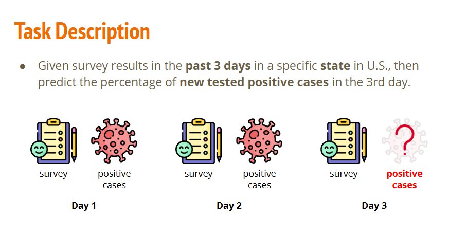
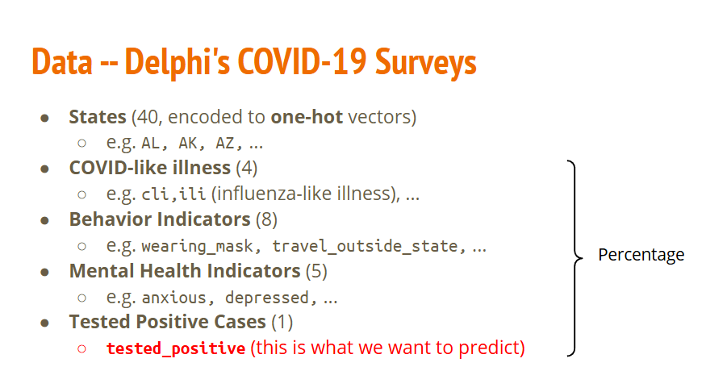
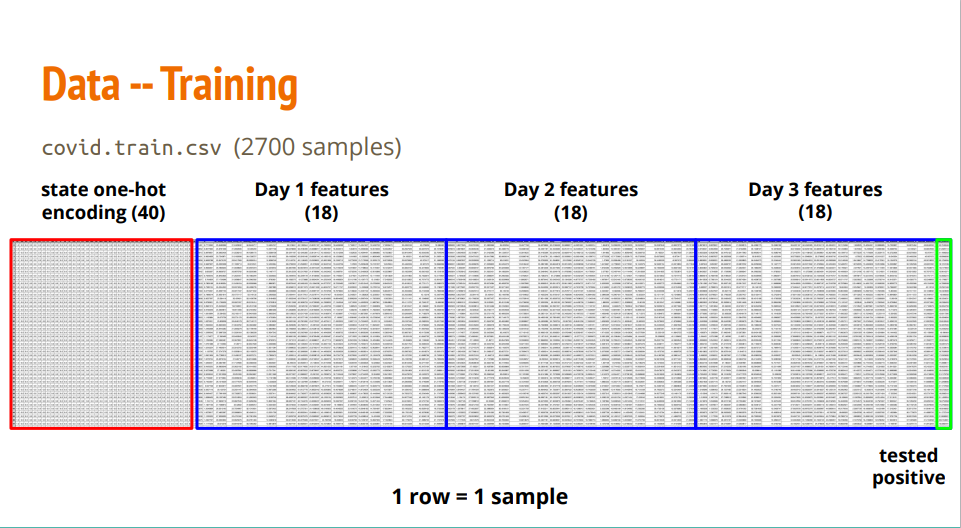
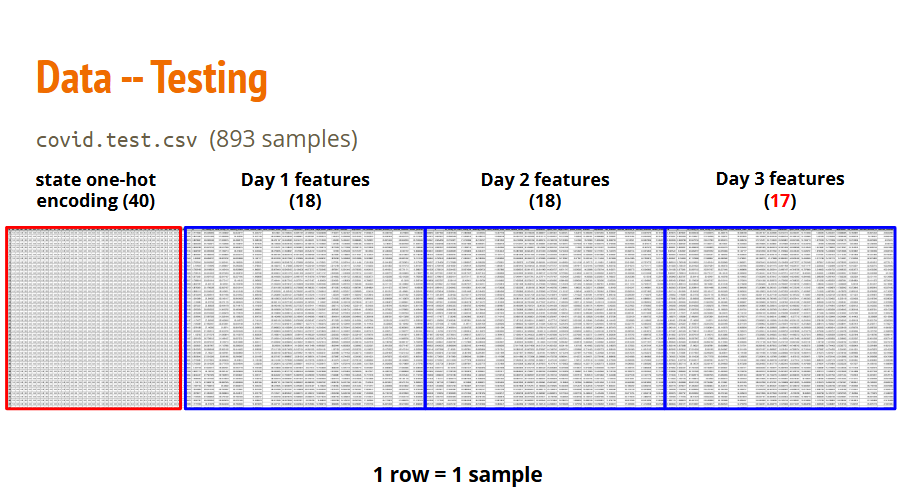
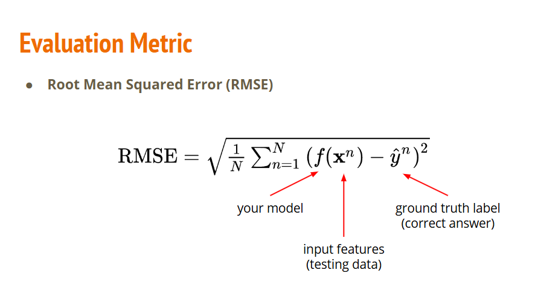
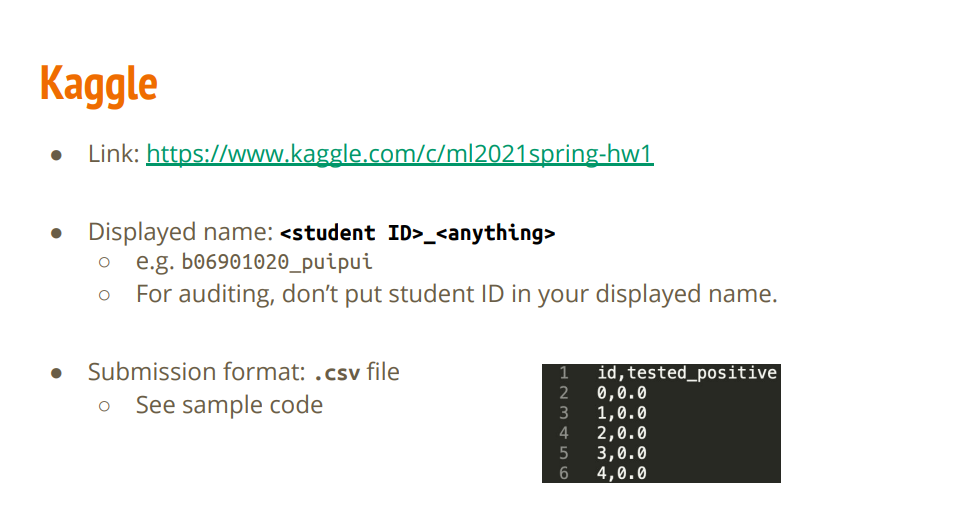
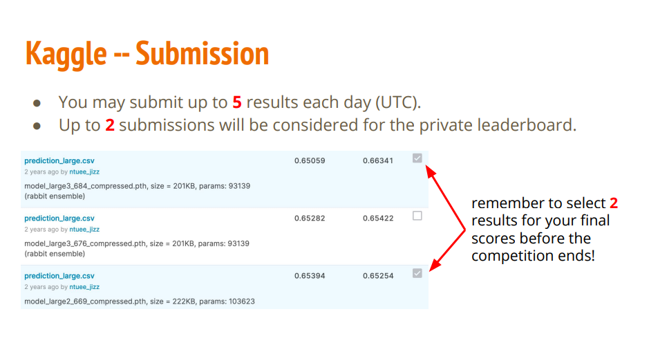
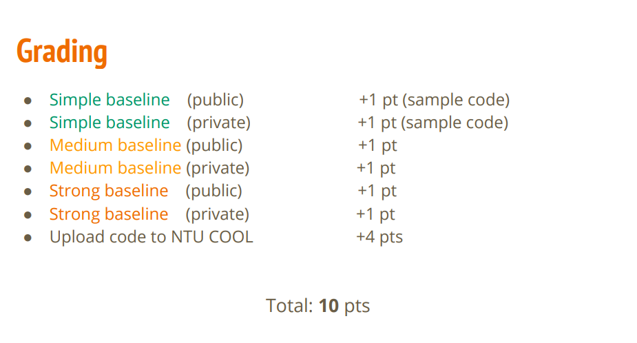
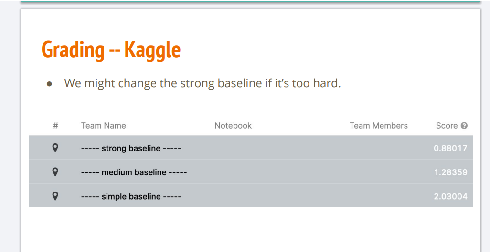
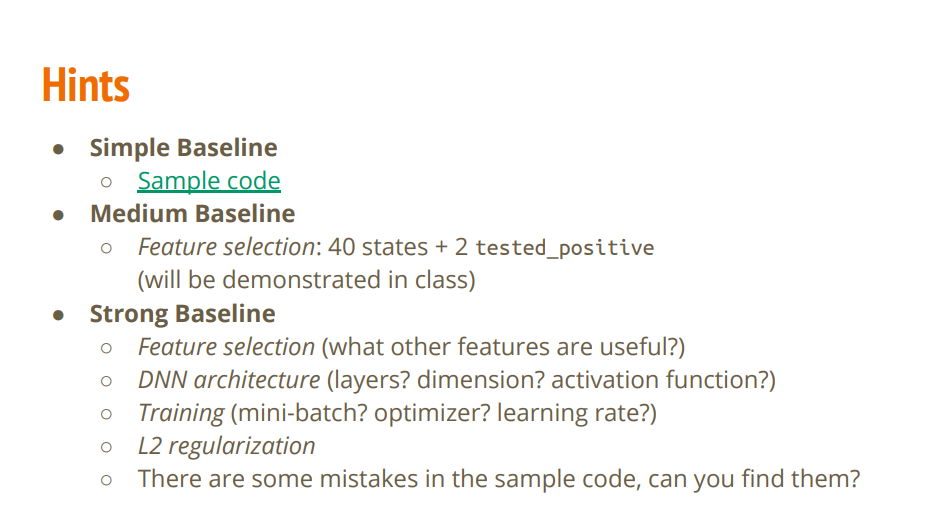

- [任务原PDF](#任务原PDF)
- [任务描述](#任务描述)
- [数据描述](#数据描述)
- [训练集](#训练集)
- [测试集](#测试集)
- [Kaggle平台上的提交规范与规则](#Kaggle平台上的提交规范与规则)
- [模型优化提示](#模型优化提示)
- [补充](#补充)
    - [BatchNorm](#BatchNorm)
    - [Dropout](#Dropout)
    - [特征标准化](#特征标准化)

## 任务原PDF

[任务原PDF](https://speech.ee.ntu.edu.tw/~hylee/ml/ml2021-course-data/hw/HW01/HW01.pdf)

## 任务描述

利用前两天的完整历史（问卷+阳性率）和第三天已经搜集到的问卷数据，来提早预判第三天的实际检测阳性率。

## 数据描述

我们直接用数据表里的具体数字来看，这就非常直观了。

假设数据集中有一条阿拉巴马州（AL）在某一天的数据记录，它在表格里就是一行数字：

一列一列拆开来看

1. States (前 40 列)：这是独热编码（One-Hot），只有 0 和 1。因为代表第 1 个州（AL），所以只有第 1 个数是 1，后面 39 个全是 0：
[1.0, 0.0, 0.0, 0.0, ... 0.0] （这 40 个数加起来等于 1）

2. COVID-like illness (中间 4 列)：代表比例/百分比，比如自述有 COVID 症状的人占全州的 3%：
[0.03, 0.02, 0.01, 0.04]

3. Behavior Indicators (中间 8 列)：代表比例/百分比，比如戴口罩的人占全州的 85%：
[0.85, 0.12, 0.40, ...]

4. Mental Health Indicators (中间 5 列)：代表比例/百分比，比如感到焦虑的人占全州的 30%：
[0.30, 0.15, ...]

5. Tested Positive Cases (最后 1 列)：也是比例/百分比，代表当天实际检测出阳性的比例是 5%：
[0.05]

核心盲点澄清

1. 为啥要大括号？
    - 右边的 Percentage 括号只是告诉你：后面这 18 个特征（4+8+5+1）的取值范围都在 0 到 1 之间（即 0% 到 100%）。

2. 这些百分比会相加等于 100% 吗？
    - 完全不会！ “85% 的人戴口罩” 和 “30% 的人感到焦虑” 是两件独立的事，它们只是描述全州 population 状态的统计指标，各自是各自的比例，绝对不能加在一起。

## 训练集

它展示的是训练集 CSV 文件（covid.train.csv）在内存中的真实矩阵结构：每一行代表一个样本（1 row = 1 sample），总共 2700 行（2700 samples）。

列结构拆解（从左到右）

1. 红色框：state one-hot encoding (40)
    - 40 列，全州静态身份标识。
    - 无论跨越多少天，这个州本身是不变的，所以全局只在最左侧放一次 40 维的 One-Hot 向量。

2. 蓝色框：Day 1/2/3 features (18 x 3 = 54)
    - Day 1 features (18)：第 1 天的统计指标（4 个 COVID 症状 + 8 个行为 + 5 个心理 + 1 个阳性率 = 18 维）。
    - Day 2 features (18)：第 2 天的统计指标（同上，18 维）。
    - Day 3 features (18)：第 3 天的统计指标（同上，18 维）。
    
3. 绿色框：tested positive（最右侧 1 列）
    - 1 列，这就是我们要预测的 Target ($y$)——即 第 3 天真正的检测阳性率。

## 测试集

测试集文件为 covid.test.csv，包含 893 个独立样本（行），总列数为 93 列。

数据结构拆解

1. state one-hot encoding (40维)：红框区域，样本所属州/地区的 One-Hot 编码。

2. Day 1 features (18维)：蓝框区域，第 1 天的完整特征（包含 Day 1 真实确诊数）。

3. Day 2 features (18维)：蓝框区域，第 2 天的完整特征（包含 Day 2 真实确诊数）。

4. Day 3 features (17维)：蓝框区域，第 3 天的数据仅有 17 维。相比训练集，它去掉了最右侧的第 18 维（tested positive）。

## 评估指标

评估指标（Evaluation Metric）：均方根误差（RMSE, Root Mean Squared Error）。

它用来衡量模型的预测结果与真实情况之间的总体偏差程度。

公式中各项对应关系

1. $f(\mathbf{x}^n)$：模型算出的预测值。
    - $f$：你的模型（your model）。
    - $\mathbf{x}^n$：第 $n$ 个样本的输入特征（即测试集里的 93 列数据）。
2. $\hat{y}^n$：第 $n$ 个样本的真实标签（ground truth label），即 Day 3 实际的阳性确诊人数。
3. $N$：样本总数量（例如测试集里的 893 个样本）。

计算逻辑与特点

1. 残差平方：求预测值 $f(\mathbf{x}^n)$ 和真实值 $\hat{y}^n$ 的差值并平方，消除正负号影响，且会对较大误差施加更大的惩罚。
2. 取均值：除以样本数 $N$，算出所有样本的平均平方误差（MSE）。
3. 开根号：最终开根号把单位还原回“确诊人数”本身，方便直观衡量平均预测偏了多少人。RMSE 数值越小，说明模型预测越精准。

## Kaggle平台上的提交规范与规则

这两张图说明的是课程作业在 Kaggle 平台上的提交规范与规则。

图一：Kaggle 规则与提交格式

1. 作业链接：[作业对应的 Kaggle 竞赛网址](https://www.kaggle.com/c/ml2021spring-hw1)。
2. 显示昵称要求 (Displayed name)：
    - 选课学生：必须设置为 <学号>_<自定义名称>（例如 b06901020_puipui），方便助教登记成绩。
    - 旁听生 (Auditing)：不要在昵称里写学号。
3. 提交文件格式：必须提交 .csv 文件，包含两列：id（样本序号，0 到 892）和 tested_positive（模型预测出的第 3 天确诊数值）。

图二：提交次数与最终结算规则 (Submission)

1. 每日提交限制：每天最多可以提交 5 次结果（以 UTC 时间为准）。

2. 私有榜结算 (Private Leaderboard)：
    - 在比赛截止前，你必须在后台手动勾选最多 2 个你满意的提交文件（如图中右侧）。
    - 竞赛最终计算成绩时，会以你勾选的这 2 个文件的预测结果来进行最终评分（取高分者），防止过拟合到公开榜单（Public Leaderboard）。

## 评分标准

课程设定了三个不同难度的性能指标门槛（Baseline）：

1. Simple baseline (简单基线)：通过直接运行官方提供的示例代码（sample code）即可达成。
    - 过 Public 榜：+1 分
    - 过 Private 榜：+1 分

2. Medium baseline (中等基线)：需要对模型或超参数进行简单优化后达成。
    - 过 Public 榜：+1 分
    - 过 Private 榜：+1 分

3. Strong baseline (强基线)：需要精细调参、特征工程或改进网络架构后达成。
    - 过 Public 榜：+1 分
    - 过 Private 榜：+1 分

注意：每一级基线都分为 Public（公开榜）和 Private（私有榜）。如果模型预测的 RMSE 低于（优于）对应的 Baseline 分数线，就能拿到该项得分。

## 模型优化提示

这张图展示的是官方给出的模型优化提示（Hints），指明了如何一步步改进代码以突破各个 Baseline。

1. Simple Baseline：直接运行官方提供的[范例代码（Sample code）](https://github.com/ga642381/ML2021-Spring/blob/main/HW01/HW01.ipynb)即可过关。
2. Medium Baseline：做特征选择（Feature selection）。只保留 40 个州的 One-Hot 编码和前两天的确诊人数（2 tested_positive），丢弃其他无关或噪声特征（课上会演示）。
3. Strong Baseline：需要多维度深度调优：
    - 特征筛选：继续尝试挑选更有用的特征。
    - 网络架构 (DNN architecture)：调整隐藏层层数、神经元维度及激活函数（如 ReLU、LeakyReLU）。
    - 训练策略 (Training)：优化 Batch 大小、选择合适的优化器（如 Adam、SGD）并调整学习率（Learning Rate）。
    - 正则化 (L2 regularization)：加入权重衰减（Weight Decay）防止模型过拟合。
    - 代码纠错：示例代码中隐藏了一些故意留下的错误/坑，找出并修正它们。

## 补充

### 神经元权重

**一个神经元的权重个数，必须且一定等于输入特征值的个数。**

因为全连接网络在计算时，每一个输入特征（$x_i$）都需要配对一个专属于它的权重（$w_i$）来进行乘法运算，最后再全部加起来：

$$\text{神经元输出 } z = (x_1 \cdot w_1 + x_2 \cdot w_2 + \dots + x_n \cdot w_n) + b$$

如果有 $n$ 个输入特征（比如 93 个），就必须有 $n$ 个权重（93 个），这样才能做点积（Dot Product）计算。

### BatchNorm

BatchNorm（Batch Normalization，批归一化） 是深度学习中用来让神经网络训练更稳定、加速收敛的一种正则化技术。

在深度神经网络里，这种参数变化是层层叠加的：

1. 第 1 层的参数微调了一点点；
2. 经过第 2 层的矩阵乘法和激活函数，这种微小的变化被放大；
3. 传到第 5 层或第 10 层时，深层网络看到的输入特征在数值大小、均值和方差上，已经发生了剧烈的漂移与抖动。

结果与 BatchNorm 的救场：

1. 没有 BatchNorm 时：深层网络就像在踩一个随时会滑动的地毯，前面几层一动，后面几层就要跟着剧烈调整，导致整张网络训练得极慢，而且极易梯度爆炸或消失。
2. 有了 BatchNorm 后：无论前几层的参数怎么变、输出的数据怎么飘，BatchNorm 在进入下一层前，强制把数据拉回（归一化）到“均值为 0，方差为 1”的稳定框架里。

BatchNorm 救场的本质，就是把每一层神经元之间的“动态传话”，变成了“标准统一的标准化接口”。

1. 第一步：强行“归零”，消灭分布抖动（Z-Score Normalization）
    - 假设上一步反向传播后，前一层因为参数更新，输出的数据均值突然从 $10$ 飙升到了 $500$，发生了严重抖动。
    - BatchNorm 会立刻截获这个 Batch 的所有数据：算出这批数据的平均值 $\mu$（比如 $500$）和方差 $\sigma^2$。
    - 将每个数据减去均值、再除以标准差：$$\hat{x} = \frac{x - \mu}{\sqrt{\sigma^2 + \epsilon}}$$
        - 这个公式就是归一化的通用公式，特征标准化也是用这个公式。
        - 所以数据变成了 均值 0、标准差 1 的标准正态分布。
            - 均值 0 = 数据被"平移"了，中心跑到原点了。
            - 标准差 1 = 数据被"缩放"了，散开的程度统一变成 1。平均偏离幅度 ≈ 1
    - $\epsilon$（读作 Epsilon）在 BatchNorm 公式中是一个为了保证数值计算安全而加入的极小常数（Smoothing Factor / Numerical Stability Constant）。
        - 假设在某个 Batch 中，前一层输出给 Batch 的所有特征值完全一模一样（例如所有样本对应位置的值都是 $5.0$）。这时计算出来的方差 $\sigma_B^2$ 就刚好等于 $0$。
    - $\epsilon$ 是一个不需要网络去学习的超参数，它的值非常小，通常默认设为：
        - 1e-5（即 $0.00001$）或者 1e-8。
    
经过这一步，无论前一层参数怎么剧烈抖动，输出给下一层的数据强行变成了“均值为 0，方差为 1”的绝对稳定状态。 下一层神经元再也不用频繁跟着调整数值范围了。

2. 第二步：引入“缩放与平移”，恢复表达能力（Reconstructive Scale & Shift）
    - 如果只做第一步，把所有数据都死死卡在均值 0、方差 1 附近，会带来一个新问题：网络的表达能力被阉割了。
    - 比如 Sigmoid 激活函数在 0 附近的区间近乎一条直线，数据全挤在这里，网络就失去了处理非线性复杂特征的能力。
    - 为了解决这个问题，BatchNorm 引入了两个可学习的参数 $\gamma$（Scale 缩放）和 $\beta$（Shift 平移）：$$y = \gamma \hat{x} + \beta$$
    - 救场逻辑：它把“到底需要多大范围的数值”这个决定权交给了网络自己去学习。
    - 如果网络发现某些特征确实需要偏离 0 均值，它可以通过反向传播把 $\gamma$ 和 $\beta$ 训练成合适的值，在保证稳定的前提下恢复非线性表达能力。

3. 第三步：消除梯度消失，允许使用大学习率（Gradient Flow Maintenance）
    - 在没有 BatchNorm 的深层网络中：
        - 数值过大或过小会导致 Sigmoid/Tanh 等激活函数进入“饱和区”，梯度直接归零（梯度消失）。
        - 或者数值层层乘积放大，引发梯度爆炸。
        - 救场逻辑：通过把输入特征拉回 0 附近的合理区间，数据刚好落在了激活函数梯度最大的区域。这不仅彻底解决了梯度消失问题，还能让我们敢于使用更大的学习率（Learning Rate），把原本需要训练几天的模型缩短到几个小时收敛。

### Dropout

Dropout（随机失活） 是深度学习中应用最广泛的防止过拟合（Overfitting）的正则化技术。

如果说 BatchNorm 是给网络加“稳定器”，那么 Dropout 就是在训练时给网络加“抗压训练”。

1. 核心工作原理
    - 在训练阶段（model.train()），每次前向传播时，Dropout 会以指定的概率 $p$（比如 $p = 0.5$）随机选择一部分神经元，将它们的输出直接置零（暂时“杀死”）。
    - 每个 Batch 迭代时，随机被屏蔽掉的神经元组合都是不一样的。

2. 为什么 Dropout 能防止过拟合？
    - ① 破除神经元之间的“共谋依赖”（Co-adaptation）
        - 在没有 Dropout 时，某些神经元可能会“偷懒”，依赖其他强力神经元算出的结果。Dropout 每次都随机关掉一部分神经元，这就迫使每一个神经元都必须独立学习有用的特征，不能把希望寄托在别人身上。
    - ② 相当于集成学习（Ensemble Learning）
        - 假设网络有 $N$ 个神经元，每次随机掩码都会产生一个全新的子网络架构。训练 $M$ 个 Epoch，就相当于隐式地训练了 $M$ 个轻量化子网络。最终模型相当于这无数子网络的“投票集合”，大大增强了泛化能力。

### 特征标准化

特征标准化（Feature Normalization / Standardization），简单来说，就是把不同单位、不同大小范围的特征，统一拉到同一个“标准数量级”上。

1. 为什么要做特征标准化？（核心原因）
    - 假设你要预测一个人的整体健康得分，输入特征有两个：
        - 特征 A（步数）：每天 10,000 步。
        - 特征 B（体温）：正常是 36.5 ℃。

    - 在模型的眼里，它不认识“步”和“℃”这两个单位，它只看纯数字：
        - 步数稍微波动 1,000，数字变化就是 1000。
        - 体温发烧变化 1 ℃，数字变化只有 1。

    - 如果不做标准化：
        - 模型会误以为步数的变动比体温重要 1000 倍！步数这个巨大数值会彻底主导梯度的计算，而体温这样微小但极其关键的特征则会被完全忽视。

2. 标准化是怎么做的？（Z-Score 公式）
    - 代码中使用的 (X - mean) / std 叫 Z-Score 标准化，做法分两步：
        - 减去均值（X - mean）：把数据的中心点拉到 0。
            - 比平均值高的变成正数，比平均值低的变成负数。
        - 除以标准差（/ std）：把数据的波动幅度缩放到 1。
    - 缩放后的效果：
        - 无论原始数据是几万（如步数）还是零点几（如阳性率），经过标准化后，绝大部分数字都会被强制约束在 -3 到 +3 这个很小的区间内。

3. 标准化带来的直接好处

| 比较维度 | 未做标准化 | 做了标准化 |
| :--- | :--- | :--- |
| **特征权重分配** | 极大数值特征主导梯度，微小但关键的特征被完全忽略 | 所有特征处于同一数量级，在同一起跑线上公平竞争 |
| **梯度下降轨迹** | 损失函数呈极度扁平的椭圆形，梯度剧烈震荡，极难收敛 | 损失函数呈接近正圆的碗状，梯度沿着最短路径快速收敛 |
| **数值计算稳定性** | 特征数值过大易引发梯度爆破（出现 `NaN` 或 `Inf`） | 数值分布在 [-3, 3] 附近，梯度更新极其平稳 |

### SGD

SGD（Stochastic Gradient Descent，随机梯度下降）是深度学习中最基础、最核心的参数优化算法。

如果把训练模型比作在雾天山顶下山（寻找最小的 Loss）：

1. Loss 就是你当前所在的位置高度。
2. 梯度（Gradient） 就是当前脚下最陡峭的方向。
3. 学习率（Learning Rate, lr） 就是你每一步迈出的步长。

SGD 的核心公式非常简洁：

$$\text{新参数} = \text{旧参数} - (\text{学习率} \times \text{梯度})$$

也就是：沿着梯度的反方向走一小步。

参数：

1. 'lr': 0.001 —— 学习率（Learning Rate）
    - 学习率决定了参数更新时的“步子迈多大”。在梯度下降中，模型通过梯度计算出最陡峭的下山方向后，需要乘上学习率 $\eta$ 来决定更新的幅度：$$\text{新权重} = \text{旧权重} - \text{学习率} \times \text{梯度}$$
    - 如果设得太大（如 0.1）：步子迈得太大，容易越过 Loss 的最低点，导致损失值在最低点附近剧烈震荡，甚至直接发散（Loss 变无穷大）。
    - 如果设得太小（如 0.00001）：步子迈得太小，模型训练极其缓慢，甚至容易困在半山腰（局部最小值）走不出来。0.001 是深度学习中常用的经典初始值，兼顾了收敛速度和稳定度。

2. 'momentum': 0.9 —— 动量（Momentum）
    - 动量引入了物理学中的“惯性”概念，用来加速梯度下降并防止卡在平坦区域或局部极小值。如果不加动量，标准的 SGD 每次更新只看当前这一步的梯度。如果遇上非常曲折的峡谷地形，更新方向就会不停地左右摆动（Z 字形锯齿震荡），前进效率极低。引入动量后，优化器在更新时不仅看当前步的梯度，还会累加历史更新方向的惯性：$$\text{当前速度} = \text{momentum} \times \text{上一步的速度} + \text{当前梯度}$$ $$\text{新权重} = \text{旧权重} - \text{学习率} \times \text{当前速度}$$
        - momentum = 0.9 意味着：保留 90% 上一次迭代时的更新方向与速度，只把 10% 的注意力放在当前计算出的新梯度上。
            - 好处：冲过平坦区与局部极小值：就像一个小球从山上滚下来，自带冲劲（动量），即便遇到小洼地（局部最小值）也能凭惯性冲过去。
            - 平滑震荡：如果梯度方向前后频繁相反，历史惯性会抵消掉两边的剧烈摆动，让下山路线更平滑、更快冲向全局最低点。