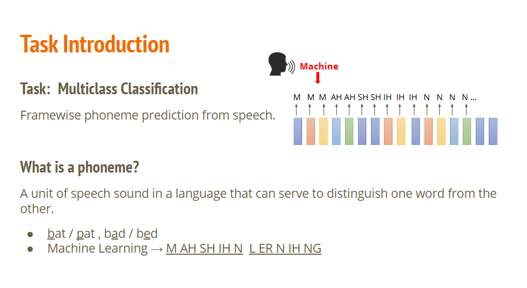
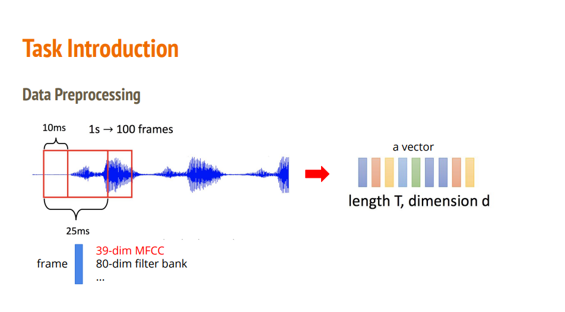
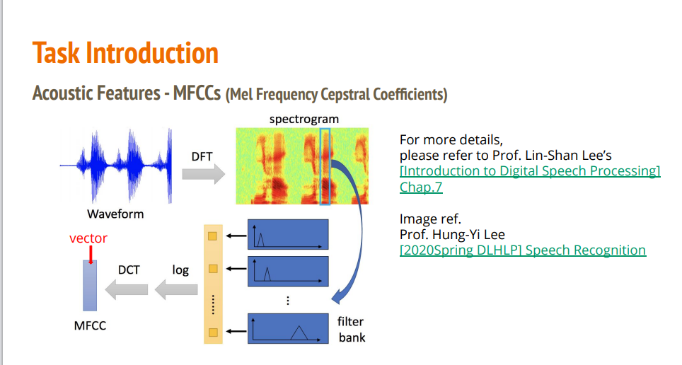
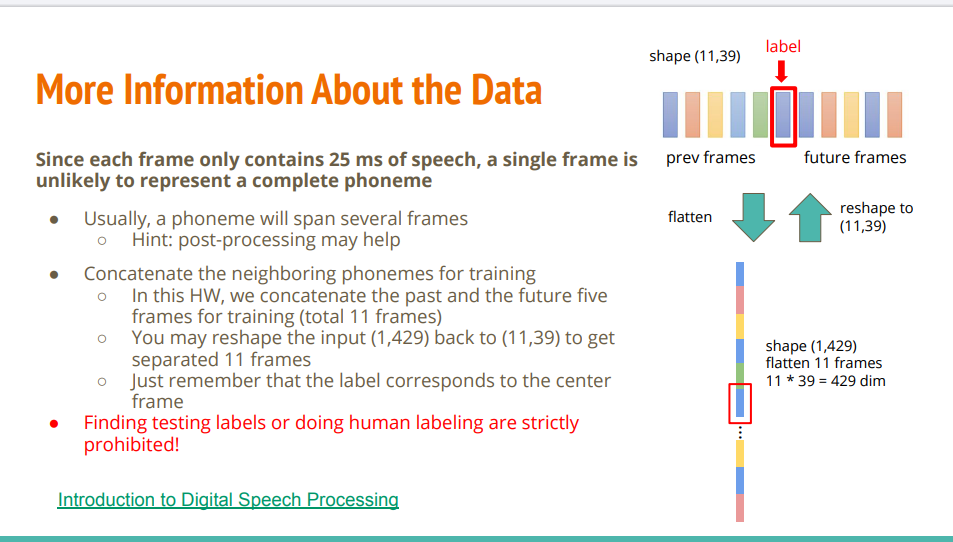
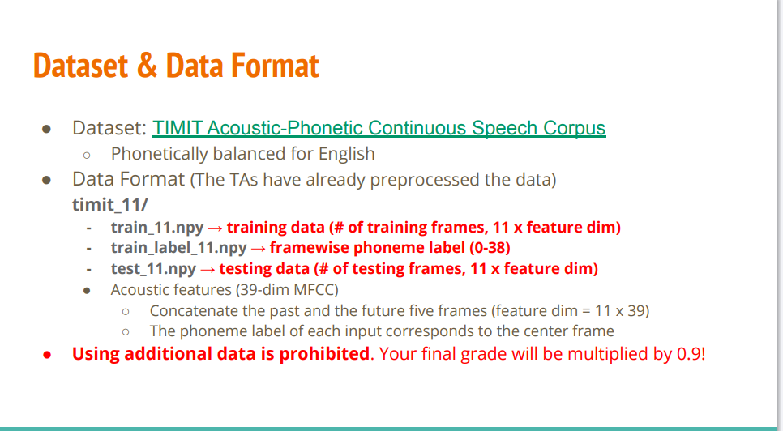
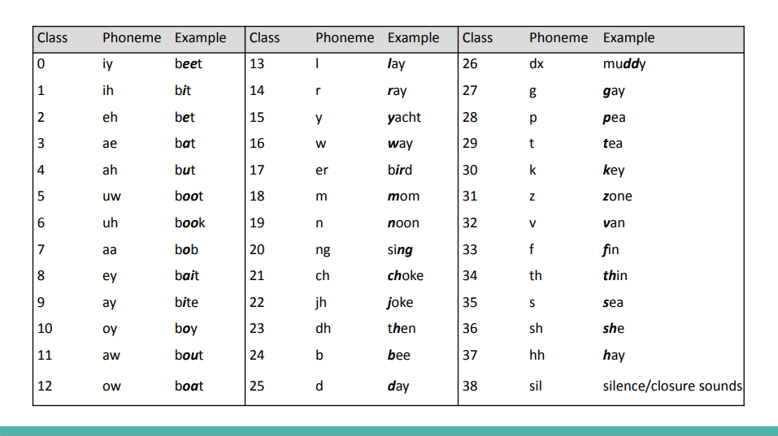

- [任务原PDF](#任务原PDF)
- [任务描述](#任务描述)
- [关于数据的更多信息](#关于数据的更多信息)
- [数据描述](#数据描述)

## 任务原PDF

[任务原PDF](https://speech.ee.ntu.edu.tw/~hylee/ml/ml2021-course-data/hw/HW02/HW02.pdf)

## 任务描述

语音识别（Speech Recognition）领域中的一个经典入门任务：逐帧音素预测（Framewise Phoneme Prediction）。

1. 任务定义（Task Introduction）
    - 任务类型：多分类任务（Multiclass Classification）。
    - 核心目标：从给定的语音信号中，进行逐帧音素预测（Framewise phoneme prediction）。
    - 工作机制：人类说话的连续语音会被切分成极短的时间片（称为“帧 Frame”，图里下方那一排彩色小方块）。
    - 机器（Machine）要做的事情，就是对每一帧音频进行分类，判断这一帧的声音对应哪一个音素（Phoneme）（如图上方预测出的 M, AH, SH, IH, N...）。
    
2. 什么是音素？（What is a phoneme?）
    - 定义：语言中能够区分不同词义的最小发音单位。
    - 示例说明：
        - 区分词义：改变一个音素，词义就变了。
            - bat / pat（/b/ 和 /p/ 是不同音素，改变后词变了）
            - bad / bed（/æ/ 和 /e/ 是不同音素）
        - 句子拆解：
            - 比如短语 "Machine Learning"，用音素标注序列表示就是：Machine $\rightarrow$ M AH SH IH NLearning $\rightarrow$ L ER N IH NG

3. 一个语音样本在标注体系（TIMIT 数据集）、文本单词（拼写）和 标准发音（国际音标）之间的对应关系：
    - iy，beet，/biːt/
    - $$\text{人类文字: } \mathbf{beet} \xrightarrow{\text{标准发音}} \text{国际音标: } \mathbf{/bi\mathbf{\boldsymbol{ː}}t/} \xrightarrow{\text{音素拆解与编码}} \text{TIMIT 机器标签: } \mathbf{iy} \text{ (Class 0)}$$
    - iy（TIMIT 音素代号）：
        - 身份：计算机/算法处理时使用的机器标签（Class Label，即 Class 0）。
        - 作用：由于国际音标符号（如 /iː/）带有特殊字符，不方便写进代码和文件名中，因此 TIMIT 数据集采用纯英文字母构成的 ARPAbet 规范，用 iy 来代表长元音 /iː/。   
    - beet（英文单词 / 文本拼写）：
        - beet 中的字母组合 ee：在口语发音中被读作长元音 /iː/。
        - 身份：人类在日常生活中书写和阅读的文本单词（意为“甜菜”）。
        - 作用：在这里作为 提示示例（Example），帮助人类直观理解 iy 这个音素对应的是什么发音。
    - /biːt/（国际音标 IPA，International Phonetic Alphabet）：
        - 身份：标准语言学中的发音标示。
        - 作用：精确刻画单词 beet 的标准读音。其中 /iː/ 是发音核心（长元音），前面的 /b/ 和后面的 /t/ 是前后辅音。

数据预处理（Data Preprocessing）过程，即如何把连续的语音波形转化为模型能看懂的特征向量矩阵。   

1. 语音切帧（Framing）与帧移动，计算机无法直接处理连续的波形，需要用“滑动窗口”把语音切成一帧一帧的片段：
    - 帧长（Frame Length / Window Size）：$25\text{ ms}$。
        - 每次截取长为 $25$ 毫秒的音频波形。因为语音信号在极短时间内（比如 $20 \sim 30\text{ ms}$）可以看作是平稳的。
    - 帧移（Frame Shift / Hop Size）：$10\text{ ms}$。   
        - 窗口每隔 $10$ 毫秒向右滑动一次。这意味着相邻的两帧会有 $15\text{ ms}$ 的重叠，保证上下文特征不丢失。   
    - 单位换算：
        - 因为每 $10\text{ ms}$ 生成一帧，所以 $1$ 秒的语音会生成 $100$ 帧（$1\text{s} \rightarrow 100\text{ frames}$）。 

2. 特征提取（Feature Extraction），把切出来的每一帧波形通过信号处理算法（如傅里叶变换、声学滤波器组）转换为数值向量：
    - 每一帧（Frame）会被转换成一个向量，常见的特征格式有：
        - 39 维 MFCC（梅尔频率倒谱系数，经典手工特征）。   
        - 80 维 Filter Bank（梅尔滤波器组特征，深度学习中更常用）。   

3. 最终输出数据形式
    - 一整段语音处理完后，就变成了一个序列向量矩阵：
        - 长度 $T$（length $T$）：总帧数
            - 因为每 1 秒的语音会被切成 100 帧（每 10ms 滑动一次）
            - 如果语音长 1 秒，那么 $T = 1 \times 100 = 100$ 帧。
            - 如果语音长 3 秒，那么 $T = 3 \times 100 = 300$ 帧。
            - 所以，$T$ 代表的是时间长度。语音越长，$T$ 就越大；语音越短，$T$ 就越小。它的本质就是把一段连续的声音拆成了多少个“小时间片”（帧）。
        -  维度 $d$（dimension $d$）：每一帧的特征维度，每一帧（即那 25ms 的声音小片段）不能直接用一维的震动波形传给深度学习模型，而是需要提取出声音的物理/声学特征（比如高音、低音、音色等）。
            - 如果你选择提取 39 维 MFCC 特征，那么这一帧声音就会被转化成由 39 个数字 组成的向量。
            - 如果你选择提取 80 维 Filter Bank 特征，那么这一帧声音就会被转化成由 80 个数字 组成的向量。
            - 所以，$d$ 代表的是每一小片段声音的信息丰富程度。无论这一帧声音发的是“啊”还是“咪”，它都被压缩编码成了 $d$ 个数字。
        
4. 总结：这一步的目标就是把原本一维的波形震动信号，转化为一个尺寸为 $T \times d$ 的矩阵，用来作为后续神经网络（如 CNN/RNN/Transformer）的输入。   

声学特征 MFCC（梅尔频率倒谱系数，Mel Frequency Cepstral Coefficients） 的提取全流程。

它展示了如何把最左边的一维原始语音波形（Waveform）一步步加工成最左下角用于神经网络输入的特征向量（vector）。   

处理流程可以分为以下 4 个核心步骤：

1. DFT（离散傅里叶变换 $\rightarrow$ 语谱图 spectrogram）
    - 操作：把切好的每一帧波形做 DFT（Discrete Fourier Transform） 变换。
    - 作用：时域波形（随着时间起伏的声波）只能看到振幅，看不到频率。通过傅里叶变换，可以将时域信号转换为频域信号，得到声音在各个频率上的能量分布，从而拼出语谱图（Spectrogram）。  
    - 对应图示：波形图 $\xrightarrow{\text{DFT}}$ 语谱图。

2. Filter Bank（梅尔滤波器组）
    - 操作：把语谱图上某一帧的频率能量（图中蓝色长框选中的那一列）通过一组三角形状的梅尔滤波器（filter bank）。
    - 作用：人耳对声音频率的感知不是线性的（比如人耳对 100Hz 到 200Hz 的变化很敏感，但对 10000Hz 到 10100Hz 的变化几乎感觉不到）。梅尔滤波器组模拟了人耳的这种听觉特性，低频区间隔密、高频区间隔稀，提取出符合人耳感知特性的能量分布（形成图中浅黄色的 Filter Bank 向量）。   

3. Log（取对数）
    - 操作：对 Filter Bank 提取出的各频段能量数值取 log 运算。   
    - 作用：模拟人耳对响度（声音大小）的非线性感知（人耳对音量的感知同样是非线性的，比如声音能量翻倍，我们并不觉得声音响了一倍），同时还能把乘性噪声变成加性噪声，增强特征的鲁棒性。   

4. DCT（离散余弦变换 $\rightarrow$ 最终 MFCC 向量）
    - 操作：对取了对数后的特征做 DCT（Discrete Cosine Transform） 变换。   
    - 作用：不同频段之间的能量往往是高度相关的（去除冗余），DCT 可以起到去相关性（Decorrelation）和降维的作用。   
    - 最终结果：提取出前 39 维（或 13 维及其一阶/二阶差分）的核心系数，组合成最终的 MFCC 向量（即图中的 vector，这就是上一张 PPT 提到的维度 $d$）。   

5. 总结整个链条
    - $$\text{Waveform (原始波形)} \xrightarrow{\text{DFT}} \text{Spectrogram (语谱图)} \xrightarrow{\text{Filter Bank}} \text{Fbank特征} \xrightarrow{\text{log}} \text{Log-Fbank} \xrightarrow{\text{DCT}} \text{MFCC 向量}$$
    
6. 在现代深度学习中，很多模型会直接用到 Log-Fbank 那一步（不去做最后的 DCT），因为神经网络本身就具备强悍的去相关和降维能力；但 MFCC 依然是传统语音识别和经典轻量化任务中最基础、最经典的声学特征。

## 关于数据的更多信息

作业数据拼接（Concat Context Frames）与输入数据形状（Shape）转换的原理。

核心逻辑在于：单靠一帧 $25\text{ ms}$ 的声音太短了，很难单独识别出音素，必须结合前后上下文（Context）一起预测。

1. 核心背景与动机
    - 单帧信息量不足：每一帧只有 $25\text{ ms}$，一个完整的音素通常会持续几十到几百毫秒（跨越多个帧）。如果只给模型看独立的一帧，模型很难准确判断。
    - 后处理提示：因为一个音素通常跨越连续多帧，预测结果往往会有连续相同的音素（如 M M M AH AH），提示大家可以通过后处理（Post-processing）来平滑结果。

2. 上下文拼接（Concat Frames）机制，为了预测中心那一帧（Center Frame）的音素（图中标红的 label），我们需要把它的前 5 帧和后 5 帧一起拼接到一起：
    - 过去（Past）：5 帧   
    - 中心（Center）：1 帧（即我们要预测的目标帧）
    - 未来（Future）：5 帧
    - 总共（Total）：$5 + 1 + 5 = 11$ 帧拼接为一个窗口。

3. 数据形状变化（Shape 详解），原本每一帧有 $39$ 维特征（MFCC）：   
    - 拼接后的原始形状：shape (11, 39)，即 11 帧，每帧 39 维。   
    - 展平（Flatten）：
        - 将这 11 帧的特征展平连成一条一维向量：$11 \times 39 = 429$ 维。
        - 展平后的形状为 shape (1, 429)（如果加上 Batch，就是 (batch_size, 429)）。   
    - Reshape 复原：如果你要在模型里（比如用 CNN 或 RNN）把 11 帧拆开单独处理，可以随时将 (1, 429) 重新 reshape 回 (11, 39)。  
    
4. 关键提醒（Label 对应关系）
    - 无论输入是拼接了 11 帧还是 429 维，模型输出的标签（Label）始终只对应最中间的那 1 帧。   
    - 底部红字强调：严禁找测试集标签或进行人工标注。   

5. 总结
    - 这就是语音识别中经典的 拼接上下文窗口（Concat Context Window） 操作：用当前帧 + 前后各 5 帧（共 11 帧，展开后 $11 \times 39 = 429$ 维特征）作为模型输入，来预测中间这 1 帧的音素类别。

## 数据描述

数据集结构、文件组织方式以及具体的分类标签映射表。

第一张图：数据集与数据格式 (Dataset & Data Format)

1. 数据集名称：TIMIT Acoustic-Phonetic Continuous Speech Corpus（经典的英文语音识别数据集，包含语音学均衡的连续语音）。   
2. 数据已预处理（助教已帮你切帧与拼接）：
    - timit_11/train_11.npy：训练集特征。形状为 (训练帧数, 11 × 39)，即已将当前帧及其前后各 5 帧（共 11 帧）拼接，维度为 429。
    - timit_11/train_label_11.npy：训练集标签。每个元素是一个 0 到 38 的整数，代表中心帧对应的音素类别。  
    - timit_11/test_11.npy：测试集特征。形状为 (测试帧数, 11 × 39)，用于生成预测结果并提交。   
3. 特征规范：
    - 采用 39 维 MFCC 特征。   
    - 拼接上下文后单个样本维度：$11 \times 39 = 429$。  
    - 每个样本的 Label 严格对应 11 帧中最中间的那 1 帧。   
4. 硬性规则：禁止使用任何额外的外部数据，否则最终成绩打 9 折（乘 0.9）。   

第二张图：音素类别映射表 (Phoneme Class Mapping)，这张表给出了分类任务中 39 个类别（Class 0 ~ 38） 与具体音素及发音示例的对应关系：
1. 分类数量：一共 39 类（输出层的 num_classes 或 out_features 应设置为 39）。   
2. 类别划分：
    - Class 0 ~ 37：38 个具体的元音与辅音音素（例如 Class 0 的 /iy/ 对应 beet，Class 35 的 /s/ 对应 sea）。
    - Class 38 (sil)：代表静音/闭塞音（Silence / Closure sounds，即没有说话声音或停顿的帧）。   

写代码时的核心要点

1. 模型输入层（Input Dimension）：应该是 429（即 $11 \times 39$）。
2. 模型输出层（Output Dimension）：应该是 39（对应 39 个分类）。
3. 损失函数（Loss Function）：因为是多分类任务，且标签给的是类索引（0~38），直接使用 nn.CrossEntropyLoss() 即可。 