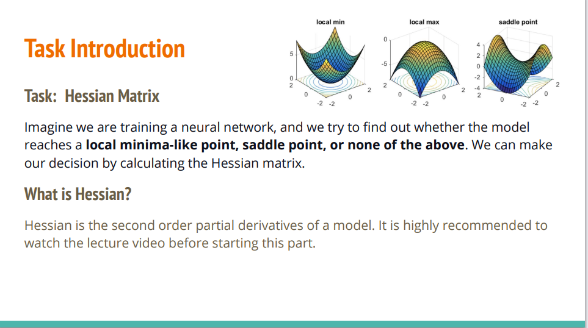
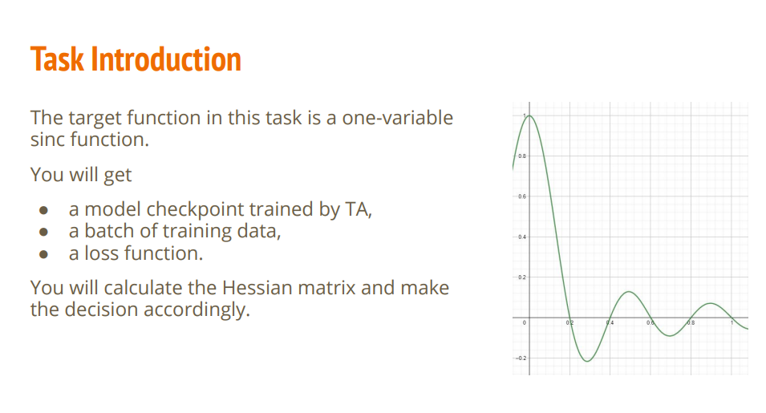
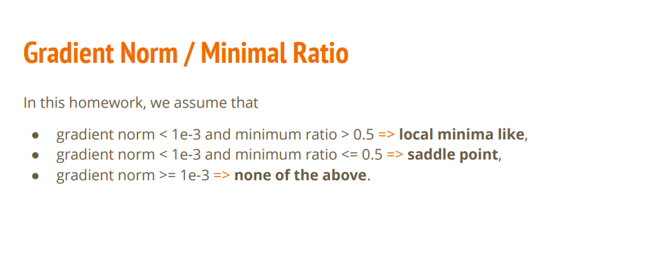

- [任务原PDF](#任务原PDF)
- [任务描述](#任务描述)
- [梯度范数和极小值比例](#梯度范数和极小值比例)
- [重要提示](#重要提示)
- [补充](#补充)
    - [梯度范数](#梯度范数)
    - [用四维张量表示矩阵](#用四维张量表示矩阵)
    - [为什么代码里可以用“梯度外积”来偷懒代替复杂的 Hessian 矩阵](#为什么代码里可以用“梯度外积”来偷懒代替复杂的-Hessian-矩阵)

## 任务原PDF

[任务原PDF](https://speech.ee.ntu.edu.tw/~hylee/ml/ml2021-course-data/hw/HW02/HW02.pdf)

## 任务描述

关于 黑塞矩阵（Hessian Matrix） 的作业/任务说明。它的核心目的是让你利用二阶导数（Hessian 矩阵）来判断神经网络训练停滞时，模型究竟卡在了哪种临界点（Critical Point）。

1. 核心背景与问题，在训练神经网络时，当我们发现梯度变为 0（Gradient $\approx$ 0）、Loss 不再下降时，通常有以下三种可能：   
    - 局部极小值点（Local Minimum）：   
        - 形状：像山谷/碗底（对应图中的 local min）。  
        - 特点：往任何方向走 Loss 都会变大。此时梯度下降法无法继续优化，是真的卡住了。   
    - 局部极大值点（Local Maximum）：   
        - 形状：像山顶（对应图中的 local max）。   
        - 特点：往任何方向走 Loss 都会变小。   
    - 鞍点（Saddle Point）：   
        - 形状：像马鞍（对应图中的 saddle point）。   
        - 特点：在某些方向上是极小值（往上弯），但在另一些方向上是极大值（往下弯）。此时如果沿着往下弯的方向走，Loss 还可以进一步降低！   

2. 什么是 Hessian 矩阵？
    - 只看一阶梯度（一阶导数）只能知道“当前斜率是否为 0”，无法区分到底是山谷、山顶还是马鞍。
    - 而 Hessian 矩阵 就是损失函数 $L(\boldsymbol{\theta})$ 对模型所有参数 $\boldsymbol{\theta}$ 求取出的二阶偏导数矩阵（Second Order Partial Derivatives）：$$H_{ij} = \frac{\partial^2 L}{\partial \theta_i \partial \theta_j}$$ 它可以捕捉曲面在各个方向上的曲率（Curvature）。

3. 判断驻点处的曲面形态，在优化问题或机器学习训练中，当我们找到一个梯度为 0 的临界点/驻点（$\nabla f = \mathbf{0}$）时，一阶信息就失效了。此时，高度差近似由 Hessian 矩阵构成的二次型决定：  

$$\Delta z \approx \frac{1}{2} \boldsymbol{\Delta x}^T H \boldsymbol{\Delta x}$$

4. 最终推到：令 $\mathbf{y}=Q^T\boldsymbol{\Delta x}$（即把位移 $\boldsymbol{\Delta x}$ 投影到 $H$ 的特征向量方向上），则

$$\boldsymbol{\Delta x}^T H \boldsymbol{\Delta x}

= \boldsymbol{\Delta x}^T(Q\Lambda Q^T)\boldsymbol{\Delta x}

= (Q^T\boldsymbol{\Delta x})^T\Lambda(Q^T\boldsymbol{\Delta x})

= \mathbf{y}^T\Lambda\mathbf{y}

= \sum_{i=1}^{m}\lambda_i y_i^2$$

所以

$$\boxed{\Delta z \approx \frac{1}{2}\sum_{i=1}^{m}\lambda_i\, y_i^{\,2}}$$

其中 $\lambda_i$ 是 Hessian $H$ 的特征值，$y_i=\boldsymbol{q_i}^T\boldsymbol{\Delta x}$ 是 $\boldsymbol{\Delta x}$ 在第 $i$ 个特征方向上的分量。

5. 综合判定表（特征值组合与全局几何形态），通过分析 $H$ 的正定性（特征值 $\lambda$ 的正负号），就能判断该点附近的局部几何形态：
    1. 正定矩阵（所有特征值 $\lambda_i > 0$）：
        - 几何形态：碗状凹陷（Bowl shape）   
        - 结论：朝任何方向走高度都上升，该点为 局部极小值（Local Minimum）。   
    2. 负定矩阵（所有特征值 $\lambda_i < 0$）：
        - 几何形态：倒扣的碗（Cap shape）   
        - 结论：朝任何方向走高度都下降，该点为 局部极大值（Local Maximum）。   
    3. 不定矩阵（特征值有正有负）：
        - 几何形态：马鞍面（Saddle shape）   
        - 结论：沿某些方向上升，沿某些方向下降，该点为 鞍点（Saddle Point）。

你需要通过计算神经网络模型参数的 Hessian 矩阵，来判断助教（TA）训练好的模型当前停在了什么类型的关键点（极小值、鞍点还是其他）。
1. 在这个任务中，模型需要拟合的目标曲线是一个单变量的 sinc 函数（即右图展示的绿线，公式通常为 $f(x) = \frac{\sin(\pi x)}{\pi x}$）。
    - 充当的是神经网络要拟合的“真值曲线/目标数据（Ground Truth）”。
2. 作业已经帮你把模型训练到了某个特定位置，并把此时的权重、数据和损失函数直接提供给你。
3. 你需要写代码计算损失函数对当前模型参数的 Hessian 矩阵，求出它的特征值，并根据特征值的正负情况做出判断（Decision）：
    - 如果特征值全部为正 $\implies$ 判断模型停在了 局部极小值（Local Minimum）；   
    - 如果特征值有正有负 $\implies$ 判断模型停在了 鞍点（Saddle Point）；   
    - 如果是鞍点，可能还需要顺便计算负特征值对应的特征向量（即逃离鞍点的方向）。

## 梯度范数和极小值比例

作业中判断模型是否处于“类局部极小值点（Local Minima-like Point）”的具体量化标准。   

由于在真实的浮点数计算机运算中，我们很难遇到严格为 0 的梯度或绝对完美的 100% 正特征值，因此作业给出了两个工程上的近似指标和判定阈值：

1. 梯度范数（Gradient Norm）
    - 含义：用来衡量当前点处的梯度向量有多大（即陡不陡峭）。
    - 工程处理：在实际训练中，梯度几乎不可能刚好精确等于 0。因此作业规定：当梯度的范数（L2 Norm）小于 1e-3（即 $< 0.001$）时，我们就认为此时梯度已经“接近于零”，模型进入了驻点/临界点区域。
2. 极小值比例（Minimum Ratio）
    - 定义公式：$$\text{Minimum ratio} = \frac{\text{正特征值的数量}}{\text{总特征值的数量}}$$ 即 Hessian 矩阵中大于 0 的特征值所占的比例。  
    - 数学含义：理想的局部极小值（Strict Local Minima）：所有特征值都为正（$\text{Minimum ratio} = 1.0$）。   
    - 鞍点（Saddle Point）：特征值有正有负（$\text{Minimum ratio} < 1.0$）。 
3. 本作业的具体判定法则（Decision Rule）
    - PPT 中用红字标注了最终的判定条件：$$\text{若 } \mathbf{\text{Minimum ratio} > 0.5} \quad \text{且} \quad \mathbf{\text{Gradient Norm} < 1\text{e}-3}$$只要满足这两个条件，作业就认定模型当前处于 “类局部极小值（local minima like）” 的位置！ 
4. 为什么设为 Minimum ratio > 0.5？
    - 在深度学习的高维参数空间中，极小值点（要求 100% 正特征值）极其罕见，绝大多数驻点都是 Saddle Point（鞍点）。

满足这两个条件，确实只能证明模型踩在了一个“局部极小值（Local Minimum）”，完全无法保证它就是“全局最小值（Global Minimum）”。

三种判定规则拆解
1. gradient norm < 1e-3 且 minimum ratio > 0.5 $\implies$ local minima like   
    - 含义：梯度几乎为零（停在临界点），且特征值里大部分是正的（超过 50% 的方向是上坡）。  
    - 结论：认定为类局部极小值点。   
2. gradient norm < 1e-3 且 minimum ratio <= 0.5 $\implies$ saddle point   
    - 含义：梯度几乎为零（停在临界点），但特征值里正特征值占少数（至少一半或以上的方向是平的或下坡的）。   
    - 结论：认定为鞍点。   
3. gradient norm >= 1e-3 $\implies$ none of the above   
    - 含义：坡度还很陡，连临界点/驻点都算不上。   
    - 结论：既不是极小值也不是鞍点，模型还在正常下山/优化途中。   

## 重要提示

1. 禁止修改代码
    - 明确说明不需要也不应该修改代码的任何部分。这是为了保证实验基准的一致性，避免因代码改动影响预期结果。
2. 限定运行环境
    - 强调只能使用 Colab（Google Colaboratory）运行代码。因为不同的本地电脑或服务器环境（如深度学习框架版本、CUDA 版本、随机种子等）会导致计算结果存在差异，统一使用 Colab 是为了确保环境一致。
3. 绑定学号分配检查点
    - 说明系统会根据你的学号（student ID）分配不同的模型检查点（checkpoint）。结合上一张图的背景，这意味着不同同学拿到的预训练模型参数会不一样，算出的 Hessian 矩阵和极值判断结果也会不同。

## 补充

### 梯度范数

1. 梯度（Gradient）就是偏导数拼成的向量：如果模型有 $n$ 个参数，梯度就是由这 $n$ 个偏导数拼成的向量 $\boldsymbol{g} = \left(\frac{\partial L}{\partial w_1}, \frac{\partial L}{\partial w_2}, \dots, \frac{\partial L}{\partial w_n}\right)$。

2. 权重（Weight, $w$）模型自身的参数，决定了神经网络的拟合能力。

3. 梯度和权重之间的关系，神经网络在训练时，是通过梯度来修改权重的（梯度下降法）：$$\text{新权重} = \text{旧权重} - \text{学习率} \times \text{梯度}$$ $$\left(w_{\text{new}} = w_{\text{old}} - \eta \cdot \frac{\partial L}{\partial w}\right)$$

4. 梯度范数（Norm）就是距离原点的欧氏距离：在几何上，向量 $\boldsymbol{g}$ 的 L2 范数就是 $\sqrt{g_1^2 + g_2^2 + \dots + g_n^2}$，正好对应高维空间里这个梯度向量点（$g_1, g_2, \dots$）距离坐标原点 $(0, 0, \dots)$ 的距离。在物理/几何意义上，它代表了这个位置的总坡度陡峭程度。   

### 用四维张量表示矩阵

用四维张量表示你那个 $128\times128$ 矩阵，其实很简单。

先把一维编号翻译成二维坐标

你的 $g_1,\dots,g_{128}$ 对应第一层的 128 个权重。

每个权重的坐标是（输出神经元编号, 输入编号），因为输入维度是 1，所以输入编号永远是 0：

| 你的编号 | 权重坐标 |
| :--- | :--- |
| g₁ | (0, 0) |
| g₂ | (1, 0) |
| g₃ | (2, 0) |
| ⋮ | ⋮ |
| g₁₂₈ | (127, 0) |

在你的二维矩阵里

第 $a$ 行第 $b$ 列的值是：

$$H_{a,b} = g_a \cdot g_b$$

其中 $a$ 对应权重 $(a-1,0)$，$b$ 对应权重 $(b-1,0)$。

在四维张量里

四维张量的元素写成：

$$H_{4\text{D}}[i, 0, k, 0]$$

意思是：
1. 第一个权重是输出编号 $i$、输入编号 0 → 即 $g_{i+1}$
2. 第二个权重是输出编号 $k$、输入编号 0 → 即 $g_{k+1}$

所以：

$$H_{4\text{D}}[i, 0, k, 0] = g_{i+1} \cdot g_{k+1}$$

正好等于你二维矩阵的第 $i+1$ 行第 $k+1$ 列。

### 为什么代码里可以用“梯度外积”来偷懒代替复杂的 Hessian 矩阵

这个方法在机器学习中被称为 Gauss-Newton（高斯-牛顿）近似算法。

1. Hessian 矩阵的本来面目（真实的二阶导数），公式开头发问：Hessian 矩阵的每一个元素 $\mathbf{H}_{ij}$ 到底是什么？
  - 它是损失函数 $L$ 对两个权重 $w_i$ 和 $w_j$ 的二阶导数：$$\mathbf{H}_{ij} = \frac{\partial^2 L}{\partial w_i \partial w_j}$$
  - 假设我们用最简单的均方误差 $L = e^2$（其中 $e$ 是误差），对它求两次导，展开后会得到两项：$$\mathbf{H}_{ij} = 2\frac{\partial e}{\partial w_i}\frac{\partial e}{\partial w_j} + 2e\frac{\partial^2 e}{\partial w_j \partial w_i}$$

2. 为什么要“偷懒”（高斯-牛顿假设）？在上面那堆式子里，第二项长这样：$2e\frac{\partial^2 e}{\partial w_j \partial w_i}$。
  - 这项里面包含了误差 $e$ 和 误差的二阶导数。
  - 为什么要扔掉它？
    - 如果网络训练得差不多了，误差 $e$ 本身就很小，乘以 $e$ 之后这一项几乎就等于 0 了。
    - 求真正的二阶导数（误差的二阶导）计算量实在太恐怖了，计算机根本算不动。
  - 于是，高斯-牛顿算法大笔一挥：把复杂的第二项直接忽略/抹掉（Neglect）！

3. 简化后的结果：只剩一阶导数相乘，扔掉第二项之后，Hessian 矩阵就被大大简化了，它只正比例于第一项：$$\mathbf{H}_{ij} \propto \frac{\partial e}{\partial w_i}\frac{\partial e}{\partial w_j}$$而误差的一阶导数，本质上就对应着我们平时用的梯度（损失对权重的导数 $\frac{\partial L}{\partial w}$）。

4. 最终的结论，所以，最后推导出来的结论是：$$\mathbf{H} \propto (\mathbf{B} \times \mathbf{A}) \times (\mathbf{B} \times \mathbf{A})$$
  - 这里的 $\mathbf{B} \times \mathbf{A}$ 就是我们前面提到的该层梯度（由反向传播值 $\mathbf{B}$ 和输入 $\mathbf{A}$ 组合而成）。
  - 整段话的意思就是：我们不需要去费劲计算真实的、复杂的二阶导数 Hessian 矩阵；我们只需要用梯度（$\mathbf{B}$ 和 $\mathbf{A}$）自己跟自己做外积，就能近似模拟出 Hessian 矩阵了！
