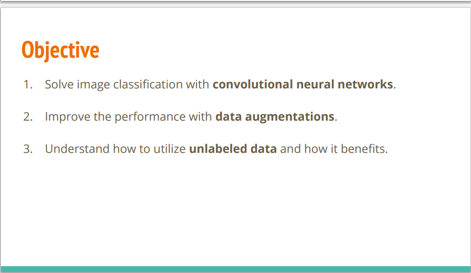
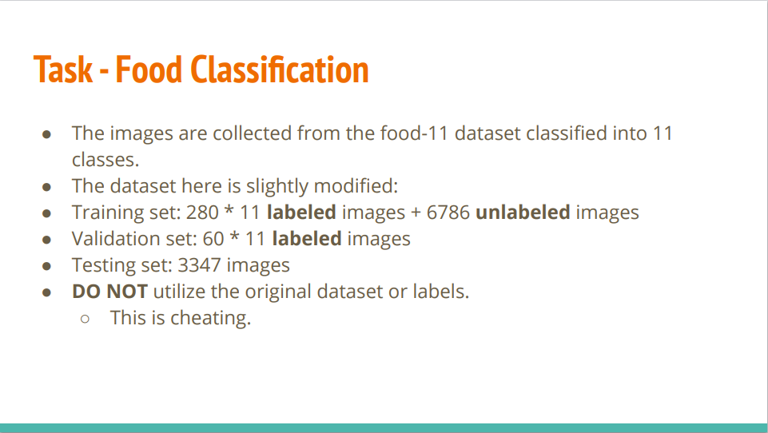
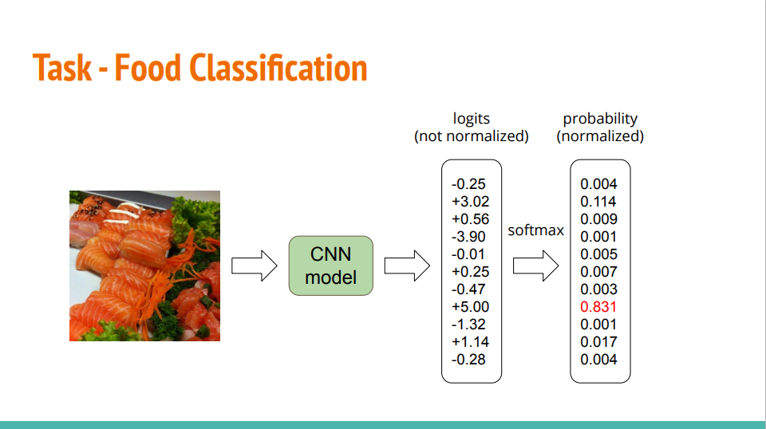
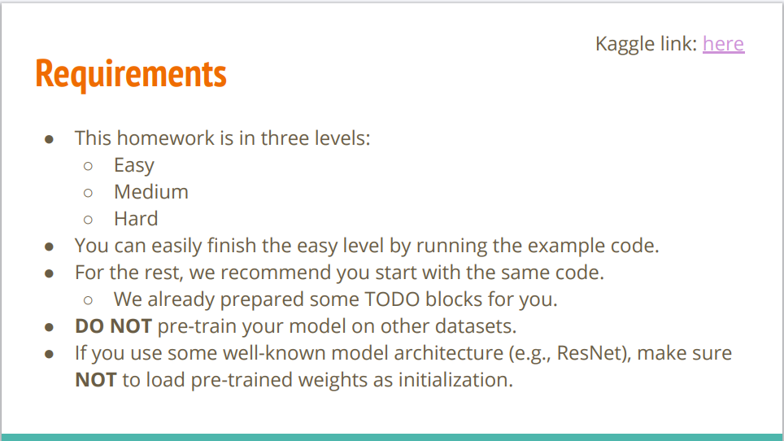
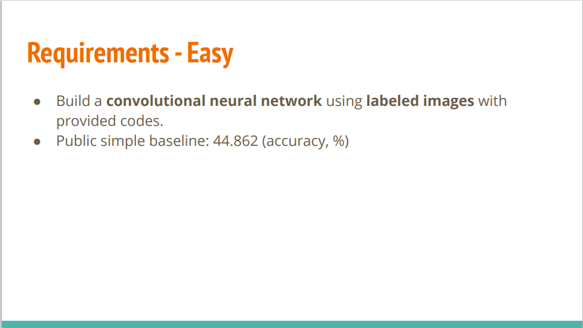
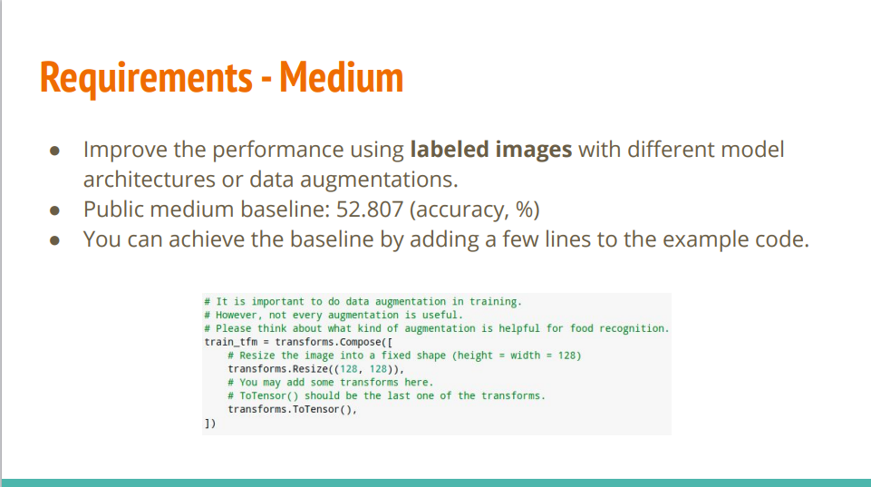
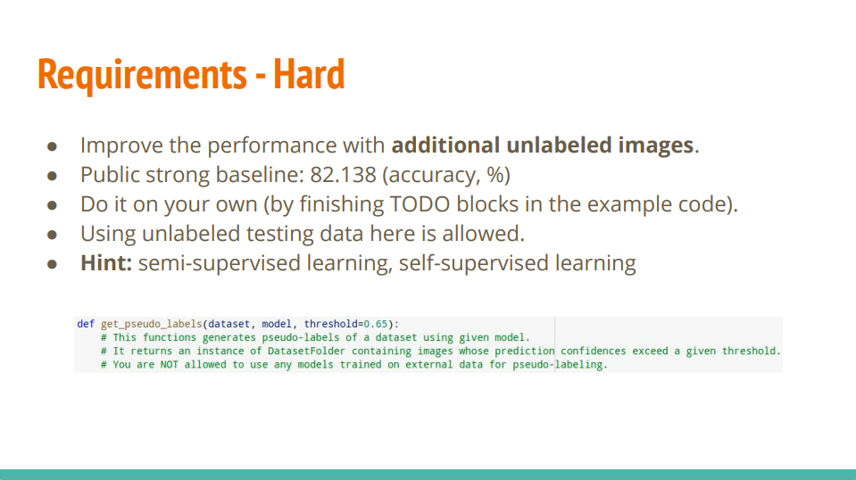
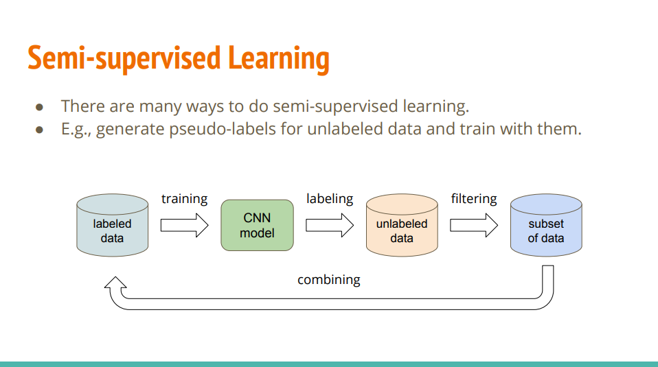
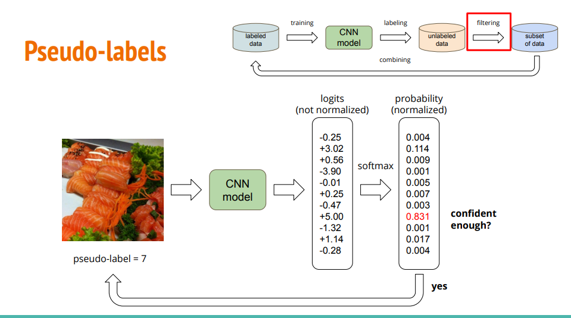

- [任务原PDF](#任务原PDF)
- [任务描述](#任务描述)
- [要求](#要求)
- [回顾CNN](#回顾CNN)
- [半监督学习](#半监督学习)
    - [置信度判断](#置信度判断)

## 任务原PDF

[任务原PDF](https://speech.ee.ntu.edu.tw/~hylee/ml/ml2021-course-data/hw/HW03/HW03.pdf)

## 任务描述

1. 使用卷积神经网络（Convolutional Neural Networks）解决图像分类问题。
2. 通过数据增强（Data Augmentations）来提升模型的性能。
3. 理解如何利用未标记数据（Unlabeled Data）以及它能带来哪些益处。

1. 任务目标：处理一个来自 food-11 数据集的图像分类任务，总共分为 11 个类别。   
2. 数据集划分与结构：
    - 训练集（Training set）：包含 $280 \times 11$ 张有标签（labeled）的图像，以及 6786 张无标签（unlabeled）的图像。这里包含大量的无标签数据，意味着这道作业的核心考点之一是半监督学习（Semi-supervised Learning）。   
    - 验证集（Validation set）：包含 $60 \times 11$ 张有标签图像，用来在训练过程中评估模型表现。   
    - 测试集（Testing set）：包含 3347 张图像。   
3. 重要警告（防作弊规定）：严禁使用原始的 food-11 官方数据集或其自带标签。你必须严格使用作业下发给你的、经过修改的专属数据集，否则会被判定为作弊（Cheating）。

## 要求

1. 作业分级：本次作业分为三个难度层次：Easy（简单）、Medium（中等）和 Hard（困难）。   
2. 完成建议：
    - 运行提供的示例代码就可以轻松通过 Easy 级别。   
    - 对于更高级别的挑战，建议基于相同的代码模板进行开发，助教已经在代码中准备好了对应的 TODO 模块供你填写。   
    - 可以通过右上角的链接跳转到 Kaggle 页面。
3. 重要规则红线（严禁作弊）：
    - 严禁使用其他数据集对模型进行预训练（Pre-train）。
    - 如果你在代码中使用了知名的模型架构（例如 ResNet），必须确保没有加载任何预训练权重作为初始化参数，所有权重都必须从头开始训练（From scratch）。

作业的三个难度级别（Easy、Medium、Hard）的具体要求、目标和核心技术方向：
1. Easy 级别（简单） 
    - 核心任务：使用提供的基础代码和有标签的图像来构建并训练一个基本的卷积神经网络（CNN）。   
    - 评分基准：公开的简单基准（Public simple baseline）要求准确率达到 44.862%。   
2. Medium 级别（中等）   
    - 核心任务：在有标签图像的基础上，通过调整模型架构或添加数据增强（Data Augmentations）来提升模型性能。
    - 评分基准：公开的中等基准（Public medium baseline）要求准确率达到 52.807%。
    - 实现建议：可以通过在代码中的 transforms.Compose 模块里加入合适的图像变换来达成。
3. Hard 级别（困难）   
    - 核心任务：充分利用训练集中那六千多张额外的无标签图像来进一步大幅提升性能。   
    - 评分基准：公开的强基准（Public strong baseline）要求准确率达到 82.138%。   
    - 实现方式：需要自行完成代码中预留的 TODO 模块。   
    - 核心提示：主要考察半监督学习（Semi-supervised learning）或自监督学习方法。幻灯片中给出了 get_pseudo_labels 函数的提示，通常的做法是利用当前模型对无标签数据进行预测，挑选出预测置信度高（超过阈值，如 0.65）的样本打上伪标签（Pseudo-labels），再将它们合并到训练集中一同训练。

## 回顾CNN

假设输入是一张尺寸为 $224 \times 224 \times 3$ 的图像，以下是经典 CNN 流程中的数据维度变化示例：

1. 输入层 (Input)
    - 数据维度：$224 \times 224 \times 3$
    - 说明：高度为 224 像素，宽度为 224 像素，3 个通道分别代表红（R）、绿（G）、蓝（B）像素值矩阵。

2. 第一层：卷积层 (Convolution) 
    - 操作：使用若干个卷积核（将每个卷积核比作“专职专家”）进行特征提取。例如设置 32 个尺寸为 $3 \times 3 \times 3$ 的卷积核（步长 stride=1，填充 padding=1）。
    - 数据维度变化：空间尺寸保持不变（$224 \times 224$），通道数由输入的 3 变为专家/卷积核的数量 32。
    - 输出维度：$224 \times 224 \times 32$
    - 卷积输出尺寸的通用计算公式
        - 在深度学习中，无论输入多大、卷积核多大、有没有加填充，输出尺寸（Output Size）都有一个标准的计算公式：$$\text{Output Size} = \left\lfloor \frac{\text{Input Size} + 2 \times \text{Padding} - \text{Kernel Size}}{\text{Stride}} \right\rfloor + 1$$注：$\lfloor \dots \rfloor$ 表示向下取整。
    - 举例，填充（padding=0）且步长为 1（stride=1）：
        - 输入是 $5 \times 5$，卷积核是 $3 \times 3$。
        - 卷积核在格子里能有效滑动的位置（即输出矩阵的边长）计算公式是：$\text{输出尺寸} = (\text{输入尺寸} - \text{卷积核大小}) + 1$。
        - 代入进去：$(5 - 3) + 1 = 3$。
        - 所以在这个特定默认情况下，确实从 $5 \times 5$ 变成了 $3 \times 3$（尺寸缩小了）。
    - 举例，填充（padding=1）且步长为 1（stride=1）：
        - 我们在 $5 \times 5$ 的四周强行“补一圈 0”，让它在视觉上变成 $7 \times 7$ 的外框。
        - 这时再用 $3 \times 3$ 的卷积核去扫：$(7 - 3) + 1 = 5$。
        - 结果：输出依然是 $5 \times 5$，尺寸完美保持不变。
    - 举例，填充（padding=0）且步长为 2（stride=2）：
        - 输入是 $5 \times 5$，卷积核是 $3 \times 3$。
        - 代入进去：$(5 - 3) / 2 = 1.3$ 变成了 $1 \times 1$（尺寸缩小了）。

3. 第一层：池化层 (Pooling)   
    - 操作：使用最大池化（如 $2 \times 2$ 窗口，步长 stride=2）进行下采样，压缩空间尺寸并保留主要特征。
    - 数据维度变化：空间长宽减半（$224 / 2 = 112$），通道数保持不变。
    - 输出维度：$112 \times 112 \times 32$

4. 中间层：卷积与池化交替 (Convolution & Pooling)   
    - 操作：网络通常会交替堆叠多层卷积和池化（例如再经过卷积输出 $112 \times 112 \times 64$，再池化变为 $56 \times 56 \times 64$ 等），随着网络加深，提取的特征从低级边缘逐渐变为高级语义特征（如猫的耳朵、眼睛、胡须）。
    - 假设经过多层后最终的特征图（Feature Map）维度：$7 \times 7 \times 512$

5. 展平层 (Flatten)
    - 操作：将多维的特征图（Feature Map）“拉平”成一维的特征向量，以便输入到后面的全连接层。
    - 数据维度变化：将 $7 \times 7 \times 512$ 展平为 $7 \times 7 \times 512 = 25056$。
    - 输出维度：长度为 25056 的一维向量。

6. 全连接层 (Fully Connected Layers)
    - 操作：通过常规的神经网络全连接层（如包含若干神经元的隐层），将提取到的全局特征综合起来，进行高阶推理。
    - 数据维度变化：例如从 25056 维映射到 128 维。
    - 输出维度：$128$

7. 输出层 (Softmax)   
    - 操作：最后通过 Softmax 激活函数层，将输出映射为各个类别（如“猫”、“狗”等）的概率分布。
    - 输出维度：类别数量（例如若是一个二分类或多分类模型，输出如 2 或 1000 个概率值，总和为 1）。

通过这样一个流程，模型最终输出预测结果：例如 “Cat: 95%”。

## 半监督学习

半监督学习（Semi-supervised Learning）是机器学习的一种重要方法。它的核心思想是：同时利用少量的“有标签数据（Labeled Data）”和大量的“无标签数据（Unlabeled Data）”来共同训练模型。

在实际应用中，人工给数据打标签（比如标注一张图是猫还是狗、写出一段文本的情感极性）往往需要消耗大量的人力和时间，因此“有标签数据”非常稀缺，而“无标签数据”却很容易大量获取。半监督学习正是为了解决这一痛点而设计的。

半监督学习（Semi-supervised Learning） 流程，具体对应的是一种常见的方法——生成伪标签（Pseudo-labeling）。

我们可以结合图中的步骤来拆解它的工作流程：

1. 利用有标签数据训练 (Training) 
    - 首先，使用少量的 labeled data（有标签数据） 去训练一个初始的 CNN model（卷积神经网络模型）。
2. 预测并生成标签 (Labeling) 
    - 用训练好的 CNN 模型去预测大量的 unlabeled data（无标签数据），为这些无标签数据自动打上预测标签（这就是所谓的“伪标签”）。   
3. 筛选数据 (Filtering) 
    - 通过过滤机制（比如只保留模型预测置信度很高的数据），从打完标签的数据中挑选出一部分高质量的样本，形成 subset of data（数据子集）。
4. 合并与循环 (Combining)   将这部分筛选出来的、带有伪标签的数据合并回有标签数据中，用来扩充训练集，然后重新去训练模型。这个过程通常会迭代进行，让模型在不断扩充的数据集上变得越来越准确。

简单来说，这就是一种“老师带学生（利用已有标签训练模型） $\rightarrow$ 学生自己做题并写答案（给无标签数据打伪标签） $\rightarrow$ 挑出做得最好的答案加入题库（筛选并合并） $\rightarrow$ 重复循环”的半监督学习策略。

### 置信度判断

置信度判断就是让模型“自测成绩”，只有当模型表现得足够自信、很有把握时，才采纳它的结果，打上伪标签。以此保证半监督学习中自动生成的标签质量。

1. 设置门槛：模型预测后会产生一个概率分布，系统会设定一个较高的置信度阈值（比如 0.8 或 0.9）。
2. 严格筛选：只有当模型对某个类别的预测概率足够高（超过这个阈值，如图中达到了 0.831）时，系统才会通过（yes）。
3. 安全使用：只有通过筛选的高置信度样本，才会被真正赋予伪标签（如 pseudo-label = 7），并送回数据集去训练下一轮模型。   

如果模型的预测概率很低（例如最高只有 0.4 或 0.5，说明模型自己也拿不准、处在“猜”的状态），系统就会将其过滤掉，不会勉强给它打上伪标签。这样做的目的，是为了防止模型把错误的预测结果当作“正确答案”带偏后面的训练（避免“以错传错”）。