- [任务原PDF](#任务原PDF)
- [回顾SelfAttention](#回顾SelfAttention)
- [任务描述](#任务描述)
    - [作业四任务描述](#作业四任务描述)
- [数据集](#数据集)
- [数据预处理](#数据预处理)
- [数据格式](#数据格式)
- [训练阶段的数据切片](#训练阶段的数据切片)

## 任务原PDF

[任务原PDF](https://speech.ee.ntu.edu.tw/~hylee/ml/ml2021-course-data/hw/HW04/HW04.pdf)

## 回顾SelfAttention

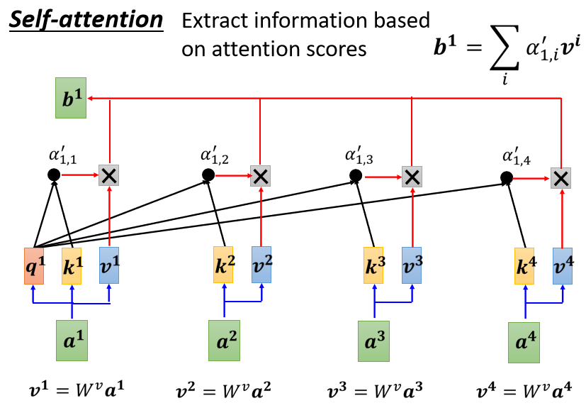

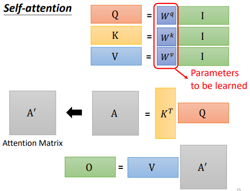

大核心步骤拆解

1. 线性变换（Feature Projection）计算：
    - $Q = W^q I, \quad K = W^k I, \quad V = W^v I$
    - 关键点：图中用红框特别强调了 $W^q, W^k, W^v$ 是整个层中唯一需要学习的参数（Parameters to be learned）。
        - 训练（Backpropagation）更新的就是这三个权重矩阵。
        - $Q, K, V$ 只是输入 $I$ 经过权重矩阵映射后产生的中间激活值（Activations）。

2. 计算关联度（Attention Score）计算：
    - $A = K^T Q \xrightarrow{\text{Softmax}} A'$
    - 关键点：$K^T \cdot Q$ 一口气算出了序列中所有向量两两之间的点积相似度，再通过 Softmax 按列归一化，得到概率分布矩阵 $A'$（**注意力矩阵（Attention Matrix）**）。
    
3. 上下文融合（Context Aggregation）计算：
    - $O = V A'$
    - 关键点：用特征数值矩阵 $V$ 乘上注意力权重矩阵 $A'$，得到最终的输出矩阵 $O$。
    
终极公式与工程直觉整个 Self-Attention 层的计算可以用一行公式总结：

$$O = (W^v I) \cdot \text{Softmax}\left((W^k I)^T (W^q I)\right)$$

Self-Attention 模块能拥有特征学习与抽象能力的核心原因：$W^q, W^k, W^v$ 不是硬编码的常量，而是模型的权重（Weights），会在训练过程中不断优化。

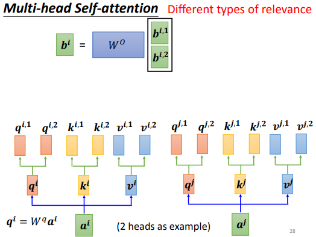

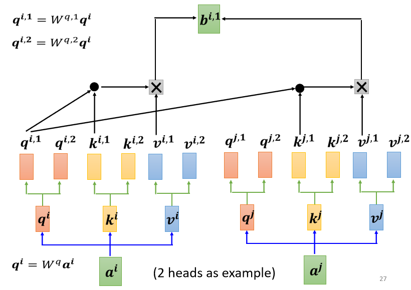

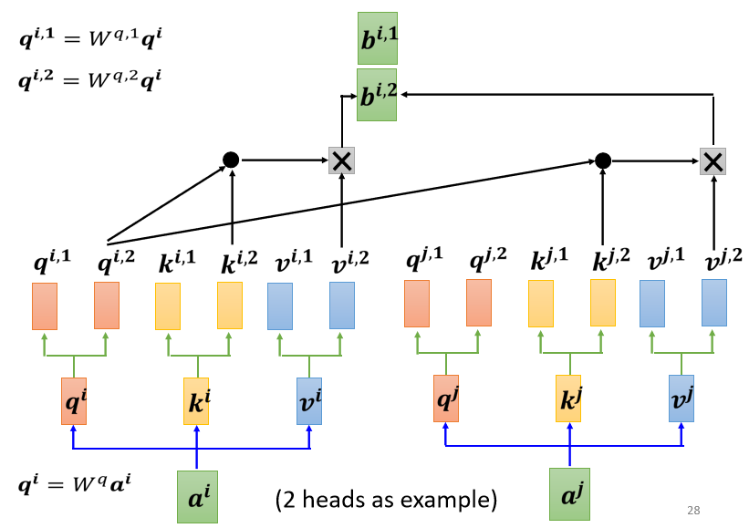

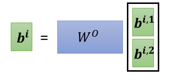

我们设定一个极简的数值化具体例子：
- 设定输入序列：包含 2个词（$a^1$ 和 $a^2$）。
- 设定向量维度：总维度 $d = 4$。
- 设定头数（Multi-head）：$h = 2$（2个 Head）。
- 每个 Head 的维度：$d_k = d_v = d / h = 4 / 2 = 2$。

第一步：定义输入向量与初始参数

假设输入的两个词向量为：
1. $a^1 = \begin{bmatrix} 1 \\ 0 \\ 0 \\ 1 \end{bmatrix}$
2. $a^2 = \begin{bmatrix} 0 \\ 1 \\ 1 \\ 0 \end{bmatrix}$

为了让计算过程完全透明且不引入不必要的浮点数复杂性，我们设定投影矩阵 $W^q$、$W^k$、$W^v$ 均为 $4 \times 4$ 的单位矩阵（Identity Matrix）。

第二步：计算 Query, Key, Value 向量

根据公式 $Q = W^q I, K = W^k I, V = W^v I$，因为权重是单位矩阵，所以变换后的向量等于原向量：   
1. $q^1 = k^1 = v^1 = a^1 = \begin{bmatrix} 1 \\ 0 \\ 0 \\ 1 \end{bmatrix}$
2. $q^2 = k^2 = v^2 = a^2 = \begin{bmatrix} 0 \\ 1 \\ 1 \\ 0 \end{bmatrix}$

第三步：多头拆分（Split into Heads）

由于总维度是 4，且有 2 个 Head，我们将每个 4 维向量从中间均分为两半（前 2 维给 Head 1，后 2 维给 Head 2）：
1. 对于词 1 ($a^1$)：
    - Head 1（前 2 维）：$q^{1,1} = \begin{bmatrix} 1 \\ 0 \end{bmatrix}, \quad k^{1,1} = \begin{bmatrix} 1 \\ 0 \end{bmatrix}, \quad v^{1,1} = \begin{bmatrix} 1 \\ 0 \end{bmatrix}$
    - Head 2（后 2 维）：$q^{1,2} = \begin{bmatrix} 0 \\ 1 \end{bmatrix}, \quad k^{1,2} = \begin{bmatrix} 0 \\ 1 \end{bmatrix}, \quad v^{1,2} = \begin{bmatrix} 0 \\ 1 \end{bmatrix}$
2. 对于词 2 ($a^2$)：
    - Head 1（前 2 维）：$q^{2,1} = \begin{bmatrix} 0 \\ 1 \end{bmatrix}, \quad k^{2,1} = \begin{bmatrix} 0 \\ 1 \end{bmatrix}, \quad v^{2,1} = \begin{bmatrix} 0 \\ 1 \end{bmatrix}$
    - Head 2（后 2 维）：$q^{2,2} = \begin{bmatrix} 1 \\ 0 \end{bmatrix}, \quad k^{2,2} = \begin{bmatrix} 1 \\ 0 \end{bmatrix}, \quad v^{2,2} = \begin{bmatrix} 1 \\ 0 \end{bmatrix}$

第四步：各个 Head 内部独立计算 Self-Attention

我们以计算词 1 的输出（$b^1$）为例，分别在两个 Head 中独立进行：

1. Head 1 的计算过程：
    - 计算 Attention Scores（内积）：
        - $q^{1,1}$ 与 $k^{1,1}$ 的得分：$\begin{bmatrix} 1 & 0 \end{bmatrix} \cdot \begin{bmatrix} 1 \\ 0 \end{bmatrix} = 1 \times 1 + 0 \times 0 = 1$
        - $q^{1,1}$ 与 $k^{2,1}$ 的得分：$\begin{bmatrix} 1 & 0 \end{bmatrix} \cdot \begin{bmatrix} 0 \\ 1 \end{bmatrix} = 1 \times 0 + 0 \times 1 = 0$
        - 得分向量为：$[1, 0]$
    - Softmax 归一化（得到权重 $\alpha'$）： 
        - $\alpha'_{1,1} = \frac{e^1}{e^1 + e^0} = \frac{2.718}{3.718} \approx 0.73$
        - $\alpha'_{1,2} = \frac{e^0}{e^1 + e^0} = \frac{1}{3.718} \approx 0.27$
    - 加权求和（$b^{1,1} = \sum \alpha'_{1,i} v^{i,1}$）：   
        - $b^{1,1} = 0.73 \times \begin{bmatrix} 1 \\ 0 \end{bmatrix} + 0.27 \times \begin{bmatrix} 0 \\ 1 \end{bmatrix} = \begin{bmatrix} 0.73 \\ 0.27 \end{bmatrix}$
2. Head 2 的计算过程：
    - 计算 Attention Scores（内积）：
        - $q^{1,2}$ 与 $k^{1,2}$ 的得分：$\begin{bmatrix} 0 & 1 \end{bmatrix} \cdot \begin{bmatrix} 0 \\ 1 \end{bmatrix} = 0 \times 0 + 1 \times 1 = 1$
        - $q^{1,2}$ 与 $k^{2,2}$ 的得分：$\begin{bmatrix} 0 & 1 \end{bmatrix} \cdot \begin{bmatrix} 1 \\ 0 \end{bmatrix} = 0 \times 1 + 1 \times 0 = 0$
        - 得分向量为：$[1, 0]$
    - Softmax 归一化：   
        - 权重同样为：
            - $\alpha'_{1,1} \approx 0.73, \quad \alpha'_{1,2} \approx 0.27$
        - 加权求和（$b^{1,2} = \sum \alpha'_{1,i} v^{i,2}$）：   
            - $b^{1,2} = 0.73 \times \begin{bmatrix} 0 \\ 1 \end{bmatrix} + 0.27 \times \begin{bmatrix} 1 \\ 0 \end{bmatrix} = \begin{bmatrix} 0.27 \\ 0.73 \end{bmatrix}$

第五步：多头拼接（Concatenation），将各个 Head 计算出来的子向量上下拼在一起，恢复成原本的总维度（$2 + 2 = 4$ 维）：

$$\begin{bmatrix} b^{1,1} \\ b^{1,2} \end{bmatrix} = \begin{bmatrix} 0.73 \\ 0.27 \\ 0.27 \\ 0.73 \end{bmatrix}$$

第六步：通过输出矩阵 $W^O$ 进行线性变换（Final Projection），最后，将拼接好的 4 维向量乘以可学习的输出权重矩阵 $W^O$。

假设此处 $W^O$ 也是 $4 \times 4$ 的单位矩阵：

$$b^1 = W^O \times \begin{bmatrix} 0.73 \\ 0.27 \\ 0.27 \\ 0.73 \end{bmatrix} = \begin{bmatrix} 1 & 0 & 0 & 0 \\ 0 & 1 & 0 & 0 \\ 0 & 0 & 1 & 0 \\ 0 & 0 & 0 & 1 \end{bmatrix} \begin{bmatrix} 0.73 \\ 0.27 \\ 0.27 \\ 0.73 \end{bmatrix} = \begin{bmatrix} 0.73 \\ 0.27 \\ 0.27 \\ 0.73 \end{bmatrix}$$

至此，针对词 1 的多头自注意力完整计算流程（输入 $\rightarrow$ 投影 $\rightarrow$ 拆分 Head $\rightarrow$ 独立 Attention $\rightarrow$ 拼接 $\rightarrow$ 线性输出）全部完成。

## 任务描述

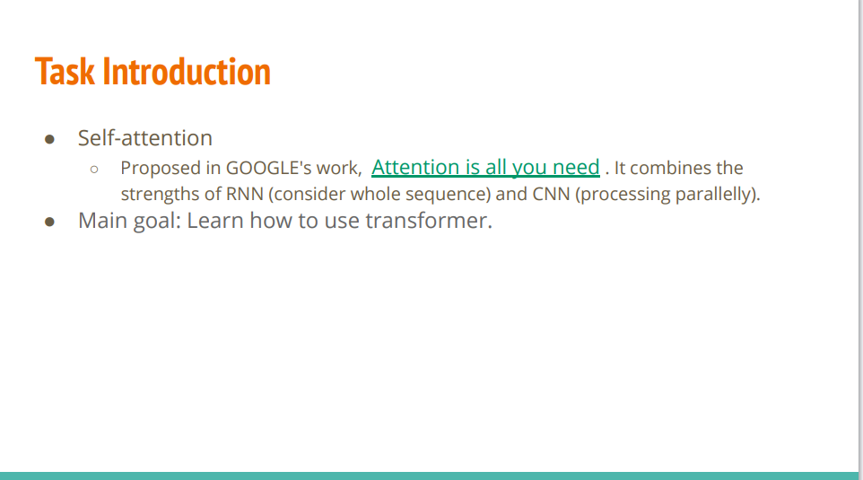

Self-attention（自注意力机制）巧妙地结合了传统两大架构的核心优势：   

1. 继承了 RNN 的优点：能够考虑整个序列的上下文（全局视野，不再像 CNN 那样受限于局部感受野）。   
2. 继承了 CNN 的优点：能够进行高效的并行处理（利用矩阵乘法在 GPU 上同时运算，摆脱了 RNN 必须逐个词串行计算的枷锁）。   

这页幻灯片的最终目标（Main goal）也很直接：教你学会如何使用 Transformer。   

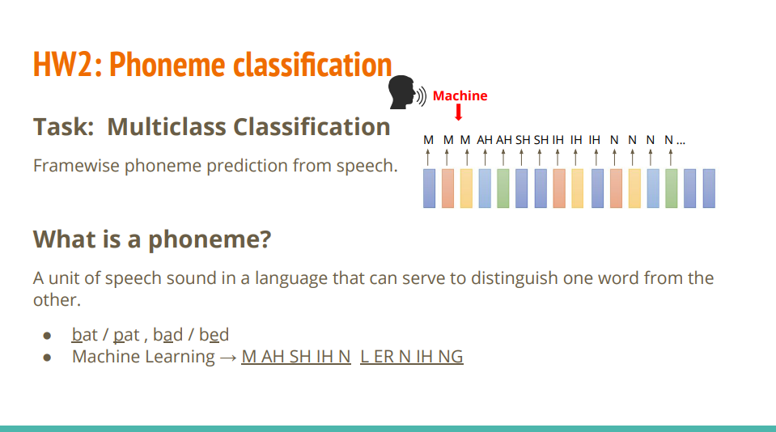

语音识别（Speech Recognition）领域中的一个经典入门任务：逐帧音素预测（Framewise Phoneme Prediction）。

1. 任务定义（Task Introduction）
    - 任务类型：多分类任务（Multiclass Classification）。
    - 核心目标：从给定的语音信号中，进行逐帧音素预测（Framewise phoneme prediction）。
    - 工作机制：人类说话的连续语音会被切分成极短的时间片（称为“帧 Frame”，图里下方那一排彩色小方块）。
    - 机器（Machine）要做的事情，就是对每一帧音频进行分类，判断这一帧的声音对应哪一个音素（Phoneme）（如图上方预测出的 M, AH, SH, IH, N...）。
    
2. 什么是音素？（What is a phoneme?）
    - 定义：语言中能够区分不同词义的最小发音单位。
    - 示例说明：
        - 区分词义：改变一个音素，词义就变了。
            - bat / pat（/b/ 和 /p/ 是不同音素，改变后词变了）
            - bad / bed（/æ/ 和 /e/ 是不同音素）
        - 句子拆解：
            - 比如短语 "Machine Learning"，用音素标注序列表示就是：Machine $\rightarrow$ M AH SH IH NLearning $\rightarrow$ L ER N IH NG

3. 一个语音样本在标注体系（TIMIT 数据集）、文本单词（拼写）和 标准发音（国际音标）之间的对应关系：
    - iy，beet，/biːt/
    - $$\text{人类文字: } \mathbf{beet} \xrightarrow{\text{标准发音}} \text{国际音标: } \mathbf{/bi\mathbf{\boldsymbol{ː}}t/} \xrightarrow{\text{音素拆解与编码}} \text{TIMIT 机器标签: } \mathbf{iy} \text{ (Class 0)}$$
    - iy（TIMIT 音素代号）：
        - 身份：计算机/算法处理时使用的机器标签（Class Label，即 Class 0）。
        - 作用：由于国际音标符号（如 /iː/）带有特殊字符，不方便写进代码和文件名中，因此 TIMIT 数据集采用纯英文字母构成的 ARPAbet 规范，用 iy 来代表长元音 /iː/。   
    - beet（英文单词 / 文本拼写）：
        - beet 中的字母组合 ee：在口语发音中被读作长元音 /iː/。
        - 身份：人类在日常生活中书写和阅读的文本单词（意为“甜菜”）。
        - 作用：在这里作为 提示示例（Example），帮助人类直观理解 iy 这个音素对应的是什么发音。
    - /biːt/（国际音标 IPA，International Phonetic Alphabet）：
        - 身份：标准语言学中的发音标示。
        - 作用：精确刻画单词 beet 的标准读音。其中 /iː/ 是发音核心（长元音），前面的 /b/ 和后面的 /t/ 是前后辅音。

### 作业四任务描述

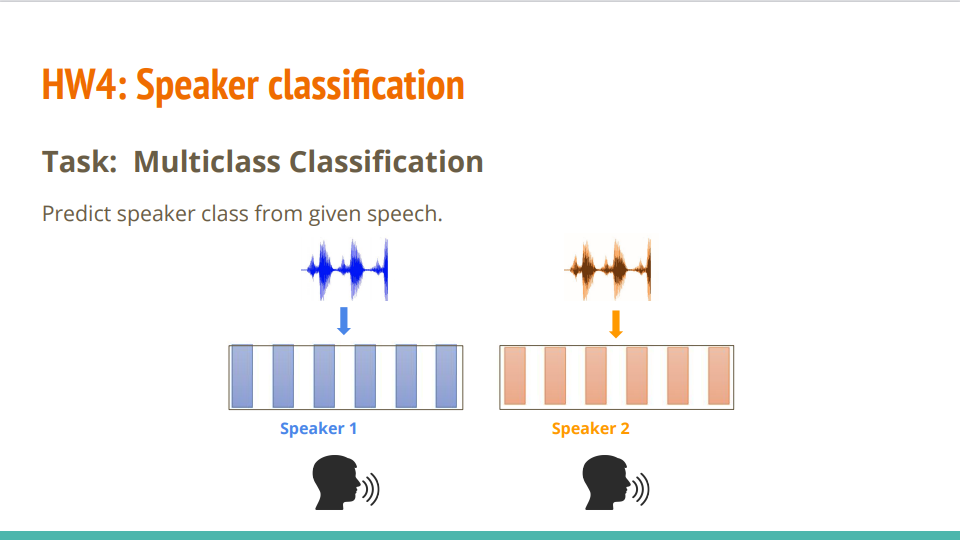

HW4：说话人分类（Speaker classification） 的任务介绍。

核心是一个多分类任务（Multiclass Classification），目标是根据输入的整段语音波形，预测出这段话是由哪一位说话人（Speaker）说的。

## 数据集

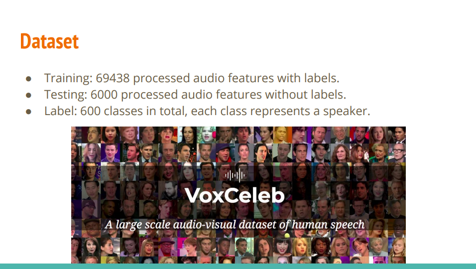

HW4（说话人分类 / Speaker Classification） 所使用的数据集背景——VoxCeleb。

我们可以从以下几个关键维度来理解这个数据集的构成：

1. 数据集规模与划分
    - 训练集（Training）：包含 69,438 个经过处理的带有标签的音频特征。   
    - 测试集（Testing）：包含 6,000 个没有标签的音频特征（需要模型预测出它们分别属于哪个说话人，并提交结果进行评分）。   
    - 类别总数（Labels）：总共包含 600 个类（classes），每一个类就代表一个不同的说话人（Speaker）。也就是说，这是一个 600 分类的多分类任务。   

2. 关于 VoxCeleb 数据集背景：
    - VoxCeleb 是语音处理和声纹识别领域非常经典、大规模的真实世界音视频数据集。  
    - 特点：里面的音频数据都是从 YouTube 访谈视频中提取出来的，包含了各种真实的噪声、不同的说话口音、以及环境干扰，因此用它来训练模型具有很强的实际应用价值。

## 数据预处理

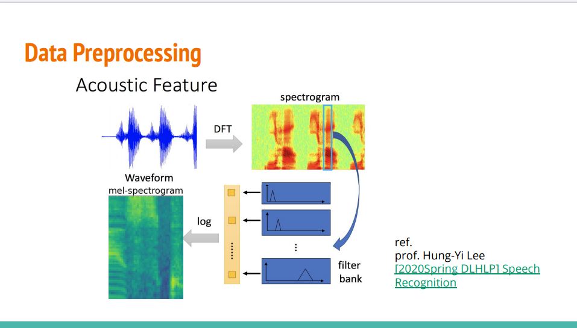

将一段原始音频波形（Waveform）转化为机器更易学习的梅尔语谱图（mel-spectrogram）：
1. DFT（离散傅里叶变换）：将时域的波形转化为频域的语谱图（spectrogram）。
2. Filter bank（梅尔滤波器组）：通过模拟人耳非线性听觉特性的滤波器对频谱进行过滤。
3. log（对数运算）：对能量数值取对数，压缩数据动态范围，最终得到梅尔语谱图（mel-spectrogram）。   

## 数据格式

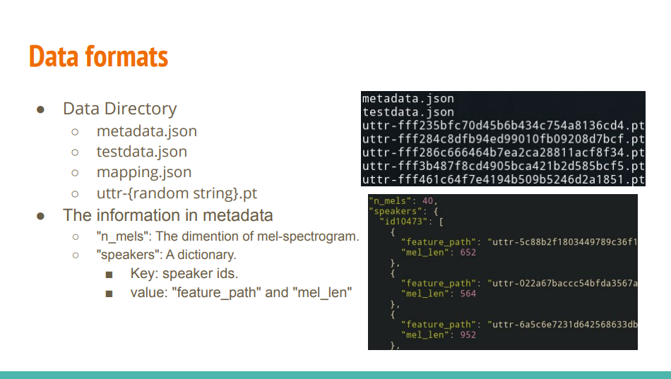

在写 PyTorch 数据加载器（Dataset 和 DataLoader）时，需要明确了解以下数据文件和字段含义：

1. 数据目录结构（Data Directory），数据集中包含以下几类文件：
    - metadata.json：训练集（Training set）的元数据说明，记录了每个说话人对应的音频文件路径和帧长度。
    - testdata.json：测试集（Testing set）的元数据说明。
    - mapping.json：说话人 ID（如 id10473）与分类类别编号（0 ~ 599）之间的映射字典。
    - uttr-{random string}.pt：存储实际音频特征的 PyTorch 张量文件（用 torch.load() 直接读取）。
2. metadata.json 内部字段解析，右下角的 JSON 示例给出了 metadata.json 包含的核心字段信息：
    - "n_mels": 40：
        - 表示梅尔语谱图（mel-spectrogram）的特征维度是 40。也就是说，每一帧音频特征向量的长度为 40。   
    - "speakers"：一个字典（Dictionary）：   
        - Key（键）：说话人的 ID（如 "id10473"）。   
        - Value（值）：一个列表，里面包含了该说话人的多段语音条目：   
            - "feature_path"：对应特征文件（如 uttr-5c88b2f1...pt）的文件名。   
            - "mel_len"：该段音频的帧数长度（如 652 帧、564 帧）。   

在代码中如何使用这些数据？
1. 读取 metadata.json 解析出 (feature_path, speaker_id) 的对。
2. 在 __getitem__ 方法中，使用 torch.load(feature_path) 加载音频特征张量（形状为 (mel_len, 40)）。
3. 通过 mapping.json 将 speaker_id 转为分类的类别 index，即可完成 PyTorch Dataset 的搭建。

## 训练阶段的数据切片

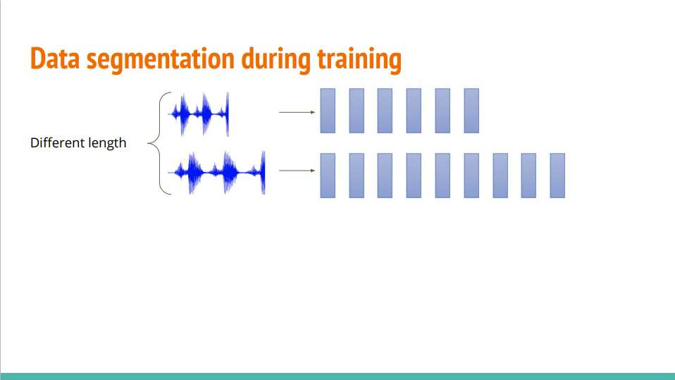

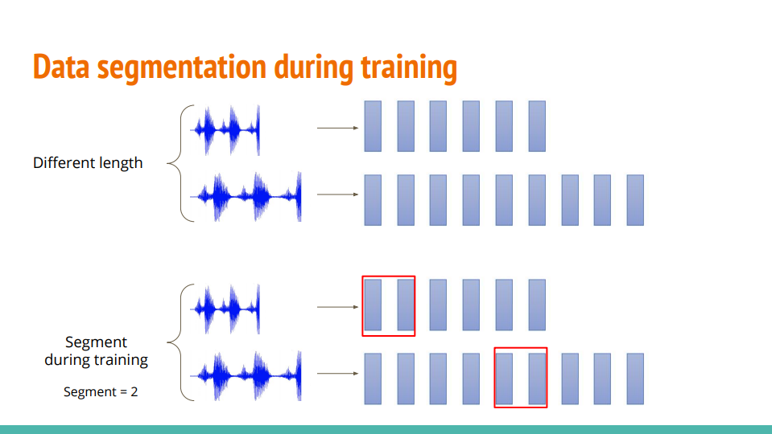

HW4（说话人分类） 等音频任务时，训练阶段的数据切片（Data segmentation during training） 策略。

我们可以从以下几个核心要点来理解为什么要这样做：

1. 问题的痛点：音频长度不一致（Different length）
    - 如图中上半部分所示，每一段输入的音频（Waveform）时长都是不一样的。   
    - 经过预处理后，转换出来的特征帧数（蓝色柱子的数量）也参差不齐（有的短，有的长）。   
    - 困难：在深度学习训练时，我们通常需要把多条数据打包成一个 Batch（批次） 输入到 GPU 中进行矩阵运算。如果序列长度不统一，直接组合就会报错。

2. 解决方案：训练时随机切片（Segment during training），为了解决变长音频的打包问题，并增加数据多样性，课程中引入了训练时切片（Segment）的策略（如图中下半部分所示）：   
    - 固定长度切片：设定一个固定的参数（例如图中 Segment = 2，或者实际项目中的固定帧数如 128 帧、200 帧）。   
    - 随机裁剪：在训练时，对于每一段音频，随机截取其中一小段固定长度的连续帧（如图中红框所示）送入模型训练。   

3. 这种做法的好处
    1. 统一 Batch 维度：所有音频在切片后都可以变成相同长度的张量，方便组成整齐的 Batch 丢进模型。
    2. 数据增强（Data Augmentation）：由于每次同一个音频被随机截取的位置不同，模型在每个 Epoch 会看到音频的不同片段，这相当于一种隐式的数据增强，能有效防止模型过拟合。