- [任务原PDF](#任务原PDF)
- [回顾SelfAttention](#回顾SelfAttention)
- [回顾Transformer](#回顾Transformer)
    - [TransformerEncoder](#Transformer-Encoder)
    - [Encoder多层输出与Cross-Attention的K和V对应关系](#Encoder多层输出与Cross-Attention的K和V对应关系)
    - [Transformer训练流程](#Transformer训练流程)
    - [Transformer预测流程](#Transformer预测流程)
    - [TransformerDecoder](#Transformer-Decoder)
- [Transformer家族](#Transformer家族)
- [Transformer衍生架构](#Transformer衍生架构)
- [任务描述](#任务描述)
    - [作业四任务描述](#作业四任务描述)
- [数据集](#数据集)
- [数据预处理](#数据预处理)
- [数据格式](#数据格式)
- [训练阶段的数据切片](#训练阶段的数据切片)
- [说话人分类任务Encoder-only架构](#说话人分类任务Encoder-only架构)
- [epoch和step](#epoch和step)

## 任务原PDF

[任务原PDF](https://speech.ee.ntu.edu.tw/~hylee/ml/ml2021-course-data/hw/HW04/HW04.pdf)

## 回顾SelfAttention

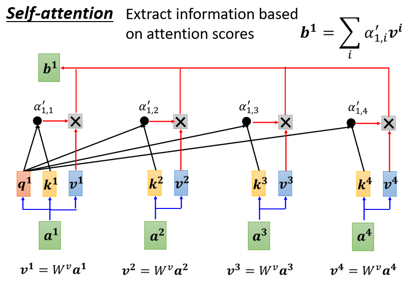

图中的核心元素拆解（“Q、K、V” 三剑客）

1. $a^1, a^2, a^3, a^4$（输入序列）：
    - 在声纹识别任务中，它们就像是音频切片（比如梅尔语谱图的各个时间帧序列）。

2. $q^1$（Query，查询）：
    - 代表 “当前我是谁？我在找什么？”
    - 图中是以第一个输入 $a^1$ 为例，它发出了一个查询 $q^1$，想要看看整个音频里其他部分和它有什么关系。

3. $k^1, k^2, k^3, k^4$（Key，键）：
    - 代表 “我是什么特征？我的标签是什么？”
    - 每一个输入都会对应一个 $k$。图中的黑色连线和黑圆圈，就是用 $q^1$ 去和所有的 $k$（$k^1, k^2, k^3, k^4$）去做匹配/打分。

4. $\alpha'_{1,i}$（Attention Scores，注意力权重）：
    - 经过归一化（比如 Softmax）后得到的得分/权重。
    - 如 $\alpha'_{1,2}$ 就代表：当我在关注第 1 个位置时，第 2 个位置对我的重要程度有多高。

5. $v^1, v^2, v^3, v^4$（Value，值）：
    - 代表 “我实际拥有的内容”。最下方写着 $v^1 = W^v a^1$ 等等，说明它们是输入经过权重矩阵变换后得到的真正“内容信息”。

顺着图中的红线，看数据是怎么流动的？

1. 第一步（找关系）：用橙色的 $q^1$ 去和所有的黄色 $k$ 逐个比对，算出相关性得分（黑线交汇处的黑圆圈）。
2. 第二步（算权重）：把这些得分转化为概率权重（即 $\alpha'_{1,1}, \alpha'_{1,2}, \alpha'_{1,3}, \alpha'_{1,4}$）。
3. 第三步（提取信息并加权求和）：
    - 每一个权重 $\alpha'$ 会去和对应的蓝色 $v$（内容）相乘（图中灰色的 X 乘号方块）。
    - 最后，所有乘完的结果通过红线汇聚到左上角，加起来就得到了最终的输出 $b^1$。   

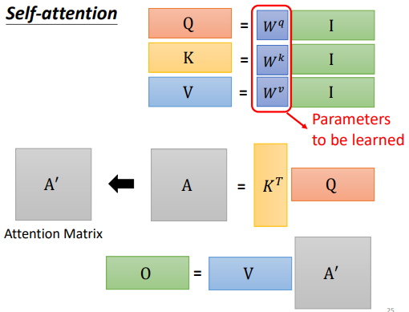

大核心步骤拆解

1. 线性变换（Feature Projection）计算：
    - $Q = W^q I, \quad K = W^k I, \quad V = W^v I$
    - 关键点：图中用红框特别强调了 $W^q, W^k, W^v$ 是整个层中唯一需要学习的参数（Parameters to be learned）。
        - 训练（Backpropagation）更新的就是这三个权重矩阵。
        - $Q, K, V$ 只是输入 $I$ 经过权重矩阵映射后产生的中间激活值（Activations）。

2. 计算关联度（Attention Score）计算：
    - $A = K^T Q \xrightarrow{\text{Softmax}} A'$
    - 关键点：$K^T \cdot Q$ 一口气算出了序列中所有向量两两之间的点积相似度，再通过 Softmax 按列归一化，得到概率分布矩阵 $A'$（**注意力矩阵（Attention Matrix）**）。
    
3. 上下文融合（Context Aggregation）计算：
    - $O = V A'$
    - 关键点：用特征数值矩阵 $V$ 乘上注意力权重矩阵 $A'$，得到最终的输出矩阵 $O$。
    
终极公式与工程直觉整个 Self-Attention 层的计算可以用一行公式总结：

$$O = (W^v I) \cdot \text{Softmax}\left((W^k I)^T (W^q I)\right)$$

Self-Attention 模块能拥有特征学习与抽象能力的核心原因：$W^q, W^k, W^v$ 不是硬编码的常量，而是模型的权重（Weights），会在训练过程中不断优化。

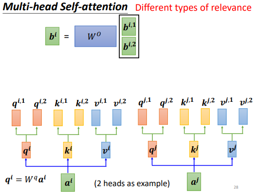

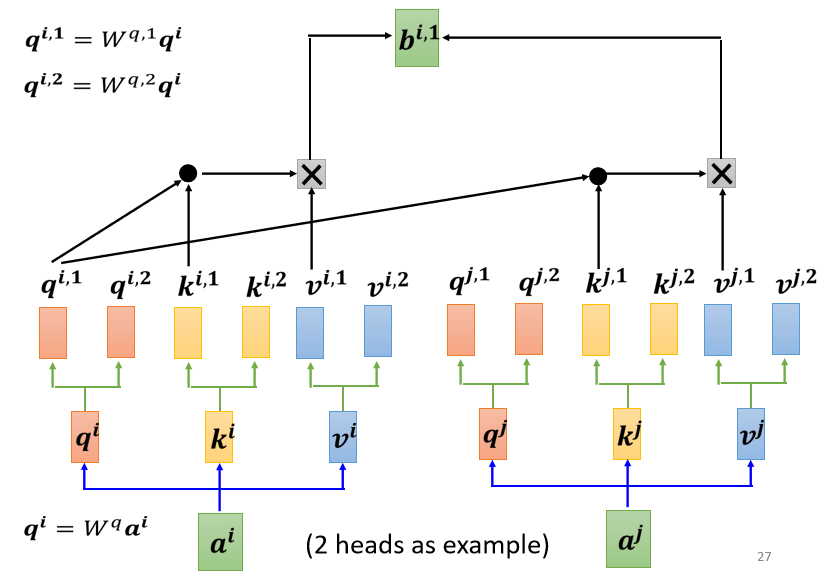

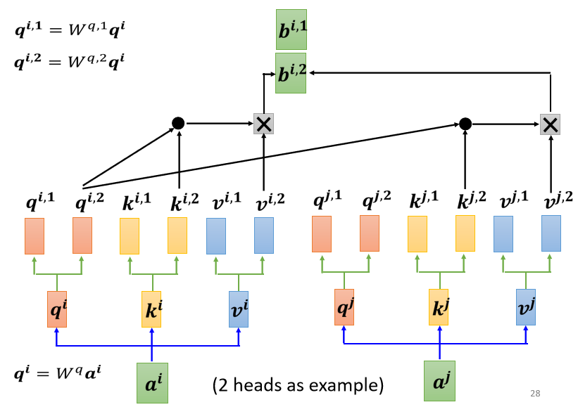

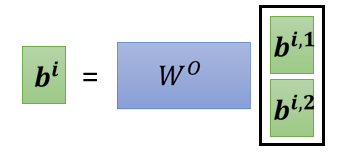

我们可以把这张图拆解为以下几个关键点：

1. 为什么要有“多头（Multi-head）”？
    - 如果只有一个头（Single-head），模型在看一段音频或一句话时，可能只能关注到一种单一的关系（比如只关注到局部的语调变化）。
    - 但如果我们设置了多个头（比如 2 个头、8 个头、甚至 16 个头），就像是给模型配了好几双不同角度的眼睛：
        - 头 1（Head 1）可能专门负责捕捉音频里长距离的节奏和韵律。
        - 头 2（Head 2）可能专门负责捕捉局部的声纹特征或发音细节。
2. 图里具体是怎么计算的？
    - 第一步：生成基础的 $q^i, k^i, v^i$
        - 就像最底下写的公式：$q^i = W^q a^i$，输入 $a^i$ 先生长出基础的查询、键、值。
    - 第二步：裂变成多个“头”（以 2 个头为例）
        - 看左上角的公式：$$q^{i,1} = W^{q,1} q^i$$ $$q^{i,2} = W^{q,2} q^i$$
            - 这意味着，原本的一个 $q^i$ 被不同的权重矩阵（$W^{q,1}$ 和 $W^{q,2}$）投影成了两份不同的子查询（$q^{i,1}$ 和 $q^{i,2}$）。
            - 同理，$k$ 和 $v$ 也都会被拆分成两组（比如图中的 $k^{i,1}, k^{i,2}$ 和 $v^{i,1}, v^{i,2}$ 等等）。
    - 第三步：各自独立计算注意力
        - 第 1 个头（Head 1）：用 $q^{i,1}$ 去和 $k^{j,1}$ 算分，然后去提取 $v^{i,1}$ 的内容，最后算出输出 $b^{i,1}$。   
        - 第 2 个头（Head 2）：用 $q^{i,2}$ 去和 $k^{j,2}$ 算分，然后去提取 $v^{i,2}$ 的内容，最后算出输出 $b^{i,2}$。 
3. 最终输出怎么处理？
    - 在各自计算完之后，所有的头（$b^{i,1}, b^{i,2} \dots$）会被拼接（Concatenate）起来，再通过一个线性变换矩阵，变成最终统一的输出。

我们设定一个极简的数值化具体例子：
- 设定输入序列：包含 2个词（$a^1$ 和 $a^2$）。
- 设定向量维度：总维度 $d = 4$。
- 设定头数（Multi-head）：$h = 2$（2个 Head）。
- 每个 Head 的维度：$d_k = d_v = d / h = 4 / 2 = 2$。

第一步：定义输入向量与初始参数

假设输入的两个词向量为：
1. $a^1 = \begin{bmatrix} 1 \\ 0 \\ 0 \\ 1 \end{bmatrix}$
2. $a^2 = \begin{bmatrix} 0 \\ 1 \\ 1 \\ 0 \end{bmatrix}$

为了让计算过程完全透明且不引入不必要的浮点数复杂性，我们设定投影矩阵 $W^q$、$W^k$、$W^v$ 均为 $4 \times 4$ 的单位矩阵（Identity Matrix）。

第二步：计算 Query, Key, Value 向量

根据公式 $Q = W^q I, K = W^k I, V = W^v I$，因为权重是单位矩阵，所以变换后的向量等于原向量：   
1. $q^1 = k^1 = v^1 = a^1 = \begin{bmatrix} 1 \\ 0 \\ 0 \\ 1 \end{bmatrix}$
2. $q^2 = k^2 = v^2 = a^2 = \begin{bmatrix} 0 \\ 1 \\ 1 \\ 0 \end{bmatrix}$

第三步：多头拆分（Split into Heads）

由于总维度是 4，且有 2 个 Head，我们将每个 4 维向量从中间均分为两半（前 2 维给 Head 1，后 2 维给 Head 2）：
1. 对于词 1 ($a^1$)：
    - Head 1（前 2 维）：$q^{1,1} = \begin{bmatrix} 1 \\ 0 \end{bmatrix}, \quad k^{1,1} = \begin{bmatrix} 1 \\ 0 \end{bmatrix}, \quad v^{1,1} = \begin{bmatrix} 1 \\ 0 \end{bmatrix}$
    - Head 2（后 2 维）：$q^{1,2} = \begin{bmatrix} 0 \\ 1 \end{bmatrix}, \quad k^{1,2} = \begin{bmatrix} 0 \\ 1 \end{bmatrix}, \quad v^{1,2} = \begin{bmatrix} 0 \\ 1 \end{bmatrix}$
2. 对于词 2 ($a^2$)：
    - Head 1（前 2 维）：$q^{2,1} = \begin{bmatrix} 0 \\ 1 \end{bmatrix}, \quad k^{2,1} = \begin{bmatrix} 0 \\ 1 \end{bmatrix}, \quad v^{2,1} = \begin{bmatrix} 0 \\ 1 \end{bmatrix}$
    - Head 2（后 2 维）：$q^{2,2} = \begin{bmatrix} 1 \\ 0 \end{bmatrix}, \quad k^{2,2} = \begin{bmatrix} 1 \\ 0 \end{bmatrix}, \quad v^{2,2} = \begin{bmatrix} 1 \\ 0 \end{bmatrix}$

第四步：各个 Head 内部独立计算 Self-Attention

我们以计算词 1 的输出（$b^1$）为例，分别在两个 Head 中独立进行：

1. Head 1 的计算过程：
    - 计算 Attention Scores（内积）：
        - $q^{1,1}$ 与 $k^{1,1}$ 的得分：$\begin{bmatrix} 1 & 0 \end{bmatrix} \cdot \begin{bmatrix} 1 \\ 0 \end{bmatrix} = 1 \times 1 + 0 \times 0 = 1$
        - $q^{1,1}$ 与 $k^{2,1}$ 的得分：$\begin{bmatrix} 1 & 0 \end{bmatrix} \cdot \begin{bmatrix} 0 \\ 1 \end{bmatrix} = 1 \times 0 + 0 \times 1 = 0$
        - 得分向量为：$[1, 0]$
    - Softmax 归一化（得到权重 $\alpha'$）： 
        - $\alpha'_{1,1} = \frac{e^1}{e^1 + e^0} = \frac{2.718}{3.718} \approx 0.73$
        - $\alpha'_{1,2} = \frac{e^0}{e^1 + e^0} = \frac{1}{3.718} \approx 0.27$
    - 加权求和（$b^{1,1} = \sum \alpha'_{1,i} v^{i,1}$）：   
        - $b^{1,1} = 0.73 \times \begin{bmatrix} 1 \\ 0 \end{bmatrix} + 0.27 \times \begin{bmatrix} 0 \\ 1 \end{bmatrix} = \begin{bmatrix} 0.73 \\ 0.27 \end{bmatrix}$
2. Head 2 的计算过程：
    - 计算 Attention Scores（内积）：
        - $q^{1,2}$ 与 $k^{1,2}$ 的得分：$\begin{bmatrix} 0 & 1 \end{bmatrix} \cdot \begin{bmatrix} 0 \\ 1 \end{bmatrix} = 0 \times 0 + 1 \times 1 = 1$
        - $q^{1,2}$ 与 $k^{2,2}$ 的得分：$\begin{bmatrix} 0 & 1 \end{bmatrix} \cdot \begin{bmatrix} 1 \\ 0 \end{bmatrix} = 0 \times 1 + 1 \times 0 = 0$
        - 得分向量为：$[1, 0]$
    - Softmax 归一化：   
        - 权重同样为：
            - $\alpha'_{1,1} \approx 0.73, \quad \alpha'_{1,2} \approx 0.27$
        - 加权求和（$b^{1,2} = \sum \alpha'_{1,i} v^{i,2}$）：   
            - $b^{1,2} = 0.73 \times \begin{bmatrix} 0 \\ 1 \end{bmatrix} + 0.27 \times \begin{bmatrix} 1 \\ 0 \end{bmatrix} = \begin{bmatrix} 0.27 \\ 0.73 \end{bmatrix}$

第五步：多头拼接（Concatenation），将各个 Head 计算出来的子向量上下拼在一起，恢复成原本的总维度（$2 + 2 = 4$ 维）：

$$\begin{bmatrix} b^{1,1} \\ b^{1,2} \end{bmatrix} = \begin{bmatrix} 0.73 \\ 0.27 \\ 0.27 \\ 0.73 \end{bmatrix}$$

第六步：通过输出矩阵 $W^O$ 进行线性变换（Final Projection），最后，将拼接好的 4 维向量乘以可学习的输出权重矩阵 $W^O$。

假设此处 $W^O$ 也是 $4 \times 4$ 的单位矩阵：

$$b^1 = W^O \times \begin{bmatrix} 0.73 \\ 0.27 \\ 0.27 \\ 0.73 \end{bmatrix} = \begin{bmatrix} 1 & 0 & 0 & 0 \\ 0 & 1 & 0 & 0 \\ 0 & 0 & 1 & 0 \\ 0 & 0 & 0 & 1 \end{bmatrix} \begin{bmatrix} 0.73 \\ 0.27 \\ 0.27 \\ 0.73 \end{bmatrix} = \begin{bmatrix} 0.73 \\ 0.27 \\ 0.27 \\ 0.73 \end{bmatrix}$$

至此，针对词 1 的多头自注意力完整计算流程（输入 $\rightarrow$ 投影 $\rightarrow$ 拆分 Head $\rightarrow$ 独立 Attention $\rightarrow$ 拼接 $\rightarrow$ 线性输出）全部完成。

## 回顾Transformer

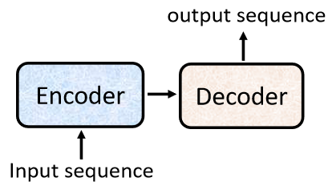

你可以把整个 Seq2Seq 过程想象成一个翻译官工作的过程：

1. Encoder（编码器 / 听众）：
    - 负责“听”并“理解”。它把输入的完整句子（Input sequence）逐字读入，把语言里的含义压缩/提炼成一个包含整句语义的“记忆脑海”（在技术上叫 Context Vector / 上下文向量）。

2. Decoder（解码器 / 表达者）：
    - 负责“思考”并“表达”。它拿到 Encoder 传过来的“记忆脑海”，结合自己上一刻刚刚说出的词，按顺序逐字吐出目标语言（output sequence）。

### TransformerEncoder

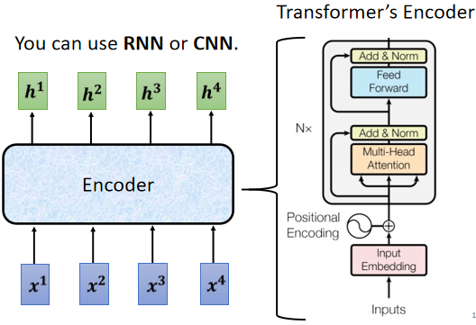

左图展示，Encoder 的本质就是“向量进，向量出”，无论是早期的 RNN/CNN，还是现在的 Transformer，编码器（Encoder）做的事情非常纯粹：

$$\text{输入 } N \text{ 个向量 } (x^1, x^2, \dots, x^N) \longrightarrow \text{输出 } N \text{ 个等长的向量 } (h^1, h^2, \dots, h^N)$$

1. 变换前的 $x^i$：只是单纯代表单个词的静态向量（如“苹果”的字面词向量）。
2. 变换后的 $h^i$：融合了全句上下文信息的动态向量（比如能区分“吃苹果”里的水果苹果，和“苹果手机”里的公司名称）。

右图完整画出了 Transformer 是如何优雅实现这种“向量特征融合”的，数据从下到上流动：

1. 准备阶段：词向量 + 位置编码
    - Input Embedding：把输入的单词转换成向量。
    - Positional Encoding（位置编码）：由于 Self-attention 是完全并行且无视顺序的，所以必须额外把“每个词在句子中的位置（第 1 个词、第 2 个词……）”加（$\oplus$）到向量里。
    
2. 核心循环块（N× 堆叠），右边的灰色大方框代表一个标准的 Encoder Block，通常会被堆叠 $N$ 层（例如 6 层或 12 层）：

1. Multi-Head Attention（多头自注意力层）：
    - 最关键的一步！利用 Self-attention 机制，让每一个向量都可以同时去关注（Attn）句子里其他的所有向量，完成全句上下文的信息融合。
    - Add & Norm（残差连接 + 层归一化）：
        - Add（残差连接）：把处理前的向量直接加到处理后的向量上（$x + f(x)$），防止网络加深时梯度消失。
        - Norm（Layer Normalization）：对向量数值做标准化，保证训练稳定性。
    - Feed Forward（前馈全连接层）：
        - 对每个位置的向量独立地进行非线性特征变换（由两层全连接 FC + 激活函数组成）。
    - Add & Norm：再次进行残差连接和层归一化。
    
总结

- 左边：展示了 Encoder 的抽象功能——把输入序列转换成带有上下文信息的特征序列。
- 右边：展示了 Transformer 的具体实现——放弃了传统 RNN 的串行循环，改用 Self-attention + 残差连接 + FC 的组件，实现了全并行、高效且上下文捕捉能力极强的编码器。现代像 BERT 这样的模型，本质上就是由多层 Transformer Encoder 堆叠而成的。

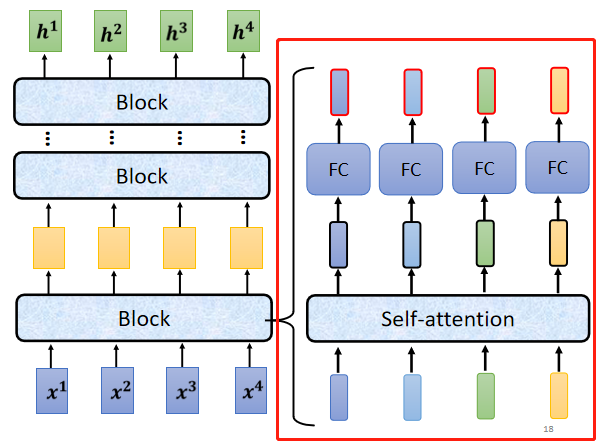

1. 宏观视角（看左图）：多层 Block 纵向堆叠，左图展示的是 Transformer Encoder 的整体设计：
    - 输入：$4$ 个初始词向量 $x^1, x^2, x^3, x^4$（假设维度 $d = 512$）。
    - 核心机制：通过堆叠多个结构完全相同的 Block（比如堆叠 6 层或 12 层），让数据一层层向上传递。
    - 输出：$4$ 个最终的深层语义向量 $h^1, h^2, h^3, h^4$（维度依然是 $512$）。
    - 作用：浅层的 Block 提取简单的语法和字面特征；越往高层的 Block，提炼出的抽象语义和复杂关系越丰富。

2. 微观视角（看右图红框）：单个 Block 内部的数据之旅，右图红框把一个 Block 内部的运作机制彻底拉大了，它由 两个阶段 顺序组成：
    - 阶段 1：Self-attention（横向跨词交流）
        - 输入：$4$ 个独立的向量（例如 $4 \times 512$ 的矩阵）。
        - 发生了什么：每个词向量通过计算 Attention 权重，与句子里的其他所有词向量做信息交互。
        - 输出：$4$ 个融合了上下文关系的新向量（中间排的那 $4$ 个带有关系的蓝色/黄色/绿色向量，维度依然是 $512$）。
    - 阶段 2：FC / 全连接层（纵向特征深度提炼）这里有 3 个绝对关键的真相：
        - 图上的 4 个 FC 蓝盒子是“同一套网络”（参数共享），图上虽然画了 4 个 FC 盒子，但它们并不是 4 套不同的网络，而是同一套 FC 网络在并行处理 4 个位置上的向量。它们共享完全相同的权重参数（$W$ 和 $b$）。
        - 一个 FC 蓝盒子里藏着几千个神经元，FC 绝对不是一个神经元！ 每一个 FC 蓝盒子内部是一个经典的两层全连接网络（Feed-Forward Network），结构如下：
            - 输入：$1$ 个 $512$ 维的上下文向量。
            - 第一层 FC（升维）：
                - 拥有 $2048$ 个神经元（每一个神经元内部都包含 $1 \times 512$ 个权重参数）。
                - $512$ 维向量与这 $2048$ 个神经元分别做点积，输出一个 $2048$ 维的大向量。
            - 非线性激活（Activation）：
                - 对这 $2048$ 个数字逐个套入非线性函数（如 GELU），给特征赋予弯曲和拟合复杂规律的能力。
            - 第二层 FC（降维还原）：
                - 拥有 $512$ 个神经元（每一个神经元内部包含 $1 \times 2048$ 个权重参数）。
                - 将 $2048$ 维特征重新压缩回 $512$ 维。
            - 输出：$1$ 个经过非线性深度提炼的 $512$ 维新向量（图顶部的红/蓝/绿/黄框向量）。

Transformer 的 Encoder Block，就是先用 Self-attention 让 $N$ 个向量互相开会交流上下文，再用 FC 里几千个带非线性激活的神经元（$1 \times d$ 参数）把每个向量独立“磨炼提炼”一遍，最终输出 $N$ 个保持原维度、但语义极深的新向量！

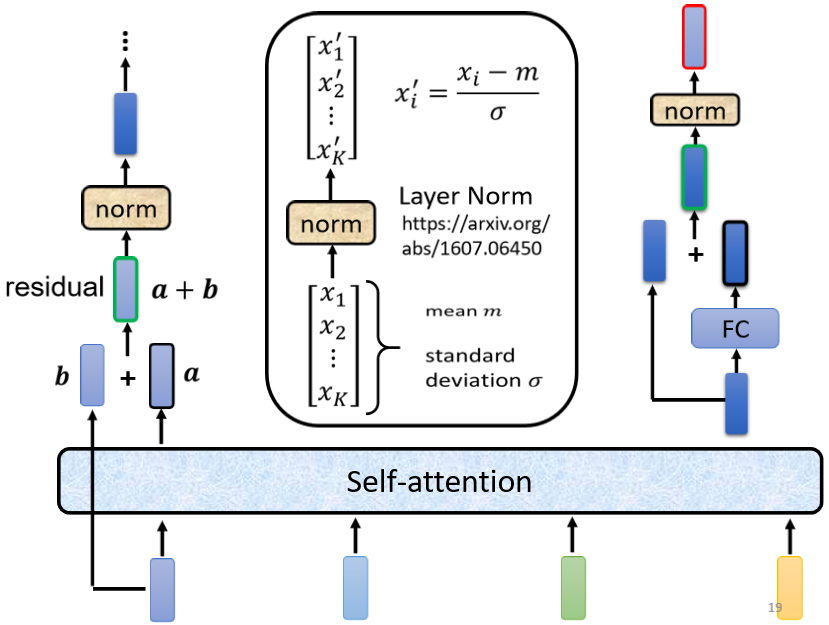

两个核心“保镖”机制是什么？

1. 残差连接（Residual Connection）—— “留一条后路/走捷径”
    - 怎么做：把模块的原始输入向量 $b$，直接拉一条线过来，加到处理后的输出向量 $a$ 上，得到 $a + b$。
    - 为什么做：在神经网络很深的时候，信息容易在层层传递中丢失或出现梯度消失。残差连接相当于给网络加了一条“捷径”，保证即使模块什么都没学到（输出 $a \approx 0$），至少原本的信息 $b$ 还能完好无损地传下去。

2. 层归一化（Layer Normalization, LN）—— “把数值拉回标准范围”
    - 怎么做（看图中中间的公式）：
        - 对于单个长度为 $K$ 的向量 $[x_1, x_2, \dots, x_K]^T$：
            - 计算这个向量内部所有元素的均值 $m$ 和 标准差 $\sigma$。
            - 对向量里的每一个数值做标准化缩放：
            $$x_i' = \frac{x_i - m}{\sigma}$$
    - 为什么做：向量经过矩阵乘法和非线性激活后，里面的数值可能会变得极大或极小（数值不稳定）。LayerNorm 可以把向量里的数字重新“拉回”到均值为 0、方差为 1 的健康分布，极大加快训练收敛速度。

3. 用两个数学公式总结在 Transformer 代码实现中，上面这一整张图的逻辑其实就是简洁的两行代码（Post-LN 变体）：
    - 第一阶段（注意力层）：
    $$\mathbf{x}_{\text{mid}} = \text{LayerNorm}(\mathbf{x} + \text{SelfAttention}(\mathbf{x}))$$
    - 第二阶段（前馈网络层）：
    $$\mathbf{x}_{\text{out}} = \text{LayerNorm}(\mathbf{x}_{\text{mid}} + \text{FC}(\mathbf{x}_{\text{mid}}))$$
    - 输入 $\mathbf{x}$ 的维度是 $512$；
    - 经过这两次 Add & Norm 之后，得到的 $\mathbf{x}_{\text{out}}$ 维度依然是完美的 $512$！

#### Encoder多层输出与Cross-Attention的K和V对应关系

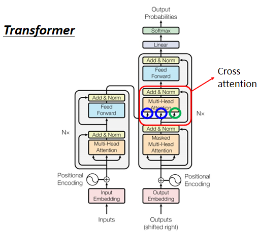

标准 Transformer 中，Decoder 每一层 Cross-Attention 的 K、V 都来自 Encoder 最后一层的输出（memory），不是来自 Encoder 各层的中间输出，也不是第 i 层对第 i 层。

单个位置的 K、V 是向量；整个序列的 K、V 是向量堆成的矩阵。

#### Transformer训练流程

第一阶段：数据准备与“打包灌输”（并行输入），在训练时，为了充分利用 GPU 的强大并行计算能力，我们绝对不会一个字一个字慢吞吞地输入，而是把整句话“打包”一次性塞进模型：
1. 左侧 Encoder 的输入：
    - 直接塞入整句原文：["I", "love", "you"]。
2. 右侧 Decoder 的输入：
    - 塞入整句目标答案，并在最前面加上一个起始符 <BOS>（代表句子开始）：
    - 输入序列变成：["<BOS>", "我", "爱", "你"]。

2. 第二阶段：左侧 Encoder 侧的计算（无 Mask，完全开放）
    - 词语先通过 Embedding 和位置编码，变成一堆高维向量。
    - 接着，数据穿过 Encoder 的 $N$ 个 Block（每一层都有自注意力和前馈网络 Feed Forward）。
    - 关键点：在 Encoder 内部，因为是整句话一起输入的，每一个词都可以和整句话的其他词互相“看一眼”（Self-Attention），完全开放，没有任何遮挡。
    - 最终输出：当走完第 $N$ 层的 Feed Forward 之后，Encoder 吐出了一组代表整句话全局语义的高维特征向量（通常叫 Hidden States）。这组特征向量随后会被稳稳保存下来，用来随时准备支援右侧。

3. 第三阶段：右侧 Decoder 侧的计算（必须加 Mask，严防死守），Decoder 的任务是根据左侧传来的全局特征，去对照、还原出目标文本 "我爱你"。在这个过程中，Decoder 内部要经历两个核心步骤：
    - 步骤 1：Masked Self-Attention（解码器内部的自注意力 + 严厉的“防作弊掩码”）
        - 为什么要加 Mask？
            - 因为我们在训练时，Decoder 的输入是一口气把 ["<BOS>", "我", "爱", "你"] 全部塞进去的。
            - 如果不加 Mask，由于矩阵计算是同时进行的，模型在处理第一个字 "<BOS>" 或者 "我" 时，一眼就能扫到后面的 "爱" 和 "你"，这就等于直接“抄了答案”。
            - 加上 Mask（掩码）之后：我们在矩阵上加了一道“黑布”。当模型计算某个位置时，它只能看到自己及之前的历史，绝对不准看后面的词。
            - 这样就能逼着模型去学：“在只有前面已知信息的情况下，我该如何预测下一个字”。
    - 步骤 2：Cross Attention（交叉注意力 —— 连通左右两边的桥梁）
        - 经历过 Mask 过滤的 Decoder 特征，会变成 Query ($Q$)。
        - 此时，它会去调用我们在第二阶段里由 Encoder 留下的那组全局特征向量，通过乘以权重，当场转换成 Key ($K$) 和 Value ($V$)。
        - 在这里，Decoder 带着它当前的翻译进度（$Q$），去查阅 Encoder 读到的原文记忆（$K$ 和 $V$），把源语言和目标语言的语义完美对齐。

4. 第四阶段：计算损失与反向传播（学习过程）
    - Decoder 走完所有的 Cross Attention、Feed Forward 之后，最后通过 Linear 层和 Softmax，对每一个位置都预测出了一个“词表里哪个字概率最高”的预测结果。
    - 对答案：
        - 第 1 个位置预测出的词，和标准答案 “我” 去对比。
        - 第 2 个位置预测出的词，和标准答案 “爱” 去对比。
        - 第 3 个位置预测出的词，和标准答案 “你” 去对比。
    - 反向传播：如果预测错了（比如把“爱”猜成了“恨”），系统就会计算损失（Loss），然后通过梯度下降去更新模型里所有参数的权重，让它下一次猜得更准。

#### Transformer预测流程

预测阶段和训练阶段有一个本质的不同：训练时是一口气把整句话“并行”喂进去的（靠 Mask 防作弊）；而预测时，由于我们不知道未来要生成什么，模型必须“串行”——一个字、一个字地往外蹦（这叫自回归 Auto-regressive）。

我们依然用翻译任务：输入英文 "I love you" $\rightarrow$ 预测并输出中文 "我爱你"，来看看预测时的真实流程。

1. 第一阶段：左侧 Encoder 预处理（只跑一次，且结果被永久缓存），在预测时，Encoder 的任务非常纯粹：把整句原文读懂，然后把记忆存起来。
    - 输入原文：将整句 "I love you" 输入给左侧的 Encoder。
    - 一次性计算：Encoder 顺着它的 $N$ 个 Block 一路向前，把整句话的特征全部算完，吐出最终的全局特征矩阵（Hidden States）。
    - KV Cache（关键缓存）：
        - 因为在接下来的整个生成过程中，用户的输入（源文本）是固定不变的。
        - 所以，系统会把 Encoder 最终的特征通过线性变换算出来的 $K$（Key）和 $V$（Value） 直接缓存（Cache）在显存里。
            - 这些 $W_k$ 和 $W_v$ 属于【Decoder（解码器）每一层内部的 Cross Attention 模块】，它们是每一层各自拥有的专属权重矩阵。
        - 在后面的整个生成过程中，再也不需要让 Encoder 重新计算了，Decoder 的交叉注意力每次直接去显存里读取这套缓存即可。
2. 第二阶段：右侧 Decoder 逐字循环生成（核心“自回归”过程），右侧的 Decoder 开始工作了。由于它不知道答案，它必须一个字一个字地往外蹦。
    - 🔹 第 1 步：生成第一个字
        - 输入：喂给 Decoder 一个起始标志 "<BOS>"（代表句子的开始）。
        - Decoder 内部计算：
            - Masked Self-Attention：此时输入只有一个词 "<BOS>"，它自己看自己。
            - Cross Attention：Decoder 带着当前的状态（Query $Q$），去显存里查询 Encoder 留下的 $K$ 和 $V$，看看原文到底讲了啥。
        - 预测输出：经过最后的线性层和 Softmax 概率计算，模型在词表里挑选出概率最高的一个字 ➔ “我”。
        - 动作：把刚生成的 “我” 拼到输入后面。此时的已生成序列变成了：["<BOS>", "我"]。
    - 🔹 第 2 步：生成第二个字
        - 输入：把刚才积累的 ["<BOS>", "我"] 一起作为 Decoder 的输入。
        - Decoder 内部计算：
            - Masked Self-Attention：此时有两个词了。通过 Mask 的保护，第二个字“我”能看到第一个字 "<BOS>"，但看不到未来。
            - Cross Attention：继续去显存里查询 Encoder 的全局特征。
        - 预测输出：模型根据前文 "<BOS> 我"，预测出下一个字 ➔ “爱”。
        - 动作：把 “爱” 再拼进输入序列。此时序列变成了：["<BOS>", "我", "爱"]。
    - 🔹 第 3 步：生成第三个字
        - 输入：当前序列为 ["<BOS>", "我", "爱"]。
        - Decoder 内部计算：重复上述的自注意力和交叉注意力查询。
        - 预测输出：模型预测出下一个字 ➔ “你”。
        - 动作：序列变成：["<BOS>", "我", "爱", "你"]。
    - 🔹 第 4 步：触发结束标志
        - 输入：当前序列包含 ["<BOS>", "我", "爱", "你"]。
        - 预测输出：模型察觉到句子已经完整，预测出了一个特殊的终止符号 <EOS>（End of Sequence）。
        - 终止：检测到 <EOS> 后，生成循环立刻中断。

3. 💡 预测流程的两个核心亮点
    - KV Cache（极大提速）：
        - 因为左侧 Encoder 的 $K$ 和 $V$ 在第一步就已经算好并缓存了，所以在后面生成“我”、“爱”、“你”时，右侧每次查阅原文都是直接读显存，省去了重复计算 Encoder 的巨大开销。
    - 为什么预测时不需要 Mask 也能防作弊？
        - 在训练时我们需要用 Mask 是因为把答案全塞进去了。
        - 而在预测时，当模型在生成第 1 个字“我”的时候，第 2 个字“爱”和第 3 个字“你”在现实中根本还没被计算出来，后面是一片空白。既然“未来”还没诞生，自然也就无从“作弊”了。
        
### TransformerDecoder

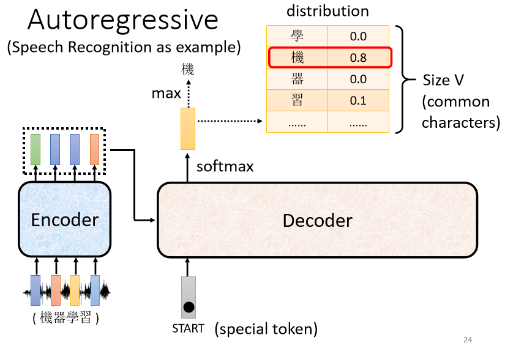

这不是训练，而是 推理 / 预测阶段（Inference / Testing） 的 自回归（Autoregressive）生成过程。

上图以语音识别（Speech Recognition）为例，展示了模型如何将一段语音（“機器學習”）逐字翻译成文本。

步骤：

1. 第一步：解码器先输入一个特殊的起始标记 START。   
2. 预测概率分布：经过 Decoder 计算和 softmax 之后，它会把整个词表（大小为 $V$，包含所有常用汉字）里的每个字都计算出一个概率。   
3. 选出最高分（Max）：如图中红框所示，“機”字的概率最高（$0.8$），于是模型第一个字输出了 “機”。   
4. 滚动循环：接下来，刚刚生成的“機”会被当作输入喂回给解码器，去预测第二个字“器”……以此类推，像滚雪球一样一个字接一个字地把整句话生成出来。


## Transformer家族

Transformer 自 2017 年在论文《Attention Is All You Need》中问世以来，已经演化成一个庞大的家族。根据网络架构的组合方式和核心应用场景，整个 Transformer 家族主要可以被划分为三大支柱：

两塔转换，一塔生成，一塔理解。

1. 两塔（Enc-Dec）：翻译摘要
2. 右塔（Dec-only）：聊天写作
3. 左塔（Enc-only）：分类理解

一、Encoder-Decoder（完整版 Seq2Seq）

结构：左塔 Encoder + 右塔 Decoder，中间用 Cross Attention 连接。

数据流：
```TEXT
源序列 → Encoder（双向理解）→ 记忆向量
                                    ↓（作 K、V）
目标序列 → Decoder（Masked 自注意力）+ Cross Attention → 逐词生成
```

特点：
1. Encoder 双向看（无 Mask），Decoder 单向看（Masked）。
2. 适合“输入一段序列，输出另一段序列”。

代表：原版 Transformer、T5、BART、mBART。

任务：机器翻译、文本摘要、语音识别、问答生成。

二、Decoder-only（自回归生成）

结构：只有解码器，没有 Encoder，没有 Cross Attention。

数据流：
```TEXT
序列 → Masked Self-Attention → FFN → 预测下一个词 → 拼回去 → 再预测…
```

特点：
1. 单序列自回归，每个位置只能看自己和前面的词。
2. “理解”和“生成”揉在同一套 Masked 自注意力里。
3. 训练并行（整段喂入 + 下三角 Mask），推理串行（逐 token + KV Cache）。

代表：GPT 系列、LLaMA、DeepSeek、Qwen、ChatGLM。

任务：文本生成、对话、代码生成、几乎所有大语言模型。

三、Encoder-only（纯编码器）

结构：只有编码器，双向自注意力，无 Mask。

数据流：
```TEXT
输入 → 多层 Encoder（全局互看）→ 池化/取[CLS] → 分类/回归
```

特点：
1. 每个位置能看到全序列，擅长“理解”。
2. 不做自回归生成，输出是标签或向量。

补充：
1. 比如一句话 20 个 token，输出就是 [1, 20, 768]——20 个向量，每个 768 维。
2. 分类头通常只接收一个向量：[batch, d_model]，所以需要一步“压缩”：把 20 个向量 → 1 个向量。这一步就叫池化（pooling，字面意思是“汇聚”）。
3. 池化的几种做法，假设有 20 个 token 向量，每个 768 维：
    - 平均池化：20 个向量逐维求平均，得到 1 个 768 维向量。
        - v = (v_1 + v_2 + ... + v_20) / 20
    - 最大池化：每一维取 20 个 token 里的最大值。
        - v[j] = max(v_1[j], v_2[j], ..., v_20[j])
    - 注意力池化：学一组权重 α，加权求和。
        - v = Σ α_i · v_i
4. 取 [CLS] 是什么？
    - 这是 BERT 的做法，属于“池化”的一种特例，但机制不同。
    - 做法：在输入序列最前面加一个特殊 token [CLS]，它本身没有词义，是个“占位符”。
        - 输入：[CLS] 我 爱 学习
    - 经过多层 Encoder 后，因为自注意力是全局互看的，[CLS] 这个位置能注意到所有其他 token，它的输出向量就逐渐聚合了整句信息。
    - 最后直接取第 0 个位置（[CLS]）的输出向量作为整句表示：
        - 句向量 = output[:, 0, :]   # 只取 [CLS] 那个位置

代表：BERT、RoBERTa、你的说话人分类器。

任务：文本分类、情感分析、命名实体识别、说话人识别、句向量提取。

## Transformer衍生架构

除了上述三大经典分类，近年来 Transformer 家族还衍生出了许多针对特定领域的王牌架构：

1. Conformer（语音领域的黄金标准）：
    - 将 Transformer 的自注意力机制（善于捕捉全局长距离依赖）与卷积神经网络（CNN，善于捕捉局部空间/时间特征）无缝结合，目前是语音识别、声纹辨识和语音合成的主流架构（也就是你接下来准备在代码里实现的模型）。
2. Vision Transformer (ViT)：
    - 把一张图像切成若干个小方块（Patch），把它们当成“文字”喂进纯 Encoder 中，彻底颠覆了计算机视觉（CV）长期由 CNN 统治的格局。
3. Mamba / State Space Models (SSM) 融合架构：
    - 尽管严格意义上属于新兴的非 Transformer 序列模型，但许多现代混合架构（如 Jamba）将 Transformer 的 Attention 与 SSM 结合，试图解决传统 Transformer 在处理超长文本时计算量爆炸（$O(N^2)$）的痛点。

## 任务描述

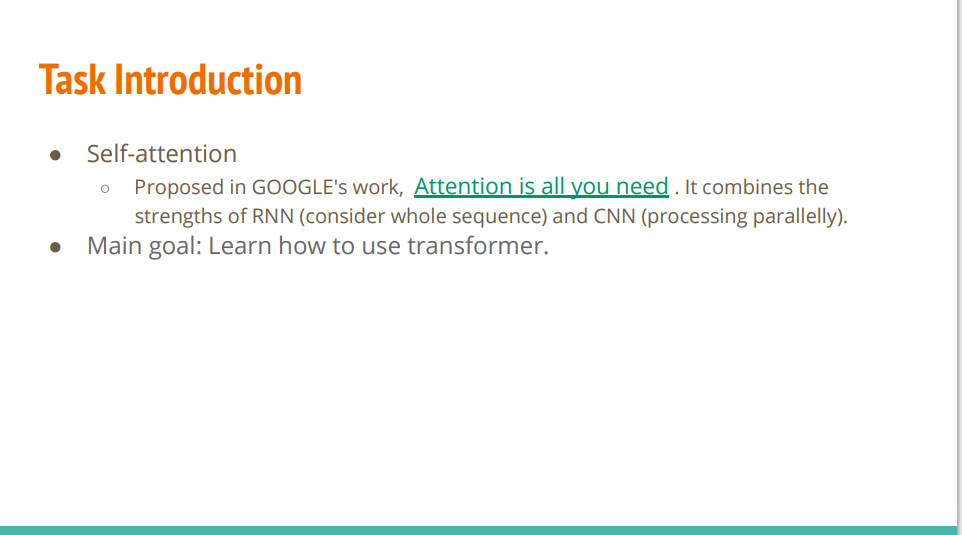

Self-attention（自注意力机制）巧妙地结合了传统两大架构的核心优势：   

1. 继承了 RNN 的优点：能够考虑整个序列的上下文（全局视野，不再像 CNN 那样受限于局部感受野）。   
2. 继承了 CNN 的优点：能够进行高效的并行处理（利用矩阵乘法在 GPU 上同时运算，摆脱了 RNN 必须逐个词串行计算的枷锁）。   

这页幻灯片的最终目标（Main goal）也很直接：教你学会如何使用 Transformer。   

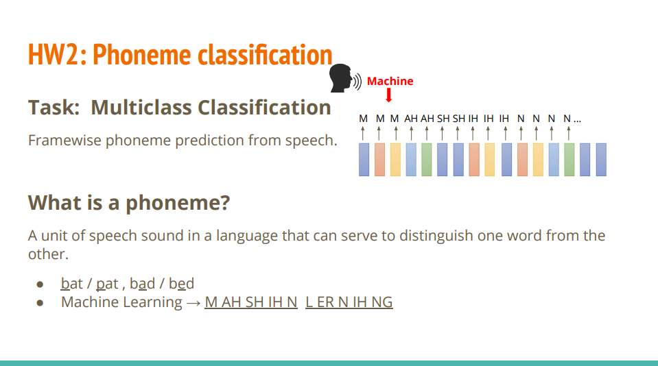

语音识别（Speech Recognition）领域中的一个经典入门任务：逐帧音素预测（Framewise Phoneme Prediction）。

1. 任务定义（Task Introduction）
    - 任务类型：多分类任务（Multiclass Classification）。
    - 核心目标：从给定的语音信号中，进行逐帧音素预测（Framewise phoneme prediction）。
    - 工作机制：人类说话的连续语音会被切分成极短的时间片（称为“帧 Frame”，图里下方那一排彩色小方块）。
    - 机器（Machine）要做的事情，就是对每一帧音频进行分类，判断这一帧的声音对应哪一个音素（Phoneme）（如图上方预测出的 M, AH, SH, IH, N...）。
    
2. 什么是音素？（What is a phoneme?）
    - 定义：语言中能够区分不同词义的最小发音单位。
    - 示例说明：
        - 区分词义：改变一个音素，词义就变了。
            - bat / pat（/b/ 和 /p/ 是不同音素，改变后词变了）
            - bad / bed（/æ/ 和 /e/ 是不同音素）
        - 句子拆解：
            - 比如短语 "Machine Learning"，用音素标注序列表示就是：Machine $\rightarrow$ M AH SH IH NLearning $\rightarrow$ L ER N IH NG

3. 一个语音样本在标注体系（TIMIT 数据集）、文本单词（拼写）和 标准发音（国际音标）之间的对应关系：
    - iy，beet，/biːt/
    - $$\text{人类文字: } \mathbf{beet} \xrightarrow{\text{标准发音}} \text{国际音标: } \mathbf{/bi\mathbf{\boldsymbol{ː}}t/} \xrightarrow{\text{音素拆解与编码}} \text{TIMIT 机器标签: } \mathbf{iy} \text{ (Class 0)}$$
    - iy（TIMIT 音素代号）：
        - 身份：计算机/算法处理时使用的机器标签（Class Label，即 Class 0）。
        - 作用：由于国际音标符号（如 /iː/）带有特殊字符，不方便写进代码和文件名中，因此 TIMIT 数据集采用纯英文字母构成的 ARPAbet 规范，用 iy 来代表长元音 /iː/。   
    - beet（英文单词 / 文本拼写）：
        - beet 中的字母组合 ee：在口语发音中被读作长元音 /iː/。
        - 身份：人类在日常生活中书写和阅读的文本单词（意为“甜菜”）。
        - 作用：在这里作为 提示示例（Example），帮助人类直观理解 iy 这个音素对应的是什么发音。
    - /biːt/（国际音标 IPA，International Phonetic Alphabet）：
        - 身份：标准语言学中的发音标示。
        - 作用：精确刻画单词 beet 的标准读音。其中 /iː/ 是发音核心（长元音），前面的 /b/ 和后面的 /t/ 是前后辅音。

### 作业四任务描述

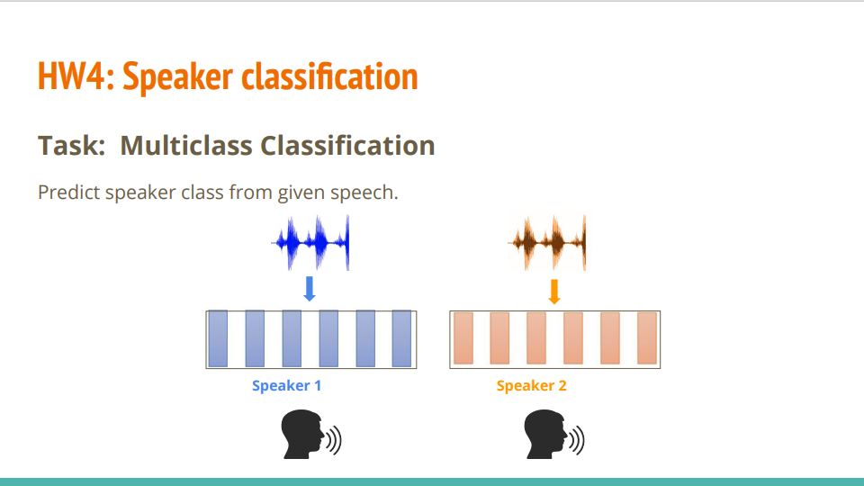

HW4：说话人分类（Speaker classification） 的任务介绍。

核心是一个多分类任务（Multiclass Classification），目标是根据输入的整段语音波形，预测出这段话是由哪一位说话人（Speaker）说的。

## 数据集

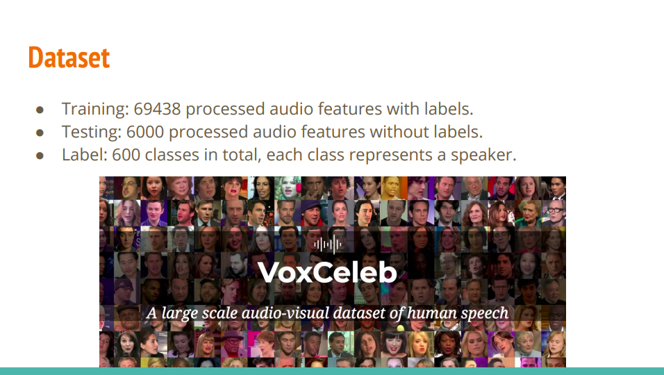

HW4（说话人分类 / Speaker Classification） 所使用的数据集背景——VoxCeleb。

我们可以从以下几个关键维度来理解这个数据集的构成：

1. 数据集规模与划分
    - 训练集（Training）：包含 69,438 个经过处理的带有标签的音频特征。   
    - 测试集（Testing）：包含 6,000 个没有标签的音频特征（需要模型预测出它们分别属于哪个说话人，并提交结果进行评分）。   
    - 类别总数（Labels）：总共包含 600 个类（classes），每一个类就代表一个不同的说话人（Speaker）。也就是说，这是一个 600 分类的多分类任务。   

2. 关于 VoxCeleb 数据集背景：
    - VoxCeleb 是语音处理和声纹识别领域非常经典、大规模的真实世界音视频数据集。  
    - 特点：里面的音频数据都是从 YouTube 访谈视频中提取出来的，包含了各种真实的噪声、不同的说话口音、以及环境干扰，因此用它来训练模型具有很强的实际应用价值。

## 数据预处理

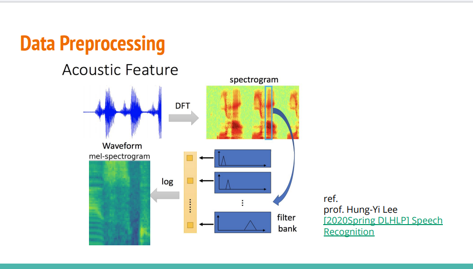

将一段原始音频波形（Waveform）转化为机器更易学习的梅尔语谱图（mel-spectrogram）：
1. DFT（离散傅里叶变换）：将时域的波形转化为频域的语谱图（spectrogram）。
2. Filter bank（梅尔滤波器组）：通过模拟人耳非线性听觉特性的滤波器对频谱进行过滤。
3. log（对数运算）：对能量数值取对数，压缩数据动态范围，最终得到梅尔语谱图（mel-spectrogram）。   

## 数据格式

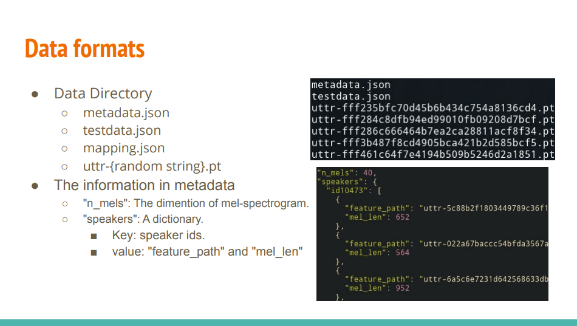

在写 PyTorch 数据加载器（Dataset 和 DataLoader）时，需要明确了解以下数据文件和字段含义：

1. 数据目录结构（Data Directory），数据集中包含以下几类文件：
    - metadata.json：训练集（Training set）的元数据说明，记录了每个说话人对应的音频文件路径和帧长度。
    - testdata.json：测试集（Testing set）的元数据说明。
    - mapping.json：说话人 ID（如 id10473）与分类类别编号（0 ~ 599）之间的映射字典。
    - uttr-{random string}.pt：存储实际音频特征的 PyTorch 张量文件（用 torch.load() 直接读取）。
2. metadata.json 内部字段解析，右下角的 JSON 示例给出了 metadata.json 包含的核心字段信息：
    - "n_mels": 40：
        - 表示梅尔语谱图（mel-spectrogram）的特征维度是 40。也就是说，每一帧音频特征向量的长度为 40。   
    - "speakers"：一个字典（Dictionary）：   
        - Key（键）：说话人的 ID（如 "id10473"）。   
        - Value（值）：一个列表，里面包含了该说话人的多段语音条目：   
            - "feature_path"：对应特征文件（如 uttr-5c88b2f1...pt）的文件名。   
            - "mel_len"：该段音频的帧数长度（如 652 帧、564 帧）。   

在代码中如何使用这些数据？
1. 读取 metadata.json 解析出 (feature_path, speaker_id) 的对。
2. 在 __getitem__ 方法中，使用 torch.load(feature_path) 加载音频特征张量（形状为 (mel_len, 40)）。
3. 通过 mapping.json 将 speaker_id 转为分类的类别 index，即可完成 PyTorch Dataset 的搭建。

## 训练阶段的数据切片

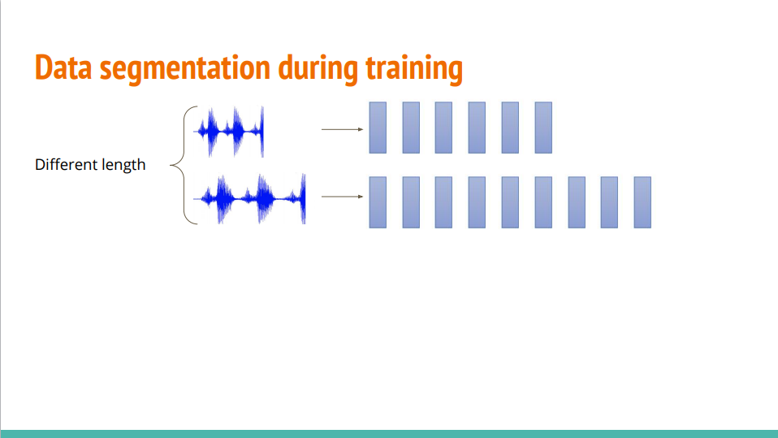

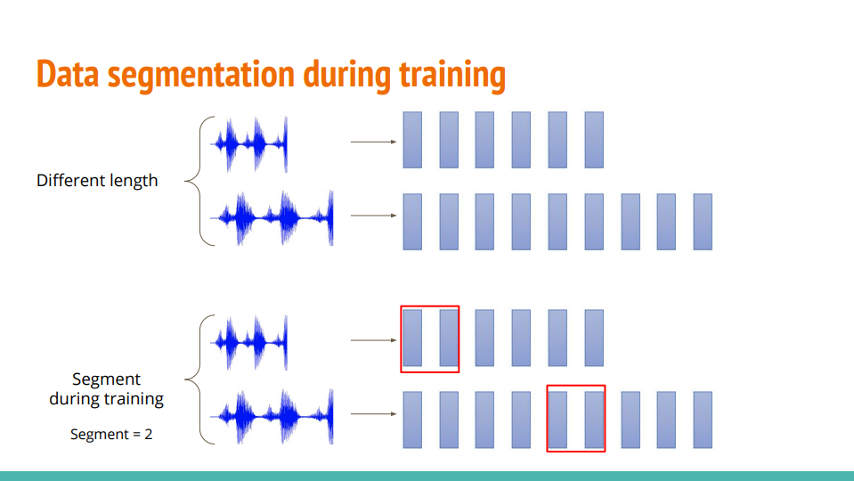

HW4（说话人分类） 等音频任务时，训练阶段的数据切片（Data segmentation during training） 策略。

我们可以从以下几个核心要点来理解为什么要这样做：

1. 问题的痛点：音频长度不一致（Different length）
    - 如图中上半部分所示，每一段输入的音频（Waveform）时长都是不一样的。   
    - 经过预处理后，转换出来的特征帧数（蓝色柱子的数量）也参差不齐（有的短，有的长）。   
    - 困难：在深度学习训练时，我们通常需要把多条数据打包成一个 Batch（批次） 输入到 GPU 中进行矩阵运算。如果序列长度不统一，直接组合就会报错。

2. 解决方案：训练时随机切片（Segment during training），为了解决变长音频的打包问题，并增加数据多样性，课程中引入了训练时切片（Segment）的策略（如图中下半部分所示）：   
    - 固定长度切片：设定一个固定的参数（例如图中 Segment = 2，或者实际项目中的固定帧数如 128 帧、200 帧）。   
    - 随机裁剪：在训练时，对于每一段音频，随机截取其中一小段固定长度的连续帧（如图中红框所示）送入模型训练。   

3. 这种做法的好处
    1. 统一 Batch 维度：所有音频在切片后都可以变成相同长度的张量，方便组成整齐的 Batch 丢进模型。
    2. 数据增强（Data Augmentation）：由于每次同一个音频被随机截取的位置不同，模型在每个 Epoch 会看到音频的不同片段，这相当于一种隐式的数据增强，能有效防止模型过拟合。

## 说话人分类任务Encoder-only架构

这个说话人分类任务（Speaker Classification）就是典型的 Encoder-only（纯编码器） 架构。

1. 输入层与预处理（Input & Prenet）
    - 输入形状：(Batch Size, Length, 40)
        - 这里的 Length 是音频的时间帧数（每段音频长短不一），40 是输入的原始梅尔频谱特征（Fbank）维度。
    - prenet（线性投影）：
        - 通过一个 nn.Linear(40, d_model)，将每帧 40 维的特征升维或映射到模型统一的隐藏层维度（如 d_model = 80 或更高），让 Transformer 能够对其进行后续的高维向量计算。

2. 核心特征提取主干（Transformer Encoder Blocks）
    - 结构组成：由多层堆叠的 TransformerEncoderLayer 组成。每层内部包含：
        - Multi-Head Self-Attention（多头自注意力）：
            - 关键点：因为是 Encoder-only 架构，这里没有任何因果掩码（Causal Mask）。音频中的每一个时间帧都可以无死角地“看清”整段语音的前后文。
            - 作用：捕捉整段语音中跨时间跨度的长距离声纹依赖关系（例如说话人的音色、共振峰特征在不同音节间的呼应）。
        - Position-wise FFN（前馈神经网络）：对注意力输出进行非线性变换。
        - LayerNorm & Residual Connection（层归一化与残差连接）：保证深层网络训练的稳定性。

3. 池化聚合层（Pooling Layer —— 变长化定长）
    - 痛点：经过 Transformer/Conformer 编码后，模型输出的依然是带有时间维度的时序特征序列，其形状为 (Batch Size, Length, d_model)。然而，最终的说话人分类器（Linear 层）只接受整段音频级别的全局向量 (Batch Size, d_model)。我们必须将“时间维度（Length）”消解掉。
    - 解决方案：
        - Mean Pooling（均值池化）：直接在时间维度（dim=1）求平均，将整个变长或对齐的时序矩阵压缩成单一的全局声纹向量。把形状从 (Batch Size, Length, d_model) 直接压缩成 (Batch Size, d_model)。
        - (注：在更高级的声纹模型如 ECAPA-TDNN 或高级 Transformer 中，也常使用统计池化 Statistics Pooling 或 Attentive Pooling 来同时聚合均值和方差)。

4. 分类预测头（Classifier Head / Pred Layer）
    - 结构组成：一个小型多层感知机（MLP），通常由 Linear -> ReLU -> Dropout -> Linear 构成。
    - 作用：将聚合后的全局声纹向量从 d_model 维映射到说话人总数 (n_spks)。
    - 输出：形状为 (Batch Size, n_spks) 的 Logits 分数。在训练时，配合交叉熵损失（Cross Entropy Loss）进行反向传播优化。

## 余弦退火

“余弦退火”这个词，拆成“余弦”和“退火”两部分理解。

1. “退火”是什么意思
    - 这个词借自冶金：金属烧红后慢慢冷却，内部结构更稳定、缺陷更少。对应到训练里：
        - 学习率大 = 高温，模型大步乱走，跳出局部坑
        - 学习率小 = 低温，模型小步微调，稳定收敛到最优解附近
    - “退火”就是让学习率由大变小、逐渐冷却的过程。早期大 LR 探索，后期小 LR 精修。

2. “余弦”是说降温的曲线形状
    - 余弦退火用的是余弦曲线：$$\text{lr}(t) = \text{lr}_{max} \cdot \frac{1 + \cos(\pi \cdot t)}{2}, \quad t \in [0,1]$$
    - 余弦波形部分 $$\frac{1 + \cos(\pi \cdot t)}{2}$$ 这部分是一个数学技巧，用来生成一个从 $1$ 平滑下降到 $0$ 的曲线：
        - 当 $t = 0$ 时：$\cos(\pi \cdot 0) = \cos(0) = 1$。代入公式：$\frac{1 + 1}{2} = \frac{2}{2} = \mathbf{1.0}$（保持最大学习率）。
        - 当 $t = 0.5$ 时（中点）：$\cos(\pi \cdot 0.5) = \cos(\frac{\pi}{2}) = 0$。代入公式：$\frac{1 + 0}{2} = \frac{1}{2} = \mathbf{0.5}$（学习率衰减到一半）。
        - 当 $t = 1$ 时：$\cos(\pi \cdot 1) = \cos(\pi) = -1$。代入公式：$\frac{1 + (-1)}{2} = \frac{0}{2} = \mathbf{0.0}$（学习率衰减到 0）。
3. 图像
    - 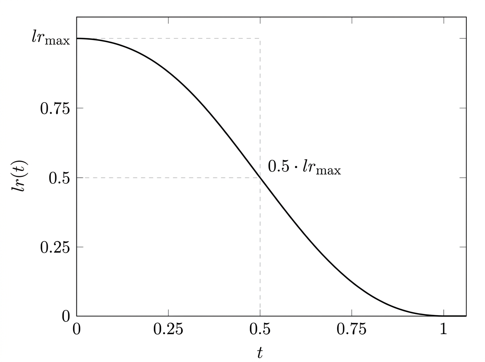

## epoch和step

epoch（轮）：把整个数据集完整过一遍，叫 1 个 epoch。

step（步）：模型更新一次参数，叫 1 个 step。也就是执行一次：

```python
loss.backward()
optimizer.step()
```

假设数据集有 10000 条语音，batch_size=32：

1. 每个 epoch（过一遍数据）= 10000 / 32 ≈ 313 步
2. 70000 步 ≈ 70000 / 313 ≈ 223 个 epoch

也就是说，同一批数据会被反复看约 223 遍，直到凑满 70000 步。