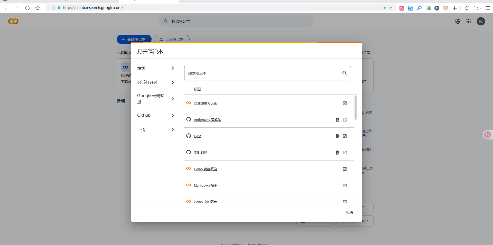
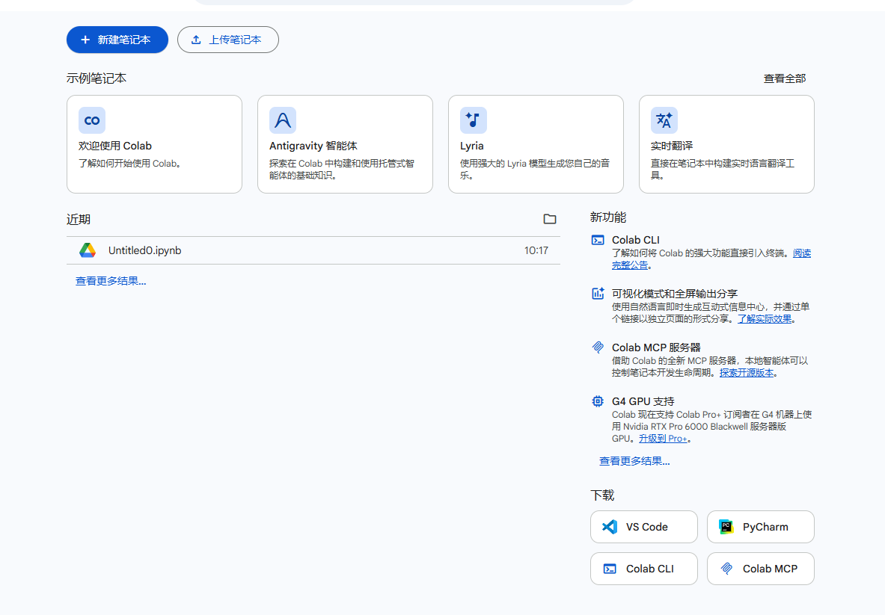
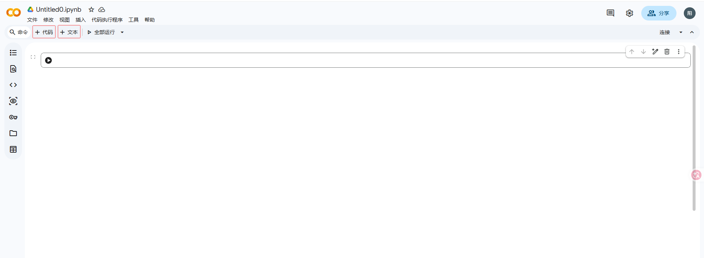
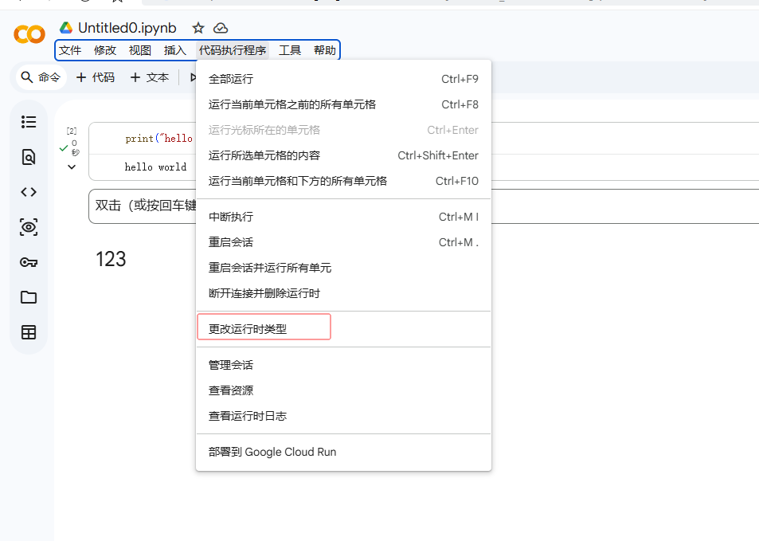
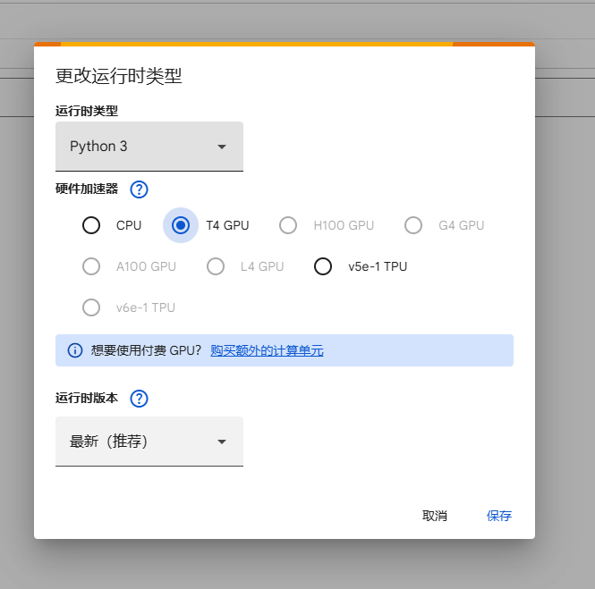
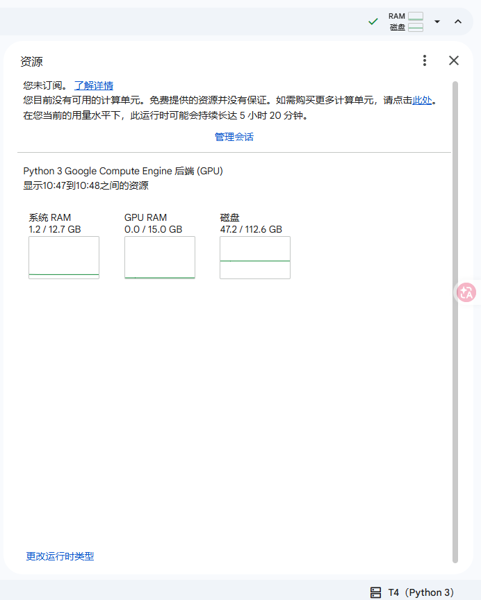

- [介绍](#介绍)
- [主要特性](#主要特性)
- [快速开始](#快速开始)

## 介绍

Colaboratory, 协作环境，简称“Colab”，允许你在浏览器中编写和运行 Python 代码。

1. 无需任何配置设置
2. 免费访问 GPU 资源
3. 易于分享

## 主要特性

Google Colab 的主要特性

1. 创建 / 上传 / 分享笔记本：支持创建、上传及与他人共享 Notebook（.ipynb 文件）。

2. 从不同来源导入 / 保存笔记本：可从多种渠道（如 GitHub、Google Drive）导入或将文件保存至不同位置。

3. 编写并执行 Python 代码：直接在浏览器中编写和运行 Python 程序。

4. 为代码编写支持数学公式的文档：支持插入 Markdown 文本及 LaTeX 数学公式来记录代码逻辑。

5. 集成 PyTorch、TensorFlow、Keras、OpenCV：预装并无缝支持各类主流深度学习与计算机视觉框架。

6. 带有免费 GPU 的免费云端服务：提供无需配置且包含免费 GPU 算力的云端计算环境。

### 快速开始

**查看全部**



**新建笔记本**





代码和文本
1. 插入一个可以编写并运行 Python 代码的输入框
2. 插入一个用来写笔记、排版说明或公式的富文本框，代码不会在这里执行。

左侧边栏的功能导航工具栏
1. 目录 (Table of Contents)：根据你在文本框里写的 Markdown 标题（如 #、##），自动生成文档的大纲树。点击可以快速跳转到对应的代码或笔记位置。
2. 查找和替换 (Find and Replace)：在当前 Notebook 的所有单元格中搜索变量名、文本或代码，并进行批量替换。
3. 代码片段 (Code Snippets)：Google Colab 预设的代码库。里面有许多写好的常用代码示例（如怎么加载 Google Drive 数据、怎么画图、怎么连接 GPU 等），双击就能直接插入到你的代码框里。
4. 变数 / 变量检查器 (Variables)：查看当前 Python 运行时中已保存在内存里的所有变量（显示变量名、类型、形状/大小和当前值），非常方便调试代码。
5. 机密 / 密钥管理 (Secrets / API Keys)：安全存储敏感凭据（如 Kaggle API Token、HuggingFace Token 等）。可以在这里添加 Key，然后在代码里安全调用，避免把密码直接硬编码暴露在代码框中。
6. 文件管理器 (Files)：查看云端虚拟机当前的本地文件系统。你可以通过这里上传本地文件、挂载（Mount）Google Drive 云端硬盘，或者下载模型训练出来的成果。
7. 数据表格 (Data tables)：用于查看和预览 Pandas DataFrame 等数据结构，方便以交互式表格的形式检索、过滤和分析数据。

**更改运行时类型**

Google Colab 默认只分配基础的 CPU，当你需要训练深度学习模型、处理图像矩阵或跑耗时较长的数据计算时，就需要通过这个选项来更换为更强的硬件。






**资源监视器**

资源监视器（Resource Monitor）弹窗，用来实时监控云端虚拟机的硬件使用情况与运行预计时长。



**将个人 Google Drive（谷歌云盘）挂载（Mount）到 Colab 云端虚拟机**

```python
from google.colab import drive
drive.mount('/content/gdrive')
```

运行这段代码后，系统会将你的 Google Drive 挂载到云端虚拟机的 /content/gdrive 路径下。你可以在代码中直接访问 Google Drive 上的文件。

```python
# 例如，访问 Google Drive 上的文件
import pandas as pd
df = pd.read_csv('/content/gdrive/MyDrive/your_file.csv')
df.head()
```