- [先决条件](#先决条件)
- [NumPy和PyTorch的关系](#numpy和pytorch的关系)
- [什么是PyTorch](#什么是pytorch)
- [PyTorch与TensorFlow](#pytorch与tensorflow)
- [深度神经网络训练过程概述](#深度神经网络训练过程概述)
    - [数据集与数据加载器](#数据集与数据加载器)
- [什么是张量计算](#什么是张量计算)
    - [张量数据类型](#张量数据类型)
    - [张量的形态](#张量的形态)
    - [张量构造函数](#张量构造函数)
    - [张量的操作](#张量的操作)
        - [张量的降维](#张量的降维)
        - [张量的升维](#张量的升维)
        - [张量的转置](#张量的转置)
        - [张量的逐元素算术运算](#张量的逐元素算术运算)
        - [张量的统计聚合操作](#张量的统计聚合操作)
        - [PyTorch v.s. NumPy](#pytorch-vs-numpy)
        - [张量的设备](#张量的设备)
- [How to Calculate Gradient?](#how-to-calculate-gradient)

## 先决条件

1. 熟悉 Python 语法。
2. 熟悉 NumPy 库。

## NumPy和PyTorch的关系

NumPy 是 CPU 科学计算的基础，而 PyTorch 是在 NumPy 理念基础上重构的、专为深度学习与 GPU 加速设计的框架。

核心区别与联系
1. 设计定位不同：
    - NumPy：通用科学计算库，核心数据结构是 ndarray，只能在 CPU 上运行。
    - PyTorch：深度学习框架，核心数据结构是 Tensor，原生支持 GPU/TPU 并行加速与自动求导（Autograd）。

2. 接口与语法极度相似：
    - PyTorch 在设计 Tensor API 时大幅参考了 NumPy 的习惯。数学运算、切片、广播机制（Broadcasting）以及维度变换的逻辑基本一致（例如 NumPy 的 axis 对应 PyTorch 的 dim）。

3. 无缝互转（零拷贝）：
    - 两者在 CPU 内存上共享底层数据块，转换几乎不消耗性能：

```python
import numpy as np
import torch

# NumPy -> PyTorch
np_arr = np.array([1, 2, 3])
tensor_data = torch.from_numpy(np_arr)

# PyTorch -> NumPy
back_to_np = tensor_data.numpy()
```

典型合作工作流，在实际 AI 项目开发中，两者通常协作互补：

1. 预处理：用 NumPy（或 Pandas）加载 CSV、图像或点云数据，完成数据清洗、标准化与特征拼接。

2. 训练：将 NumPy 数组转成 PyTorch Tensor 扔进 GPU/NPU 中，利用 PyTorch 的自动求导进行模型反向传播与权重更新。

3. 后处理：将模型的预测输出转回 NumPy，借助 Matplotlib 做可视化，或存入本地文件系统。

## 什么是PyTorch

1. 一个开源的机器学习框架。
2. 这是一个 Python 包，拥有两个高级功能：
    - 支持张量计算（类似 NumPy），且具备强大的 GPU 加速性能。
    - 能够构建基于自动微分系统的深度神经网络。

## PyTorch与TensorFlow

| 对比维度 | PyTorch | TensorFlow | 详细含义 |
| :--- | :--- | :--- | :--- |
| **Developer (开发者)** | Facebook AI (现 Meta AI) | Google Brain (谷歌大脑) | 两家顶尖科技巨头各自主导发起的开源框架。 |
| **Interface (编程接口/语言)** | Python & C++ | Python, C++, JavaScript, Swift | 都以 Python 为主流；TensorFlow 支持的跨平台语言更多。 |
| **Debug (调试难易度)** | Easier (更容易) | Difficult (较难，但在 2.0 版本后有所改善) | PyTorch 采用动态计算图，代码像普通 Python 一样直观，打断点单步调试极方便；TensorFlow 早期的静态图机制非常难调试，2.0 引入 Eager Execution 后才好转。 |
| **Application (主要应用场景)** | Research (学术研究) | Production (工业落地/生产环境) | PyTorch 在高校、科研界和学术论文中占绝对主导；TensorFlow 在大型企业服务部署、移动端/嵌入式落地（TensorFlow Lite）上生态更成熟。 |

## 深度神经网络训练过程概述

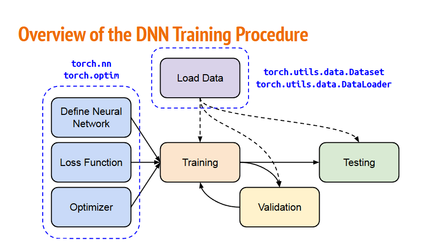

把整个流程拆解为三大核心部分：

1. 数据准备（Load Data），对应右顶部的蓝色虚线框，负责把磁盘上的数据加载并打包成模型能吃的 Batch 格式：
    - torch.utils.data.Dataset：负责定义数据的读取逻辑（如读取图片、标注文件、转换类型）。
    - torch.utils.data.DataLoader：负责对数据做 Batch 分组、打乱（Shuffle）以及多线程并行加载。
    - 数据去向：虚线分别指向了训练（Training）、验证（Validation）和测试（Testing）阶段。

2. 模型与优化器构建（网络三大件），对应左侧的蓝色虚线框，包含了模型训练的核心配置，主要依赖两个库：
    - Define Neural Network（定义网络结构）：使用 torch.nn.Module 构建
    - Loss Function（损失函数）：使用 torch.nn 里的损失函数（如 MSELoss, CrossEntropyLoss）评估模型预测结果与真实标签的误差。
    - Optimizer（优化器）：使用 torch.optim 模块（如 SGD, Adam）根据计算出的梯度来更新网络中的权重参数。

3. 训练与评估循环（Training & Evaluation Loop），对应中间和右侧的三个核心运行模块：
    - Training（训练）：将数据喂给网络，算 Loss，做反向传播（loss.backward()），用 Optimizer 更新权重。
    - Validation（验证）：在训练过程中每隔几轮验证一次，用来调参或判断模型是否过拟合（通过指标反馈回 Training 决定是否继续训练或调整策略）。
    - Testing（测试）：模型彻底训练好后，用从未见过的独立测试集评估最终的泛化性能。

### 数据集与数据加载器

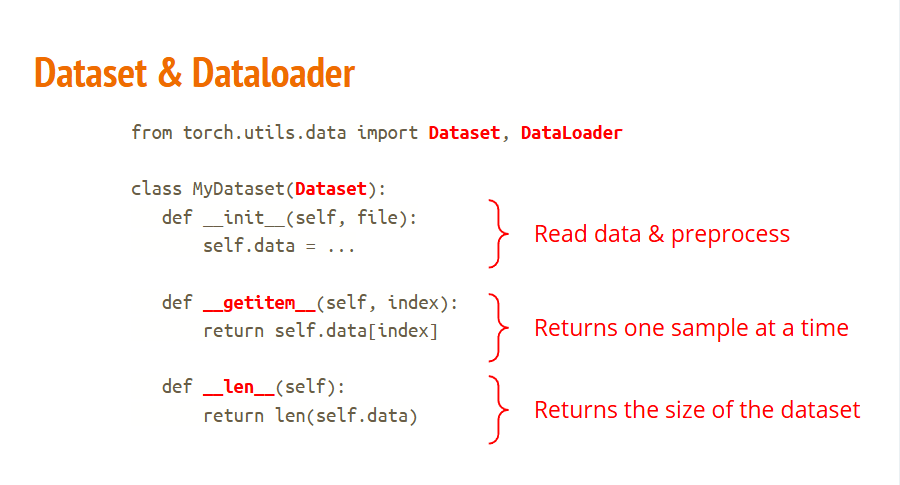

如何把硬盘里的文件（如图片、文本、3D模型数据等）规范地喂给神经网络。

1. __init__(self, file)：初始化与加载数据
    - 作用：实例化这个类时最先执行。
    - 通常在这里做：读取路径、加载文件列表、做初始的数据预处理（比如读取图片路径、加载 CSV 等）。
2. __getitem__(self, index)：根据索引取单条数据
    - 作用：支持像数组一样用 dataset[i] 去取第 index 条数据。
    - 通常在这里做：把第 index 项数据从磁盘/内存中拉出来，转换成 torch.Tensor 类型返回。
3. __len__(self)：获取数据集总长度
    - 作用：支持用 Python 的 len(dataset) 查看里面一共有多少条样本。

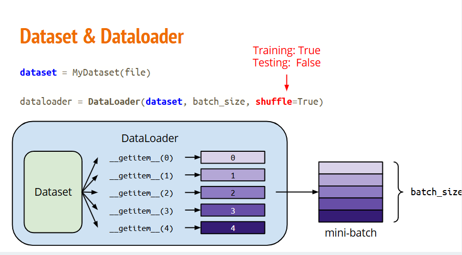

DataLoader 如何自动化地把 Dataset 里的单条数据批量打包（Batching）并喂给模型 的工作原理。

核心参数与机制解析

1. dataset：传入上一张图写好的数据容器。

2. batch_size：指定每个批次包含多少条数据（例如图中一次抽取 5 条，合成一个 mini-batch）。

3. shuffle=True / False：控制是否打乱抽取顺序。
    - 训练阶段（Training: True）：必须设为 True。每轮训练前随机打乱索引，防止模型记住数据的先后顺序，避免过拟合。
    - 测试阶段（Testing: False）：通常设为 False。评估模型时按固定顺序读取即可，方便复现结果。

回顾：

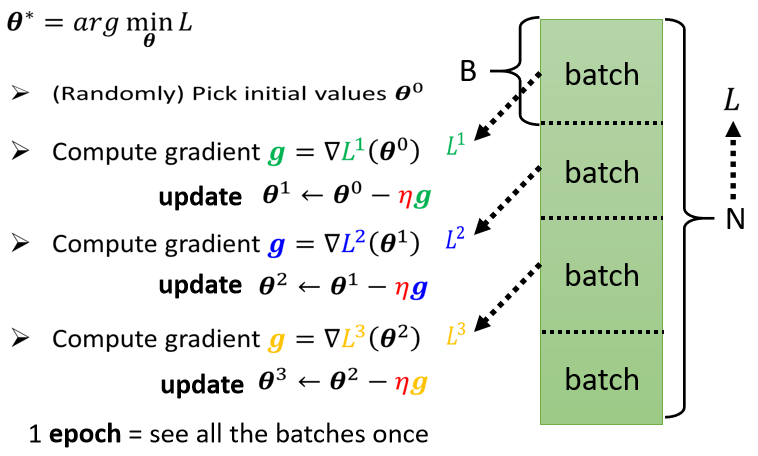

简单来说，如果你的样本数据（$N$）非常多，直接把所有数据一次性丢给模型训练是非常慢且占内存的。所以，我们把数据切分成很多小块，一块一块地喂给模型。

1. 以下是核心概念的拆解：
    - 什么是 Batch (批次)？Batch：就是把庞大的训练数据集 $N$ 分成一个个小份，每一份叫一个 Batch，大小为 $B$。
    - 为什么需要 Batch？
        - 内存限制：如果一次性把 100 万条数据全部读进内存，显卡（GPU）可能会直接崩溃。
        - 训练速度：分批次训练可以让模型在还没看完所有数据时，就已经开始通过梯度下降更新参数了，这样学习效率更高。

2. 训练流程：Update 与 Epoch
    - Update (参数更新)：
        - 每次模型读取一个 Batch 的数据。
        - 计算这一个 Batch 的损失 $L^i$。
        - 计算梯度 $g$。
        - 更新参数 $\theta$。
        - 重点：只要算完一个 Batch 并更新一次参数，就叫一次 Update。如果一个 Epoch 里有 100 个 Batch，那么一次 Epoch 就对应 100 次 Update。
    - Epoch：
        - 指的是“把所有的数据（即 $N$ 个数据）完整地看了一遍”。
        - 如果你的数据集被分成了 4 个 Batch，那么当你把这 4 个 Batch 全部训练过一次之后，就完成了 1 个 Epoch。

3. 为什么 Batch 大小也是“超参数(人为设置)”？
    1. Batch 太小：参数更新太频繁，虽然学得快，但受单个噪声数据影响大，训练不稳定。
    2. Batch 太大：更新次数少，利用不到大数据量带来的高效计算优势，且可能卡在局部最优解。
    3. 找平衡：我们需要人为去设置一个合适的 Batch 大小（比如 32, 64, 128），这就是所谓的“超参数”。
    
什么时候停止呢？


## 什么是张量

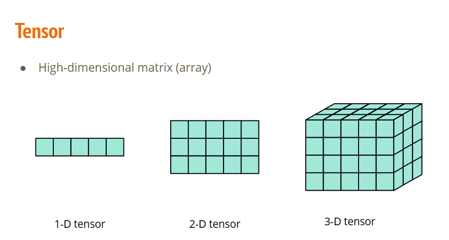

在计算机和数学里，“张量”只是多维数据的一个统称。你可以根据它的维数（Dimensions / Rank）来直观理解：

| 维数 (Rank) | 数学称呼 | 计算机里的概念 | 举个例子 |
| :--- | :--- | :--- | :--- |
| **0 维张量** | 标量 (Scalar) | 单个数字 | `5` |
| **1 维张量** | 矢量 / 向量 (Vector) | 一维数组 / 列表 | `[1.0, 2.0, 3.0]` （如：一排数据） |
| **2 维张量** | 矩阵 (Matrix) | 二维表格 / 矩阵 | `[[1, 2], [3, 4]]` （如：包含行和列的 Excel 表格） |
| **3 维张量** | 3D 张量 | 3 维数据块 | 一张彩色图片 `(高, 宽, RGB 3通道)` |
| **4 维张量** | 4D 张量 | 4 维数据阵列 | 一批彩色图片 `(批次大小, 高, 宽, 通道)`，深度学习中最常见的数据输入格式 |

### 张量数据类型

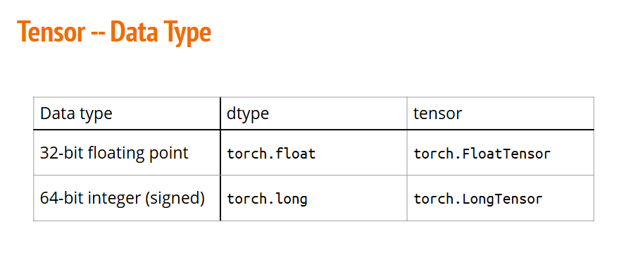

在 PyTorch 中，用来处理“小数”和“整数”的两种最核心数据类型，以及它们对应的两种代码写法。

第一行：处理带小数点的数字（浮点数）

1. 物理本质 (Data type)：32-bit floating point（32 位单精度浮点数）。

2. 应用场景：神经网络里的权重参数（Weights）、梯度（Gradients）、连续的特征输入（如图像像素缩放值、特征向量）。

3. 写法一 (dtype)：torch.float
```python
# 使用通用函数，传入 dtype 参数（推荐）
x = torch.tensor([1.5, 2.3], dtype=torch.float)
```

4. 写法二 (tensor)：torch.FloatTensor
```python
# 直接使用浮点数专用类（老式/直接写法）
x = torch.FloatTensor([1.5, 2.3])
```

第二行：处理不带小数点的数字（整数）

1. 物理本质 (Data type)：64-bit integer (signed)（64 位带符号长整型）。

2. 应用场景：分类任务的分类标签（Labels，如 0 代表猫，1 代表狗）、词表/嵌入层的索引（Indices）。

3. 写法一 (dtype)：torch.long
```python
# 使用通用函数，传入 dtype 参数（推荐）
y = torch.tensor([0, 1, 2], dtype=torch.long)
```

4. 写法二 (tensor)：torch.LongTensor
```python
# 直接使用长整型专用类（老式/直接写法）
y = torch.LongTensor([0, 1, 2])
```

### 张量的形态

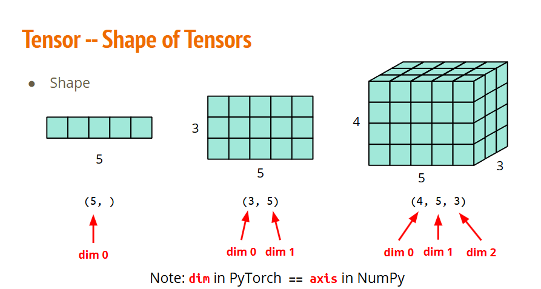

PyTorch 中张量形状（Shape）的几何表示与维度索引（dim）的对应关系。

三个示例拆解
1. 1D 张量（向量）：shape = (5, )
    - 一排共 5 个元素。
    - 只有 1 个维度：dim 0 的大小为 5。
2. 2D 张量（矩阵）：shape = (3, 5)
    - 一个 3 行 5 列的网格（共 15 个元素）。
    - 最高维度 dim 0 代表行数（3 行），下一个维度 dim 1 代表列数（5 列）。
3. 3D 张量（数据块）：shape = (4, 5, 3)
    - 可以直观理解为由 4 个 5 x 3 的矩阵堆叠而成的立体块。
    - 从外层向内层依次为：dim 0 = 4（切片数/深度）、dim 1 = 5（行）、dim 2 = 3（列）。

底部 Note 关键说明，dim in PyTorch == axis in NumPy

1. PyTorch 里的维度叫 dim（例如做求和运算 torch.sum(x, dim=0)）。

2. NumPy 里的维度叫 axis（例如 np.sum(x, axis=0)）。

3. 两者的概念完全相同，都是从外层中括号（最高维 0）向内层递增计数。


### 张量构造函数

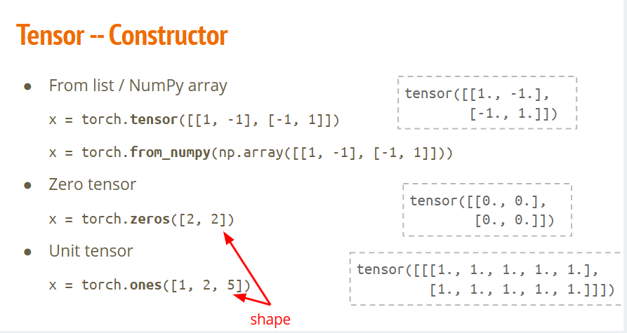

PyTorch 中最常见的几种张量构造方法（Tensor Constructor），也就是如何在代码里创建一个 Tensor。

三种常用构造方式
1. From list / NumPy array（从现有数据创建）
    - 用 Python 嵌套列表初始化：`x = torch.tensor([[1, -1], [-1, 1]])`
    - 从 NumPy 数组转换：`x = torch.from_numpy(np.array([[1, -1], [-1, 1]]))`
    - 作用：把已有的本地数据（如 Python 列表或 NumPy 矩阵）直接包装成 PyTorch Tensor。

2. Zero tensor（全零张量）
    - 代码：`x = torch.zeros([2, 2])`
    - 作用：创建一个元素全为 0. 的张量，传入的参数 [2, 2] 指定其 Shape（形状），即 2 行 2 列。常用于初始化累加变量或掩码（Mask）。

3. Unit tensor / Ones tensor（全一张量）
    - 代码：`x = torch.ones([1, 2, 5])`
    - 作用：创建一个元素全为 1. 的张量，传入的参数 [1, 2, 5] 代表 Shape 为 3 维（深度 1，行数 2，列数 5）。常用于权重初始化或偏置向量搭建。


### 张量的操作

#### 张量的降维

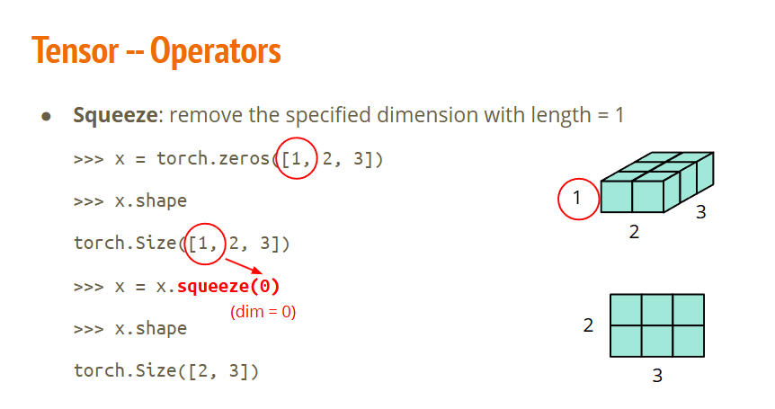

把长度为 1 的冗余维度压掉，给 Tensor 降维。

代码逻辑与几何拆解
1. 原始状态：
    - 代码：`x = torch.zeros([1, 2, 3])`
    - 形状：`torch.Size([1, 2, 3])`，这是一个 3D 张量。
    - 几何意义：如右上图，表示有 1 个 2 x 3 的数据块（最外层 dim=0 的长度只有 1）。

2. 执行挤压：
    - 代码：`x = x.squeeze(0)`
    - 参数：0 代表指定的维度 dim = 0。
    - 作用：告诉系统“检查 dim=0，如果它的长度是 1，就把这个维度抹掉”。

3. 挤压后状态：
    - 形状：torch.Size([2, 3])，变成了 2D 张量（矩阵）。
    - 几何意义：如右下图，原先那个厚度为 1 的 3D 块，被压缩成了一个标准的 2 x 3 平面网格。

#### 张量的升维

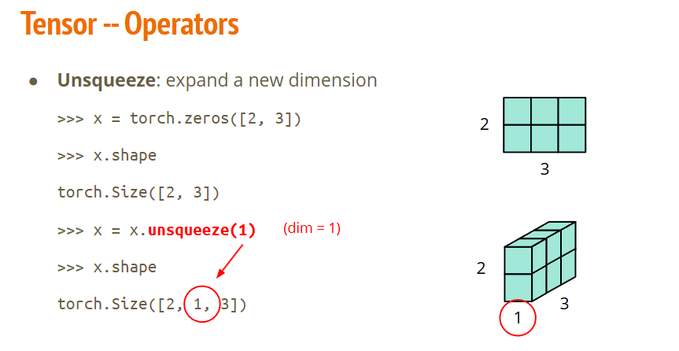

这是 squeeze 的反向操作——unsqueeze（扩维/升维），用来在指定位置硬塞入一个长度为 1 的新维度。

代码与几何逻辑拆解
1. 原始状态（2D 平面）：
    - 代码：`x = torch.zeros([2, 3])`
    - 形状：`torch.Size([2, 3])`
    - 维度索引：`dim=0` 是 2（行），`dim=1` 是 3（列）。

2. 执行升维（unsqueeze(1)）：
    - 参数 1 代表：在索引为 1 的位置插入一个长度为 1 的新维度。
    - 形状变化：`[2, 3]` $\rightarrow$ `[2, 1, 3]`
        - 原来的 dim=0（2）依然在 dim=0。
        - 新插入的 dim=1 大小为 1。
        - 现在的 dim=2 变成了原来的 3。

3. 几何图形对应：
    - 如右下图所示，原来的 2 × 3 扁平网格，在中间强行拉扯出一个厚度为 1 的新轴（红圈标出），使它从 2D 矩阵升维成了 3D 矩阵。

#### 张量的转置

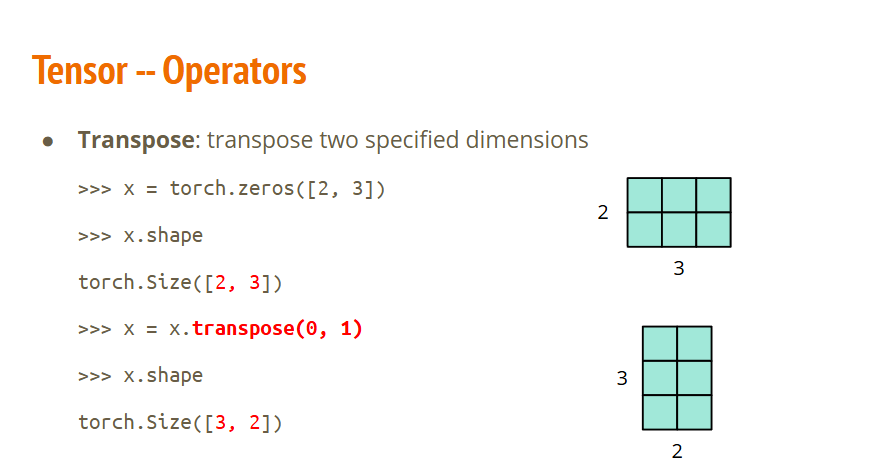

transpose（转置 / 交换维度） 操作：指定交换张量的某两个维度。

代码与几何逻辑拆解
1. 原始状态（2 行 3 列）：
    - 代码：`x = torch.zeros([2, 3])`
    - 形状：`torch.Size([2, 3])`
    - 维度划分：`dim 0 = 2`（行数），`dim 1 = 3`（列数）。
2. 执行转置（`transpose(0, 1)`）：
    - 参数 (0, 1) 表示：把 dim 0 和 dim 1 这两个轴对调位置。
    - 形状变化：`[2, 3]` $\rightarrow$ `[3, 2]`
        - 原来的行（大小 2）变成了现在的列。
        - 原来的列（大小 3）变成了现在的行。
3. 几何图形对应：
    - 如图所示，原本横着放的 2 × 3 扁平网格，经转置后旋转顺应变成了竖着放的 3 × 2 矩阵。

#### 张量的拼接

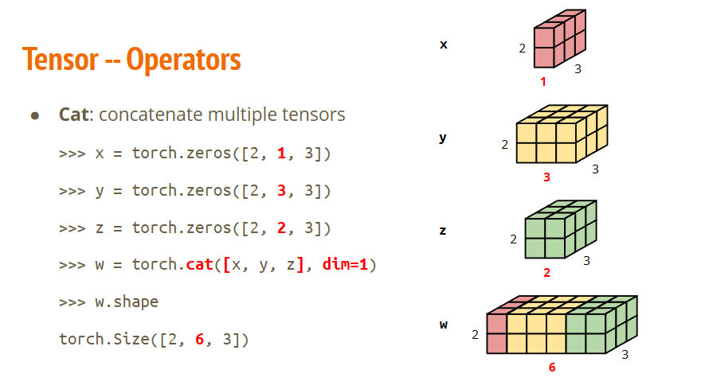

torch.cat（Concatenate，拼接） 操作：沿指定的维度（dim）将多个张量拼接成一个更大的张量。

代码与几何逻辑拆解
1. 参与拼接的三个张量：
    - 粉色 x：`shape = [2, 1, 3]`（dim 1 的长度为 1）
    - 黄色 y：`shape = [2, 3, 3]`（dim 1 的长度为 3）
    - 绿色 z：`shape = [2, 2, 3]`（dim 1 的长度为 2）
2. 拼接操作（dim=1）：
    - 代码：`w = torch.cat([x, y, z], dim=1)`
    - 规则：除了指定的 `dim=1` 之外，其他维度的大小必须完全一致（这里 dim 0 都是 2，dim 2 都是 3）。
    - 维度计算：dim 1 的新长度直接累加：$1 + 3 + 2 = 6$。
3. 拼接后的结果 w：
    - 形状：`torch.Size([2, 6, 3])`
    - 几何图形：如最下方的图所示，粉色、黄色、绿色三个块在 dim 1（横向/宽度方向）挨个并排贴合，拼成了一个宽度为 6 的完整大长方体。

#### 张量的逐元素算术运算

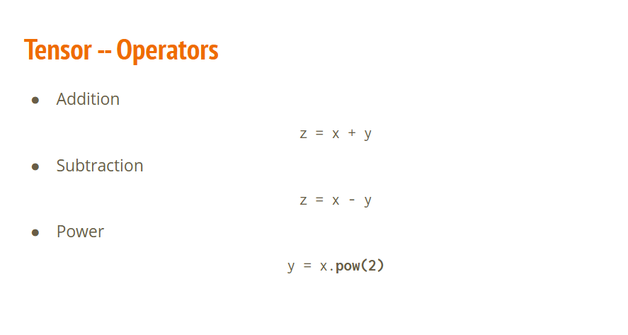

PyTorch 张量的基础逐元素算术运算（Element-wise Operations）。

1. Addition（加法）：`z = x + y`
    - 作用：将 x 和 y 中对应位置的元素逐个相加（也可写成 torch.add(x, y)）。

2. Subtraction（减法）：`z = x - y`
    - 作用：将 x 中每个元素减去 y 中对应位置的元素（也可写成 torch.sub(x, y)）。

3. Power（幂运算）：`y = x.pow(2)`
    - 作用：计算 x 中每个元素的指定次方，这里 2 代表平方（也可写成 x ** 2）。

#### 张量的统计聚合操作

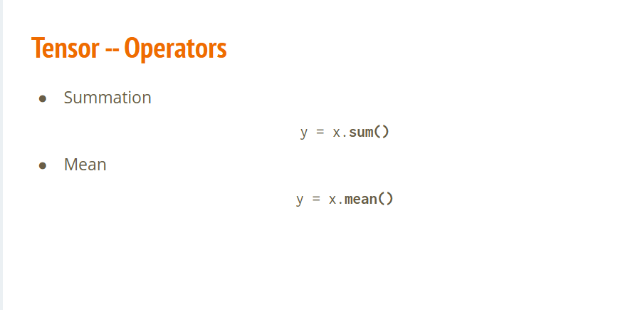

统计聚合操作（Aggregation Operations）。

1. Summation（求和）：`y = x.sum()`
    - 作用：计算张量 x 中所有元素相加的总和。不传参数时，会将所有维度压缩，返回一个标量（0 维 Tensor）。

2. Mean（求平均值）：`y = x.mean()`
    - 作用：计算张量 x 中所有元素的算术平均值（即 `x.sum() / x.numel()`）。同样返回一个标量。

#### PyTorch v.s NumPy

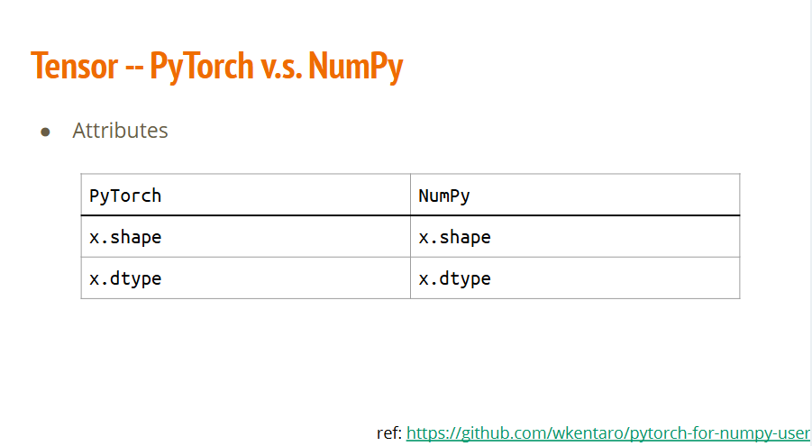

PyTorch 在设计 Tensor 的 API 时故意模仿了 NumPy 的习惯，让两者在查看数据基本属性时的语法保持完全一致。

| 属性访问 | 语法（ `PyTorch` / `NumPy` ） | 含义与作用 |
| :--- | :--- | :--- |
| **形状 / 维度** | `x.shape` | 返回张量或数组的维度（尺寸），如 `(3, 224, 224)`。（注：*PyTorch* 也可以用方法 `x.size()`） |
| **数据类型** | `x.dtype` | 返回元素的数据类型，如 `float32`，`int64` 等。 |

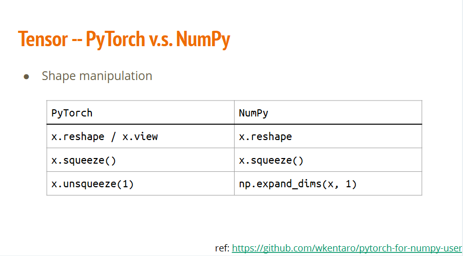

| 操作类型 / 含义 | PyTorch | NumPy |
| :--- | :--- | :--- |
| **重塑形状 (Reshape)** | `x.reshape(...)` / `x.view(...)` | `x.reshape(...)` |
| **压缩维度 (Squeeze)**<br>*(移除长度为 1 的维度)* | `x.squeeze()` | `x.squeeze()` |
| **扩充维度 (Unsqueeze)**<br>*(在指定轴插入长度为 1 的维度)* | `x.unsqueeze(1)` | `np.expand_dims(x, 1)` |

#### 张量的设备

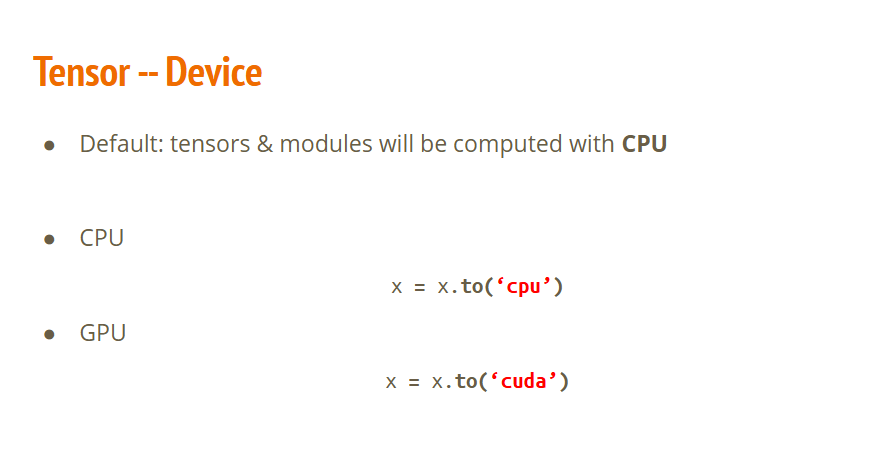

PyTorch 中张量（Tensor）与模型模块（Module）的设备分配与迁移机制（Device Management）。

1. 默认机制（Default）：
    - 在 PyTorch 中，默认创建的所有 Tensor 和神经网络模型（nn.Module）都会保存在 CPU 内存中并在 CPU 上执行计算。
2. 设备迁移 API (.to())：
    - 迁移到 CPU：x = x.to('cpu')，将数据转移至主机内存（系统 RAM）。
    - 迁移到 GPU (CUDA)：x = x.to('cuda')，将数据从 CPU 转移到显卡显存（VRAM），利用 GPU 并行加速计算。

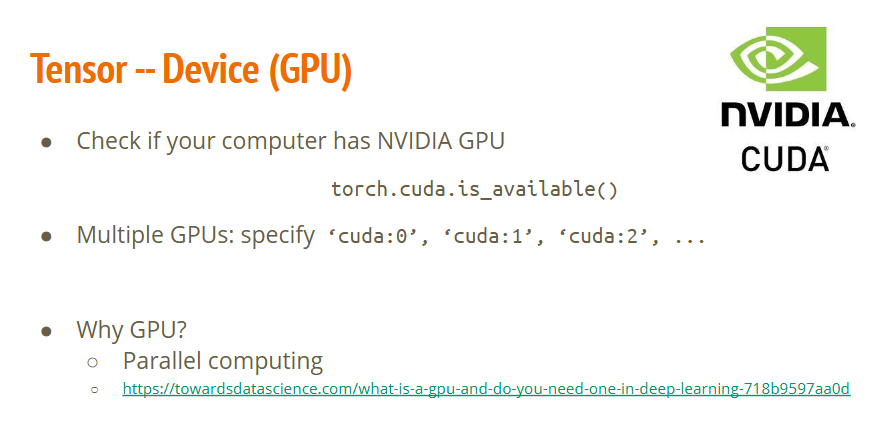

关键细节与工程实践

1. torch.cuda.is_available()：
    - 返回布尔值 True 或 False。
    - 它不仅检查你的电脑上有没有 NVIDIA 显卡，还会验证是否正确安装了匹配的 CUDA Driver 和 PyTorch CUDA 版本。

2. 多卡指定 ('cuda:X')：
    - 这里的 cuda 指的是 NVIDIA CUDA 软件驱动框架及设备识别前缀，而不是指单个物理计算单元。
    - 编号从 0 开始，cuda:0 代表第一张默认 GPU。
    - 也可以通过环境变量在终端临时限制运行卡号：CUDA_VISIBLE_DEVICES=0,1 python train.py。

3. 为什么 GPU 适合深度学习 / 矩阵运算？：
    - CPU：适合做高复杂的顺序逻辑控制（少量强大的 Core）。
    - GPU：拥有数千个小计算单元（CUDA Cores），非常适合对大规模矩阵/张量同时执行相同的加乘指令（SIMD/SIMT），从而将矩阵乘法加速几十甚至上百倍。


## How to Calculate Gradient?

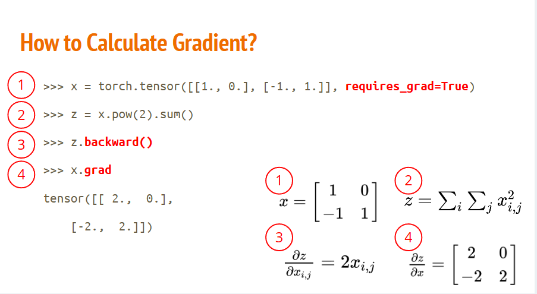

PyTorch 中使用 Autograd（自动求导引擎）计算梯度的完整过程

1. 步骤 1：创建需要求导的张量
    - 代码：`x = torch.tensor([[1., 0.], [-1., 1.]], requires_grad=True)`
    - 数学：定义矩阵 $x = \begin{bmatrix} 1 & 0 \\ -1 & 1 \end{bmatrix}$。
    - 关键点：requires_grad=True 告诉 PyTorch 开始追踪对 $x$ 的所有计算操作，以便后续计算梯度。
2. 步骤 2：前向传播（计算目标标量）
    - 代码：`z = x.pow(2).sum()`
    - 数学：$z = \sum_{i}\sum_{j} x_{i,j}^2 = 1^2 + 0^2 + (-1)^2 + 1^2 = 3$。
    - 含义：先对 $x$ 的每个元素平方，再求和得到标量 $z$（通常充当损失函数 Loss）。
3. 步骤 3：反向传播（自动求导）
    - 代码：`z.backward()`
    - 数学：根据微积分求导法则，对偏导数公式求解：$\frac{\partial z}{\partial x_{i,j}} = \frac{\partial (x_{i,j}^2)}{\partial x_{i,j}} = 2 x_{i,j}$。
    - 含义：触发自动求导引擎，利用链式法则计算 $z$ 关于 $x$ 内部每个元素的偏导数。
4. 步骤 4：提取计算得到的梯度
    - 代码：`x.grad`
    - 数学：将 $x$ 的具体数值代入导数公式 $2x$ 中：$$\frac{\partial z}{\partial x} = 2 \cdot \begin{bmatrix} 1 & 0 \\ -1 & 1 \end{bmatrix} = \begin{bmatrix} 2 & 0 \\ -2 & 2 \end{bmatrix}$$
    - 结果：输出打印出的梯度张量 tensor([[2., 0.], [-2., 2.]])。

